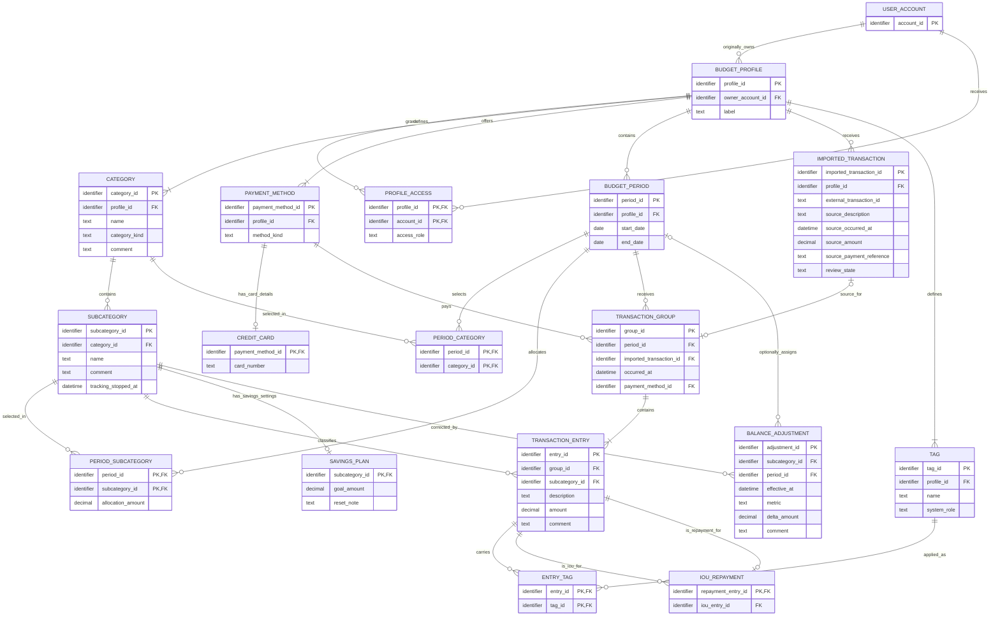

# Budget and Transaction Tracker — Logical Database Design

Version: **v1.0**. Selected from the existing `docs/v1.0/` folder; the project directory is not a Git repository. Design date: **12 October 2026**.

Status: **Reviewed, engine-independent logical design normalized through 3NF under the stated business dependencies.** Confirmed user answers resolve the main structural questions, including shared split date/time and payment method. Remaining proposed business policies are explicitly listed. This is a logical design, not a database implementation or a schema tested against a running engine.

## Scope and sources

The model covers user/profile access, profile categories and subcategories, period selections and allocations, saved cards and Cash, statement review, approved transaction splits, tags, IOU repayments, savings/debt corrections, and report inputs. Accounts are identity references only: authentication fields and credential uniqueness are not specified. Live bank connections are deferred. No executable SQL, engine types, indexes, migrations, generic audit history, or infrastructure tenancy are included.

| Source | Relevant sections | Authority and modeling use |
| --- | --- | --- |
| [PROPOSAL.md](PROPOSAL.md) | Users and Usage; Profiles and Budget Periods | Original owner and sharing; stable item identity; period-specific allocations; removed-subcategory history. |
| [PROPOSAL.md](PROPOSAL.md) | Income, Savings, and Debt | Expected/received income; balance carry; goals; editable financial totals. |
| [PROPOSAL.md](PROPOSAL.md) | Transactions and IOUs; Profile Reports | Imported source facts, review, splits, comments, tags, repayment links, transaction-date reporting. |
| [use_cases/use-cases.md](use_cases/use-cases.md) | UC-001–UC-018; Shared rules and unresolved details | Supporting workflow inventory. It is marked draft for approval, so its assumptions are not independently established requirements. |
| User answers in this design conversation, 12 October 2026 | Decisions D1–D7 below | Direct clarification; takes precedence where the proposal is ambiguous. |

No source document was unreadable. Only the proposal and the written use-case document were discovered as relevant project sources.

### Confirmed decisions

| ID | User clarification | Consequence |
| --- | --- | --- |
| D1 | Keep dated savings/debt adjustments; corrections update later balances and preserve transaction history. | Store signed correction events, not editable copies of calculated balances in every period. |
| D2 | A savings reset period is currently a note, such as “every 12 months”; it performs no calculation. The user manually resets the amount to zero. | Store `reset_note` as text. A reset is an ordinary balance adjustment; no recurrence schedule or reset-event entity. |
| D3 | All split entries are approved together into one period and sum to the original imported amount. | One transaction group owns period assignment; multiple approved entries belong to it. |
| D4 | One repayment entry pays one IOU, keeping the relationship simple. | Repayment entry is the key of its IOU link; an IOU can have many repayment entries. |
| D5 | Expected income is the period allocation for an Income subcategory. | No second expected-income amount or entity. |
| D6 | Approved Savings/Debt transactions affect balances; positive means savings addition/debt payment, negative means savings withdrawal/reversed debt payment. Periods follow their dates. | Derive movement totals from transactions and corrections; use period dates rather than creation order for previous-period selection. |
| D7 | Linked split entries always share one transaction date/time and payment method. | Store occurred_at and payment_method_id once on TransactionGroup; each linked entry obtains them through group_id. |

D2 narrows the proposal's “show when a reset period is due”: v1.0 displays the note for the user to interpret, without automatically determining a due date. The draft use cases' unresolved reset behavior must not be read as an additional automated feature.

## Entity relationship diagram

`||` means exactly one, `o|` zero or one, `o{` zero or many, and `|{` one or many. PK/FK labels show attributes, not identifier generation. Optional attribute values and cross-relation rules are detailed in the dictionary. Composite PK markers must be read together.

The general diagram allows zero/one SavingsPlan per Subcategory, but a Savings subcategory requires exactly one. PaymentMethod requires a CreditCard row exactly when its kind is `credit_card`. These conditional subtype constraints cannot be fully drawn with the same general cardinalities. A profile has at least its three automatic categories, its Cash payment method, and its two default tags.

## Entity dictionary

**Notation:** R = required, O = optional. Every chosen identifier PK is required and stable; generation and representation are undecided. Candidate keys are minimal unique identifying sets, not every possible unique superset. An identifier column alone is not evidence of normalization.

All monetary values use exact logical `decimal`, in one consistent monetary unit for a profile (assumption A1). Currency choice and supported decimal scale are unspecified. Splits and comparisons must use the same exact scale without floating-point rounding; do not assume two decimal places. Dates are calendar dates; datetimes require a consistently defined time basis before implementation. Text card numbers preserve leading zeros and are compared in a canonical form. No name is a key unless stated.

### UserAccount

**Grain:** one existing user account identity. **PK/only specified candidate key:** `account_id`.

| Attribute | Type | Required | Constraint |
| --- | --- | --- | --- |
| account_id | identifier | R | PK. |

The proposal does not establish email, username, credentials, or authentication uniqueness. These must be designed separately; there is no inferred natural account key.

### BudgetProfile

**Grain:** one independently owned budget profile. **PK/only candidate key:** `profile_id`.

| Attribute | Type | Required | Constraint |
| --- | --- | --- | --- |
| profile_id | identifier | R | PK. |
| owner_account_id | identifier | R | FK → UserAccount.account_id; original owner. |
| label | text | O | Proposed display label; not unique and not required by the proposal. |

### ProfileAccess

**Grain:** one non-owner user's current grant on one profile. **PK/only candidate key:** `(profile_id, account_id)`.

| Attribute | Type | Required | Constraint |
| --- | --- | --- | --- |
| profile_id | identifier | R | PK component; FK → BudgetProfile.profile_id. |
| account_id | identifier | R | PK component; FK → UserAccount.account_id. |
| access_role | text | R | `editor` or `view_only`. |

The owner has access through BudgetProfile and has no ProfileAccess row. Removing a grant removes this association; no access-history requirement is inferred.

### Category

**Grain:** one category belonging to one profile across all its periods. **PK/only unconditional candidate key:** `category_id`.

| Attribute | Type | Required | Constraint |
| --- | --- | --- | --- |
| category_id | identifier | R | PK. |
| profile_id | identifier | R | FK → BudgetProfile.profile_id. |
| name | text | R | Mutable display name; not an identifier. |
| category_kind | text | R | `ordinary`, `income`, `savings`, or `debt`. |
| comment | text | O | User-editable category comment. |

Proposed A2: each profile has exactly one category of each special kind, created as Income, Savings, and Debt. Ordinary categories may be numerous. `(profile_id, category_kind)` is unique **within the non-ordinary subset**, not a candidate key of the entire Category relation. Renaming never changes category kind. Moving categories to another profile or changing their kind is not an established workflow.

### Subcategory

**Grain:** one enduring profile item under one category. **PK/only candidate key:** `subcategory_id`.

| Attribute | Type | Required | Constraint |
| --- | --- | --- | --- |
| subcategory_id | identifier | R | PK. |
| category_id | identifier | R | FK → Category.category_id. |
| name | text | R | Mutable; duplicate-name policy unspecified. |
| comment | text | O | User-editable subcategory comment. |
| tracking_stopped_at | datetime | O | Business fact that future tracking has stopped; absent means active. |

Profile and kind are reached through Category rather than copied here. The removal timestamp exists specifically to preserve historical items while stopping future tracking; it is not a general soft-deletion convention. Reparenting and restoration are unspecified.

### PaymentMethod and CreditCard

**PaymentMethod grain:** one selectable payment option in one profile. **PK/only unconditional candidate key:** `payment_method_id`.

| Attribute | Type | Required | Constraint |
| --- | --- | --- | --- |
| payment_method_id | identifier | R | PK. |
| profile_id | identifier | R | FK → BudgetProfile.profile_id. |
| method_kind | text | R | `cash` or `credit_card`. |

Each profile has exactly one Cash method, requiring `(profile_id, method_kind)` uniqueness only for `cash`. Cash's existence does not preselect it in an entry form.

**CreditCard grain:** card-number details for one saved card method. **PK/only candidate key within this relation:** `payment_method_id`.

| Attribute | Type | Required | Constraint |
| --- | --- | --- | --- |
| payment_method_id | identifier | R | PK; FK → PaymentMethod.payment_method_id, whose kind must be `credit_card`. |
| card_number | text | R | Canonical card-number identity; never a numeric quantity. |

Proposed A3: `(PaymentMethod.profile_id, CreditCard.card_number)` must be unique across the join. It is a candidate key of the logical saved-card view, not a local composite FK or key of CreditCard. A card number may occur in different profiles. Cash has no CreditCard row. Keeping profile ownership in PaymentMethod prevents duplicating it in card details.

### BudgetPeriod

**Grain:** one dated budget period in one profile. **PK/only candidate key:** `period_id`.

| Attribute | Type | Required | Constraint |
| --- | --- | --- | --- |
| period_id | identifier | R | PK. |
| profile_id | identifier | R | FK → BudgetProfile.profile_id. |
| start_date | date | R | Proposed validation: start_date ≤ end_date. |
| end_date | date | R | Proposed inclusive period boundary. |

No unique date range, period name, creation-order key, or prohibition on overlapping periods is inferred. “Previous” is selected by period dates (D6); ambiguous equal-date or overlapping predecessors require a clarified choice, not an arbitrary identifier tie-break.

### PeriodCategory

**Grain:** one selected category in one period, including a category with no selected subcategories. **PK/only candidate key:** `(period_id, category_id)`.

| Attribute | Type | Required | Constraint |
| --- | --- | --- | --- |
| period_id | identifier | R | PK component; FK → BudgetPeriod.period_id. |
| category_id | identifier | R | PK component; FK → Category.category_id. |

Both parents must belong to the same profile. No category allocation is stored; its amount is the sum of selected child allocations.

### PeriodSubcategory

**Grain:** one selected subcategory with its independent allocation in one period. **PK/only candidate key:** `(period_id, subcategory_id)`.

| Attribute | Type | Required | Constraint |
| --- | --- | --- | --- |
| period_id | identifier | R | PK component; FK → BudgetPeriod.period_id. |
| subcategory_id | identifier | R | PK component; FK → Subcategory.subcategory_id. |
| allocation_amount | decimal | R | Period-specific planned amount; proposed nonnegative domain. |

The parent category must have a PeriodCategory row for this period. This rule follows the category through Subcategory: `category_id` is not redundantly stored in this relation. For Income, this same amount is expected income (D5). Zero is a genuine allocation value, distinct from not selecting the item.

### ImportedTransaction

**Grain:** one retained bank-statement source record awaiting or having completed review. **PK/only established candidate key:** `imported_transaction_id`.

| Attribute | Type | Required | Constraint |
| --- | --- | --- | --- |
| imported_transaction_id | identifier | R | Internal PK; different from the bank's ID. |
| profile_id | identifier | R | FK → BudgetProfile.profile_id. |
| external_transaction_id | text | R | Source transaction ID; its uniqueness namespace is unspecified. |
| source_description | text | R | Original imported description. |
| source_occurred_at | datetime | R | Original imported transaction date/time. |
| source_amount | decimal | R | Original signed amount. |
| source_payment_reference | text | R | Original payment-method reference, normally a canonical card number. |
| review_state | text | R | `pending` or `reviewed`; see lifecycle rules. |

The original facts are retained to explain split lineage and original totals. Matching to saved cards is computed from profile and source payment reference; a copied current card number or matching FK is not stored here. These references are historical source facts, so saving/renaming payment options does not rewrite the imported content.

Do not assume the external ID is globally unique, unique within a profile, or sufficient to identify duplicate uploads. A bank/account namespace may become necessary after statement formats are specified. Distinct imports may legitimately share external IDs; import deduplication remains open rather than inventing a candidate key.

### TransactionGroup

**Grain:** one approved transaction operation assigned to one period, containing one or more approved entries. **PK/only unconditional candidate key:** `group_id`.

| Attribute | Type | Required | Constraint |
| --- | --- | --- | --- |
| group_id | identifier | R | PK. |
| period_id | identifier | R | FK → BudgetPeriod.period_id. |
| imported_transaction_id | identifier | O | FK → ImportedTransaction.imported_transaction_id; present only for statement approval. |
| occurred_at | datetime | R | Shared transaction date/time for the group; independent of approval-period dates (D7). |
| payment_method_id | identifier | R | FK → PaymentMethod.payment_method_id; explicit Cash or saved card, shared by all group entries (D7). |

An imported source can appear in at most one group. Thus `imported_transaction_id` is an alternate key **on the imported-group subset**, not an unconditional candidate key for manual groups. A manual creation makes a group containing one entry. Imported approval makes one group containing one or multiple entries. Profile is derived from the period; source and payment method must have that profile. D7 makes date/time and payment method shared group facts; changing one changes the shared value for all linked entries.

### TransactionEntry

**Grain:** one approved financial entry assigned to one subcategory, including one portion of a split. **PK/only candidate key:** `entry_id`.

| Attribute | Type | Required | Constraint |
| --- | --- | --- | --- |
| entry_id | identifier | R | PK. |
| group_id | identifier | R | FK → TransactionGroup.group_id. |
| subcategory_id | identifier | R | FK → Subcategory.subcategory_id. |
| description | text | R | Editable approved description, initially taken from the source for imports. |
| amount | decimal | R | Signed; strictly positive for Income. Zero outside Income is unresolved. |
| comment | text | O | Manual-entry/approval comment belonging to this entry. |

Its period, transaction date/time, and payment method belong to its group and are not copied onto each entry (D3, D7). Its subcategory must be selected in that period. This checks the implied `(group.period_id, entry.subcategory_id)` against the **complete** PeriodSubcategory key across relations; it is not a declared one-column FK to that composite key.

Repeated entries using the same group/subcategory are permitted; neither that pair nor date/amount/description is a candidate key. Imported source values and editable approved group/entry values are separate historical and current facts, not a required equality dependency. Approved descriptions and comments remain per entry; date/time and payment method are shared through the group (D7).

### Tag and EntryTag

**Tag grain:** one profile-scoped tag definition. **PK/only unconditional candidate key:** `tag_id`.

| Attribute | Type | Required | Constraint |
| --- | --- | --- | --- |
| tag_id | identifier | R | PK. |
| profile_id | identifier | R | FK → BudgetProfile.profile_id; scope proposed in A5. |
| name | text | R | Editable custom display name; no uniqueness rule supplied. |
| system_role | text | O | `iou`, `iou_repayment`, or absent for a custom tag. |

Each profile has one tag of each system role, initially named IOU and IOU REPAYMENT. Role identity is independent of display name. `(profile_id, system_role)` is unique for nonempty system roles only. Protecting default roles from deletion is proposed because IOU rules depend on them; custom-tag deletion does not delete transactions.

**EntryTag grain:** one application of one tag to one approved entry. **PK/only candidate key:** `(entry_id, tag_id)`.

| Attribute | Type | Required | Constraint |
| --- | --- | --- | --- |
| entry_id | identifier | R | PK component; FK → TransactionEntry.entry_id. |
| tag_id | identifier | R | PK component; FK → Tag.tag_id. |

Tag and entry must belong to the same profile. No comma-separated tag lists or repeated tag columns are stored.

### IOURepayment

**Grain:** one approved repayment entry's link to one approved IOU entry. **PK/only candidate key:** `repayment_entry_id`.

| Attribute | Type | Required | Constraint |
| --- | --- | --- | --- |
| repayment_entry_id | identifier | R | PK; FK → TransactionEntry.entry_id. |
| iou_entry_id | identifier | R | FK → TransactionEntry.entry_id. |

The IOU is tagged with the `iou` role; repayment is tagged with `iou_repayment`. They must differ and belong to the same profile; periods may differ. Multiple different repayments may target the same IOU. A pair-key would fail to enforce one IOU per repayment, so it is not selected as the PK.

Proposed A6: the full absolute amount of a repayment is credited to its one IOU. No duplicate repayment amount is stored on the link. A single payment covering several IOUs must first become separate transaction entries; this design does not include repayment-allocation rows. Tagging alone creates no link.

### SavingsPlan

**Grain:** current savings settings for one Savings subcategory. **PK/only candidate key:** `subcategory_id`.

| Attribute | Type | Required | Constraint |
| --- | --- | --- | --- |
| subcategory_id | identifier | R | PK; FK → Subcategory.subcategory_id, under a `savings` category. |
| goal_amount | decimal | O | Current goal; proposed nonnegative amount; optional until set. |
| reset_note | text | O | User note such as “every 12 months”; no scheduling or arithmetic semantics (D2). |

Every Savings subcategory has one settings row, even when neither optional value has been set. No per-period copy of settings, calculated current balance, reset date, or goal-history entity is required. Debt needs no parallel settings entity: it has no distinct non-derived configuration in the requirements.

### BalanceAdjustment

**Grain:** one dated correction to one savings/debt metric, including an opening amount or manual reset. **PK/only candidate key:** `adjustment_id`.

| Attribute | Type | Required | Constraint |
| --- | --- | --- | --- |
| adjustment_id | identifier | R | PK. |
| subcategory_id | identifier | R | FK → Subcategory.subcategory_id. |
| period_id | identifier | O | FK → BudgetPeriod.period_id; optional for an opening correction before any period exists. |
| effective_at | datetime | R | When the correction takes effect in the balance timeline. |
| metric | text | R | `savings_balance`, `debt_remaining`, or `debt_paid`. |
| delta_amount | decimal | R | Signed independent correction; not an overwritten aggregate. |
| comment | text | O | Optional explanation. |

Savings items permit only `savings_balance`; Debt items permit `debt_remaining` or `debt_paid`; other kinds permit none. If period_id is supplied, the complete pair `(period_id, subcategory_id)` is also an FK → PeriodSubcategory `(period_id, subcategory_id)`. An unassigned opening correction has no composite target until associated with a period. Repeated adjustments at the same timestamp or for the same item/metric are allowed; timestamp is not a candidate key.

Editing a displayed amount from calculated B to desired T creates delta `T − B`. Correcting debt remaining does not silently alter debt paid; altering both creates two explicit metric adjustments. A reset to zero creates delta `−B`. Earlier corrections subsequently change later derived balances; the reset records the amount corrected at that time, not a perpetual instruction to force zero after every future backdated edit. This is balance-event history, not a full audit trail of every edit.

## Relationships, lifecycle, and cross-entity rules

### Cardinality and optionality review

| Parent → related records | Parent-side range | Child-side requirement / mapping |
| --- | --- | --- |
| UserAccount → owned BudgetProfiles | 0..many | Exactly one owner via owner_account_id. |
| BudgetProfile and UserAccount → ProfileAccess | Each 0..many | Exactly one of each; complete pair unique. |
| BudgetProfile → Categories / PaymentMethods / Tags | Each 1..many | Exactly one profile; minimum includes automatic/default records. |
| Category → Subcategories | 0..many | Exactly one category. |
| PaymentMethod → CreditCard | 0..1 | Exactly one method; required for a card, forbidden for Cash. |
| BudgetProfile → BudgetPeriods / ImportedTransactions | Each 0..many | Exactly one profile. |
| BudgetPeriod and Category → PeriodCategory | Each 0..many | Exactly one of each. |
| BudgetPeriod and Subcategory → PeriodSubcategory | Each 0..many | Exactly one of each, plus selected parent category. |
| BudgetPeriod → TransactionGroup | 0..many | Exactly one period. |
| ImportedTransaction ↔ TransactionGroup | 0..1 in both directions | Optional source on a group; source linked at most once. |
| TransactionGroup → TransactionEntry | 1..many | Exactly one group. |
| Subcategory → TransactionEntry | 0..many | Exactly one subcategory. |
| PaymentMethod → TransactionGroup | 0..many | Exactly one method for each group (D7). |
| TransactionEntry / Tag → EntryTag | Each 0..many | Exactly one of each; complete pair unique. |
| IOU TransactionEntry → IOURepayment | 0..many | Exactly one IOU target. |
| Repayment TransactionEntry → IOURepayment | 0..1 | Exactly one repayment source; its ID is the link PK. |
| Subcategory → SavingsPlan | 0..1 generally | Exactly one parent; exactly one settings row for Savings only. |
| Subcategory / BudgetPeriod → BalanceAdjustment | Each 0..many | Exactly one item; 0..1 period, with complete composite selection reference when assigned. |

### Profile boundaries and access

- Only the original owner may create, change, or remove ProfileAccess. Editors can change all profile content and periods; viewers cannot write. Owner identity is not reassigned by changing access.
- A selected item, entry, payment method, tag, import source, IOU counterpart, and optional adjustment period must agree on profile through their respective FK paths. Do not repeat `profile_id` in every relation just to make these checks local.
- Each special category, Cash method, and default tag must be created with the profile. Their initial display names do not serve as identity keys.

### Periods and item history

- Later periods copy selection rows and allocation values from the chosen date-ordered predecessor, then own the copied facts independently. No inheritance pointer or copied spending is needed. An empty new transaction set has zero spending.
- Renames modify the existing Category/Subcategory name. Reports group by IDs and can show the current name for all history. The requirement does not ask to reconstruct every former spelling.
- Removing a subcategory sets tracking_stopped_at and keeps its references, allocations, approved entries, and balance facts. It is excluded from future selections/copies. Proposed A7 permits corrections in periods that already referenced it.
- A selection with transactions or assigned adjustments cannot simply be removed while leaving orphan classification facts. Reclassify affected facts first, or retain the historical selection. Physical deletion of a referenced profile item is not a permitted substitute for stopping tracking.
- Backdating a new period does not automatically overwrite later allocations. The predecessor-selection rule must resolve overlapping/equal dates before copying.

### Review, splitting, and transaction deletion

- Pending imported records have no transaction group and contribute nothing to totals. Card matching selects the unique saved card in that profile; no match remains unresolved and never silently becomes Cash. Approval confirms a payment method.
- Manual creation produces a group and one approved entry directly. There is no pending-manual entity or redundant approved flag on every entry.
- Imported approval creates its group and all entries together, validates selected subcategories, positive Income amounts, methods and tags, and changes review_state to `reviewed`. A failed operation leaves the import pending without partial approved financial effects.
- Every imported group's entries sum exactly to source_amount. Period assignment belongs to the group. Edits that affect split amounts must preserve the sum by updating the group consistently; deleting one portion alone requires rebalancing the remaining portions or deleting the whole operation. Whole-group deletion remains possible without a sum check on an absent group.
- Proposed A8: after deleting an approved imported operation, retain its source with review_state `reviewed` and no group, so deletion does not accidentally requeue it. Thus review_state is not a duplicate of group existence. Explicit return-to-review/rejection workflows are not specified.
- Deleting an entry removes its EntryTag rows and any IOURepayment link for which it is the repayment, then recalculates unpaid amounts. An IOU target with surviving repayment links must be deliberately unlinked or its linked records resolved before deletion; it cannot leave dangling targets.
- Custom-tag deletion removes its EntryTag associations, not financial entries. System-tag membership required by an active IOU link cannot be removed without resolving that link. Default-role deletion is not an established workflow.

### Calculated values and time semantics

Use exact signed amounts. `income(E)` means an entry whose current subcategory category_kind is `income`; equivalent predicates identify Savings and Debt. In the calculations below, an entry's occurred_at and payment method are obtained from its TransactionGroup (D7); they are not duplicate entry attributes.

| Value | Calculation / retained inputs |
| --- | --- |
| Category allocation in a period | Sum allocation_amount from selected children in that period. Empty selected category totals zero. |
| Expected income by subcategory/period | Its Income PeriodSubcategory.allocation_amount (D5). |
| Income received in a period | Sum approved Income entry amounts whose group is assigned to that period. |
| Period total allocated | Sum selected subcategory allocation_amount; includes Income under the literal all-selected-items reading (A9). |
| Period net spending | Proposed A9: sum signed approved non-Income amounts assigned to that period; negative refunds/repayments reduce the result. Includes Savings and Debt movements. |
| Allocated allowance remaining | Total allocated minus period net spending. |
| Income remaining after spending | Income received minus period net spending. |
| Savings balance at time t | Sum Savings entry amounts with occurred_at ≤ t, plus savings_balance adjustment deltas with effective_at ≤ t. Opening amounts are adjustments. |
| Debt paid at time t | Sum Debt entry amounts through t, plus debt_paid adjustment deltas through t. |
| Debt remaining at time t | Sum debt_remaining adjustment deltas through t, minus Debt entry amounts through t. Opening debt is a debt_remaining adjustment. |
| Savings additions/withdrawals for a period | Positive Savings amounts / magnitudes of negative Savings amounts, selected by the group's period. Corrections are shown separately rather than invented as cash movements. |
| IOU unpaid amount | Absolute IOU entry amount minus sum of absolute amounts of its linked repayment entries (A6). Do not clamp a negative result until overpayment policy is agreed. |
| Profile totals | Sum the relevant subcategory balances/remaining debt; query IOU targets and their links. |
| Date-range income/spending | Filter approved entries by occurred_at, independent of group approval period; aggregate stable category/subcategory IDs. |

No calculated current balance, carried copy, tag list, category allocation total, unpaid amount, or period summary is stored. Savings goals and reset notes are current settings, not copied history. Original source amounts are retained as historical import facts, with conservation enforced across approved portions.

Proposed A10: carry-in at a period's start is the dated balance immediately before its start; an earlier dated correction changes later balances. Transaction-date reports and dated balances use occurred_at, while budget activity/allocations use the selected approval period. If a transaction's date lies outside that period, do not force these two views to equal each other: a carried balance is not necessarily “opening balance plus only entries assigned to this period.” This distinction preserves the explicitly separate transaction-date and approval-period facts. Current balances use activity effective through the current time; future-dated activity is not current yet. Date boundaries/time zones need confirmation.

Manual corrections are not financial transactions and do not add income/spending or count again as savings contributions/debt payments. A debt_remaining correction changes remaining only; a debt_paid correction changes paid only. The user may create both to reflect an external correction. No auto-reset or automatic zeroing is driven by reset_note.

## Normalization rationale

### Functional dependencies and candidate-key checks

The following are business dependencies for the stated grains, not observations from sample data. Group-level date/payment dependencies are confirmed by D7. The arrow targets all non-key attributes not written explicitly. Relations with only a key have no non-prime attributes to assess.

| Relation | Candidate keys / relevant dependencies |
| --- | --- |
| UserAccount | account_id; no specified non-key attributes. |
| BudgetProfile | profile_id → owner_account_id, label. Owner does not determine profile or label. |
| ProfileAccess | (profile_id, account_id) → access_role. Neither profile nor account alone determines role. |
| Category | category_id → profile_id, name, category_kind, comment. Special-kind uniqueness is conditional; ordinary categories invalidate a global (profile_id, category_kind) key. |
| Subcategory | subcategory_id → category_id, name, comment, tracking_stopped_at. No profile, kind, or category name is copied. |
| PaymentMethod | payment_method_id → profile_id, method_kind. Conditional Cash uniqueness is not a key for all methods. |
| CreditCard | payment_method_id → card_number. Card number alone does not determine a method across profiles. The joined saved-card view also has candidate key (profile_id, card_number). |
| BudgetPeriod | period_id → profile_id, start_date, end_date. Date combinations are not asserted unique. |
| PeriodCategory | Key (period_id, category_id); no non-prime attributes. |
| PeriodSubcategory | (period_id, subcategory_id) → allocation_amount. Neither component alone determines the amount. |
| ImportedTransaction | imported_transaction_id → profile_id, external_transaction_id, source_description, source_occurred_at, source_amount, source_payment_reference, review_state. No external-ID uniqueness is asserted. |
| TransactionGroup | group_id → period_id, imported_transaction_id, occurred_at, payment_method_id. On imported groups, imported_transaction_id → group_id and these group facts is also preserved by unique source use. Shared date/payment placement follows D7. |
| TransactionEntry | entry_id → group_id, subcategory_id, description, amount, comment. Group alone does not determine individual classification, amount, description, or comment. |
| Tag | tag_id → profile_id, name, system_role. Display names are not keys; special-role uniqueness applies only to its subset. |
| EntryTag | Key (entry_id, tag_id); no non-prime attributes. |
| IOURepayment | repayment_entry_id → iou_entry_id. iou_entry_id does not determine repayment_entry_id. |
| SavingsPlan | subcategory_id → goal_amount, reset_note. Goal and note do not determine one another. |
| BalanceAdjustment | adjustment_id → subcategory_id, period_id, effective_at, metric, delta_amount, comment. Dates or item/metric pairs do not identify repeated corrections. |

If future requirements make a display name, bank namespace plus external ID, or other set an alternate key, reassess its dependencies explicitly. A surrogate ID does not erase alternate-key or partial dependencies. Conditional uniqueness constraints are analyzed on their applicable subsets and are not claimed as whole-relation candidate keys.

### 1NF

Each attribute is one scalar value from its declared domain. Selections, approved split entries, tag memberships, repayment links, and dated adjustments are separate rows, not repeated columns or collections. reset_note is atomic for its actual use as a human-readable note; splitting “every 12 months” into recurrence components would invent computational semantics. Card numbers and external IDs remain scalar text.

### 2NF

All relations satisfy 1NF. The only whole-relation composite candidate keys are ProfileAccess, PeriodCategory, PeriodSubcategory, and EntryTag. ProfileAccess.access_role and PeriodSubcategory.allocation_amount depend on both components; neither parent alone fixes their value. The other two relations have no non-prime attributes. The joined saved-card alternate key `(profile_id, card_number)` determines its method identity as a whole; neither profile nor card alone identifies the saved option. No non-prime attributes depend on a proper subset of any specified composite candidate key.

### 3NF

For every stated nontrivial dependency `X → A`, X is a superkey or A is prime (belongs to a candidate key). This is the 3NF criterion, not a blanket claim that all determinants must be candidate keys as in BCNF. In these ordinary relations, the listed non-key facts depend on their complete entity/association keys. Profile, category kind/name, period dates, and tag names are not redundantly copied into subordinate financial rows. Cross-entity constraints below are integrity rules, not extra stored non-key attributes.

Source and approved values are intentionally different facts: corrections can change approved descriptions/dates/methods while original imported values remain. Confirmed D7 establishes `group_id → occurred_at, payment_method_id`, represented once in TransactionGroup. Copying those values into TransactionEntry would create a non-key determinant of non-prime attributes and violate 3NF. Shared date/time and payment-method corrections update the group once and apply consistently to every linked portion.

### Meaningful decompositions and anomalies prevented

| Dependency / repeated fact to avoid | Decomposition or omission | Anomaly prevented |
| --- | --- | --- |
| subcategory_id → category_id; category_id → profile_id, category name/kind | Separate Category and Subcategory; derive profile/kind through the FK. | A rename or kind interpretation does not require updating every period or entry. |
| (period_id, subcategory_id) → allocation; subcategory_id → name/comment | Keep allocations in PeriodSubcategory and item facts in Subcategory. | Editing a period's allocation does not redefine the shared item or overwrite another period. |
| (profile_id, account_id) → access_role | ProfileAccess separate from profile details/owner. | Multiple grants do not duplicate profiles; last grant removal does not remove owner identity. |
| payment_method_id → profile_id, method_kind and card details only for card subtype | PaymentMethod plus CreditCard keyed by method ID. | Cash does not require fabricated card details; card changes do not repeat profile ownership. |
| group_id → approval period, date/time, payment method; entry_id → classified portion | TransactionGroup plus TransactionEntry. | A split cannot acquire conflicting copies of shared group facts. |
| tag_id → tag name/role; many independent entry/tag memberships | Tag plus EntryTag. | Tag rename requires one change; deleting a membership does not delete the tag or entry. |
| repayment_entry_id → one IOU target; entry_id → amount | IOURepayment stores only the target link, deriving credited amount. | Repayment edit cannot leave an outdated amount copied on the link. |
| Dated balance = movements + metric corrections | BalanceAdjustment; omit periodic copies of running totals. | Backdated edits update downstream results rather than leaving conflicting carry-forward snapshots. |
| Expected Income amount equals Income allocation (D5) | Use allocation_amount; omit duplicate expected-income field. | The two values cannot diverge after an update. |

These are explanations of the chosen decomposition, not a manufactured original spreadsheet schema.

Decompositions using a common referenced parent key are lossless: that shared key determines the parent facts, so joining a child back to its required parent cannot multiply it. PaymentMethod/CreditCard reconstruct the card subtype losslessly on method ID; Cash is intentionally outside that subtype. Optional source/settings links are reconstructed with an optional join rather than discarding manual transactions or non-Savings items. Composite associations preserve their full parent references.

The ordinary dependencies listed in the table are preserved within their owning relations. Constraints needing checks across relations include same-profile consistency, profile-scoped card-number uniqueness, selected parent category, entry selection through group period, conditional subtype completeness, special category/tag uniqueness, tag-role eligibility for IOU links, and imported split conservation. These are explicitly retained as logical constraints; enforcement mechanisms are left to implementation. External-ID deduplication, currency conversion, and credential uniqueness have no established dependency to preserve yet.

## Representative use-case review

| Use cases / scenario | Representation and outcome |
| --- | --- |
| UC-001–003: account, profile, sharing | Account identity → owned profile; automatic categories/Cash/default tags; separate grants for editors/viewers. An editor has no ownership FK authority to manage grants. |
| UC-004, UC-006–008: select, allocate, copy, rename, remove | January and February each have their own PeriodSubcategory rows referencing the same item. Rename changes one name. Editing January's allocation cannot change February's copy. Removing an item retains January history and excludes it from subsequent copying. |
| UC-005, UC-010: upload a card transaction | Source number matches through the profile's card-method join. The same number in another profile is irrelevant. An unmatched import remains pending and contributes zero; Cash is an explicit later choice. |
| UC-009, UC-011: manual versus imported split | A 120 imported restaurant payment becomes one selected-period group with entries 80 restaurant and 40 paid-for-others. Sum remains 120, with separate comments/tags. A source cannot create a second approved group. A negative Income portion fails even if the group total is valid. |
| UC-012–013: tags and later repayment | The 40 paid-for-others entry has IOU plus any custom tags. A later-period repayment of 15 links to it; unpaid is 25. Another repayment of 25 settles it. Trying to link the first repayment to a second IOU violates its link PK. |
| UC-014: savings carry and manual reset | Opening +100, Savings transaction +30, withdrawal −20 give 110. A reset creates savings_balance adjustment −110 and leaves zero. The reset note stays text. Correcting the earlier withdrawal to −25 changes subsequent balances by −5; no copied carry value conceals it. |
| UC-015: debt movement and override | Opening debt_remaining +1000; Debt payment +100 yields remaining 900 and paid 100. A debt_remaining correction +20 yields 920 without altering paid; an independent debt_paid correction is possible. A −10 reversed payment increases remaining by 10 and reduces paid by 10. |
| UC-016: recurring associations and repeated corrections | Many repayments per IOU and multiple same-day adjustments use their correct row identities. No uniqueness on item/date or IOU/period blocks legitimate repeats. |
| UC-017–018: historical and date-range reports | A transaction dated 31 January approved into February is in February's budget activity and January's transaction-date report. Renaming its subcategory later does not fragment aggregation. Pending source rows never join approved-entry totals. |
| Edge case: deleted approved import | Deleting the entire group removes financial effects; retained source remains reviewed under A8. No dangling tag or repayment link survives, and the import is not silently counted twice or requeued. |

## Assumptions and remaining decisions

The user confirmed D1–D7. The following interpretations are **proposed**, not additional established requirements. They do not imply a particular engine. Former assumption A4 is resolved by D7; remaining assumption identifiers are retained for continuity. A1 could add currency/exchange-rate facts if rejected.

| ID | Proposed interpretation / open question | Affected model |
| --- | --- | --- |
| A1 | A profile uses one monetary unit and exact decimal scale. Multi-currency scope, rounding, time zone, and datetime precision are unspecified. | All money/date calculations; possible additional currency facts. |
| A2 | Exactly one special Income/Savings/Debt category per profile; kind stays stable when renamed. Special-category deletion/reparenting behavior is unspecified. | Category constraints and historical classification. |
| A3 | A canonical card number is unique within a profile. Card edit/removal must preserve referenced historical payment identity. | PaymentMethod/CreditCard; matching and joined uniqueness. |
| A5 | Tags are profile-scoped; default roles stay available. Used custom-tag deletion removes associations. Duplicate names are allowed until a rule says otherwise. | Tag/EntryTag; default uniqueness. |
| A6 | Full repayment magnitude applies to its single IOU. IOUs represent amounts owed back to the user; partial attribution, overpayments, both-role tagging, and owing money to others are unspecified. | IOURepayment and unpaid calculation. |
| A7 | Removal blocks new tracking but permits correction in already-selected historical periods. Restoration, current-report inclusion of removed items, and other deletion workflows need definition. | Subcategory lifecycle and selection validation. |
| A8 | Deleting approved imported activity retains a reviewed source and does not return it to pending. Explicit re-review and import deduplication require further rules. | ImportedTransaction review_state; approval/deletion lifecycle. |
| A9 | Net spending sums all non-Income signed entries; total allocation includes every selected allocation, including Income. Confirm whether summary/report definitions should exclude savings transfers, debt payments, or expected-income allocations. | Derived summaries only; no extra stored totals. |
| A10 | Dated balances use transaction/correction effective times; approval-period assignment separately determines budget activity. Boundaries are inclusive for displayed dates. Equal-date/overlapping predecessors, out-of-period corrections, and future-dated current balances need a final reporting policy. | Carry/report calculations and predecessor choice. |
| A11 | Payment selection is required for approved entries; allocations/goals are nonnegative; an unset goal is allowed. Zero non-Income transactions and negative savings/debt balances remain unspecified. | Attribute optionality and value validation. |

No arbitrary uniqueness on labels, category/subcategory/tag names, period dates, bank IDs, or transaction appearance is assumed. Identifier-based selection continues to distinguish duplicate display names.

## Design verification

- Reviewed all discovered requirements and walked representative UC-001–UC-018 workflows, including split conservation, cross-period repayment, backdated correction, retirement, and transaction-date/approval-period separation.
- Reviewed diagram and dictionary for the same entities, attribute names, PKs, FK targets, and cardinalities. A local structural check confirmed all 18 entity names, 26 relationship endpoints, and documented FK targets resolve. This was not a full Mermaid parse. Conditional rules and composite references are explicitly stated where the diagram is incomplete.
- Assessed 1NF, 2NF, and 3NF against all specified candidate keys and stated semantic dependencies, including the confirmed shared-group date/time and payment-method dependency (D7).
- Mermaid syntax was manually reviewed using standard `erDiagram` entity/attribute and crow's-foot notation. No automated Mermaid renderer/validator was available in the project runtime; no automated rendering is claimed.
- This deliverable is the logical schema and its diagram. It introduces no physical database, executable DDL, or implementation artifacts. Revisit the labeled assumptions when requirements are finalized.
