# Budget and Transaction Tracker — Logical Database Design

Version: **v1.0**. The current Git branch is `main`, with no release version; `docs/v1.0/` is the latest and only version folder. Revised **20 October 2026** using the updated proposal-to-erd skill.

Status: **Reviewed, engine-independent logical design normalized through 3NF under the stated business dependencies.** Currency reconciliation is resolved: the user selected the latest proposal, with a main currency per profile and a required main-currency amount before foreign-import approval. Remaining policy assumptions are labeled. This is a logical design, not a database implementation or a schema tested against a running engine.

## Scope and sources

The model covers user/profile access, profile categories and subcategories, period selections and allocations, saved cards and Cash, statement review, approved transaction splits, tags, IOU repayments, savings/debt corrections, and report inputs. Accounts retain a stable identity, email address, first name and last name; field requiredness and authentication policy remain unspecified. Live bank connections are deferred. No executable SQL, engine types, indexes, migrations, generic audit history, or infrastructure tenancy are included.

| Source | Relevant sections | Authority and modeling use |
| --- | --- | --- |
| [PROPOSAL.md](../PROPOSAL.md) | Users and Usage; Profiles and Budget Periods | Original owner and sharing; stable item identity; period-specific allocations; removed-subcategory history. |
| [PROPOSAL.md](../PROPOSAL.md) | Income, Savings, and Debt | Expected/received income; balance carry; goals; editable financial totals. |
| [PROPOSAL.md](../PROPOSAL.md) | Transactions and IOUs; Profile Reports | Imported source facts, review, splits, comments, tags, repayment links, transaction-date reporting. |
| [use_cases/use-cases.md](../use_cases/use-cases.md) and [CSV](../use_cases/use-cases.csv) | UC-001–UC-018; Shared rules; Per-use-case diagrams | Approved on 19 October 2026; 19 use cases including the approved UC-019 currency addendum are represented in Markdown/CSV. Open questions stay qualified. |
| [Use-case diagram set](../use_cases/use-cases.md#per-use-case-diagrams) | 57 flow, state, and sequence documents under UC-001–UC-019 | Supporting conceptual workflows; currency paths in UC-009–011, IOU links in UC-013, balances in UC-014–016, and reports in UC-017–018. Interaction states are not presumed to be stored data. |
| Earlier logical design, formerly `docs/v1.0/database-design.md` | Entity dictionary; ERD; dependencies; confirmed decisions | Superseded baseline, not an observed deployed schema. All 18 baseline entities are explicitly mapped below; this document replaces that output. |
| User answers in this conversation, including 20 October 2026 | Decisions D1–D15 below | Direct clarification; takes precedence where the proposal is ambiguous. |

The selected version contains the proposal, approved written/CSV use cases, 57 supporting diagrams, and the prior logical design. No material source was unreadable. Project discovery and tracked-file inspection found no application code, schema definitions, entity models, migrations, or database access configuration. No live database was inspected; there is no evidence of an implemented schema to inventory. The `migrations/` folder here holds logical design artifacts only.

### Confirmed decisions

| ID | User clarification | Consequence |
| --- | --- | --- |
| D1 | Keep dated savings/debt adjustments; corrections update later balances and preserve transaction history. | Store signed correction events, not editable copies of calculated balances in every period. |
| D2 | A savings reset period is currently a note, such as “every 12 months”; it performs no calculation. The user manually resets the amount to zero. | Store `reset_note` as text. A reset is an ordinary balance adjustment; no recurrence schedule or reset-event entity. |
| D3 | All split entries are approved together into one period and sum to the original imported amount. | One transaction group owns period assignment; multiple approved entries belong to it. |
| D4 | One repayment entry pays one IOU, keeping the relationship simple. | Repayment entry is the key of its IOU link; an IOU can have many repayment entries. |
| D5 | Expected income is the period allocation for an Income subcategory. | No second expected-income amount or entity. |
| D6 | Approved Savings/Debt transactions affect balances; positive means savings addition/debt payment, negative means savings withdrawal/reversed debt payment. Periods follow their dates. | Derive movement totals from transactions and corrections; use period dates rather than creation order for previous-period selection. |
| D7 | Linked split entries always share one transaction date/time and payment method. | Store occurred_at and payment_method_id once on Transaction; each linked entry obtains them through group_id. |
| D10 | Every split entry has its own amounts in each supplied currency; totals reconcile independently. | EntryAmount is keyed by entry/currency. Source-currency portions reconcile to source_amount; other imported valuations reconcile to ApprovalAmount declarations. |
| D11 | Use the latest proposal: each profile has a main currency and optional enabled additional currencies; foreign imports require their main-currency value before approval. | BudgetProfile selects the main unit; ProfileCurrency enables additional units. Main-currency valuations alone feed calculations; alternatives are descriptive and manually entered. |

| D12 | Explicit category/subcategory deletion stops future tracking and preserves history; period omission is temporary non-selection. | Category and Subcategory each retain tracking_stopped_at. Parent retirement makes children unavailable without overwriting their own timestamps. Historical corrections and financial obligations remain visible. |
| D13 | Income, Savings, and Debt categories cannot be deleted. | Derive deletion eligibility from category_kind; no redundant deletable column. |
| D14 | Add email_address, first_name, and last_name to UserAccount, separately from its stable ID. | Store the three text facts; requiredness, uniqueness and authentication policy remain open. |
| D15 | Rename TransactionGroup to Transaction, retaining its purpose for both manual and approved imported transactions. | TRANSACTION replaces TRANSACTION_GROUP; group_id is retained as the existing attribute name. No relationship or identity change. |

D2 clarified the earlier proposal's “show when a reset period is due”: v1.0 displays the note for the user to interpret, without automatically determining a due date. The approved use-case set still describes a computed due indication and labels several D1–D7 decisions unresolved. Those are source discrepancies: the explicit answers in this conversation remain authoritative, and this design implements the reset note and dated-correction rules rather than reintroducing a scheduler. The proposal now incorporates these decisions. The retained use-case snapshot still needs reconciliation; it is not rewritten by this schema task.

**Resolved currency-source discrepancy:** The latest proposal supersedes the approved use cases’ earlier GBP-default/optional-GBP wording. The user explicitly selected that newer rule (D11), replacing the earlier GBP-only and incomplete-total answers D8–D9. The design below follows per-profile main currencies and requires main-currency amounts at approval. The use-case UC-019 addendum now agrees with D11. Earlier snapshot diagrams and remaining lifecycle/account notes still need reconciliation with D12–D14; their historical wording is not authoritative over the updated proposal.

## Existing model and proposed changes

The observed baseline is an earlier **logical proposal**, not implemented tables. Its relationships are the same ownership, sharing, selection, approval, tagging, repayment, settings, and correction relationships retained in the target ERD. No physical normalization violations can be diagnosed without a physical schema. The old model's single-unit assumption is a requirements gap after the currency change, not itself evidence of a normal-form violation.

Every earlier entity is accounted for below. “Retained” means retained in the proposed design; it does not claim deployment. No entity is silently retired.

| Earlier logical entity / putative table | Status | Target mapping and change |
| --- | --- | --- |
| UserAccount | Modified | UserAccount; stable ID plus email_address, first_name and last_name. |
| BudgetProfile | Modified | Original ownership retained; add main_currency_code → Currency. |
| ProfileAccess | Retained | ProfileAccess; same complete user/profile key. |
| Category | Modified | Category; add tracking_stopped_at for explicit deletion; protect system kinds. |
| Subcategory | Retained | Subcategory; rename/stop-tracking semantics preserved. |
| PaymentMethod | Retained | PaymentMethod; profile Cash/card choices. |
| CreditCard | Retained | CreditCard; method-keyed subtype. |
| BudgetPeriod | Retained | BudgetPeriod; date order and independent selections. |
| PeriodCategory | Retained | PeriodCategory; category selections. |
| PeriodSubcategory | Modified meaning | Same relation/key; allocation_amount is in its profile main currency (D11). |
| ImportedTransaction | Modified | Add source_currency_code → Currency; preserve original source amount/currency. |
| TransactionGroup | Renamed | Transaction; shared period/date/payment and optional source link retained. Main unit is derived from its profile; import native unit is derived from its source. |
| TransactionEntry | Modified | Remove unqualified amount; move monetary facts to EntryAmount. Preserve entry identity, description, comment and subcategory. |
| Tag | Retained | Tag; default roles and custom definitions. |
| EntryTag | Retained | EntryTag; all existing associations retained. |
| IOURepayment | Modified calculation only | Same keyed link; unpaid uses main-currency valuations of its one profile, all required before approval. |
| SavingsPlan | Modified meaning | Same relation/key; goal_amount is in profile main currency; reset_note stays text. |
| BalanceAdjustment | Modified meaning | Same relation/key; delta_amount is in profile main currency. |
| — | New | Currency; GBP/USD reference identity, names, symbols. |
| — | New | EntryAmount; one entered monetary representation per entry/currency. |
| — | New | ProfileCurrency; enabled additional currency memberships, with main currency offered implicitly. |
| — | New | ApprovalAmount; reviewer-declared imported valuations in currencies other than the retained source currency. |

The prior file is replaced by this document and its exports. This is a current-to-proposed logical mapping, not a data migration plan. In particular, do not relabel legacy numeric values in a chosen main currency without confirming their denomination; no data exists in this project to transform or validate.

## Entity relationship diagram

`||` means exactly one, `o|` zero or one, `o{` zero or many, and `|{` one or many. PK/FK labels show attributes, not identifier generation. Optional attribute values and cross-relation rules are detailed in the dictionary. Composite PK markers must be read together.


[Open ERD SVG](erd.svg). Zoom for all attributes and keys.

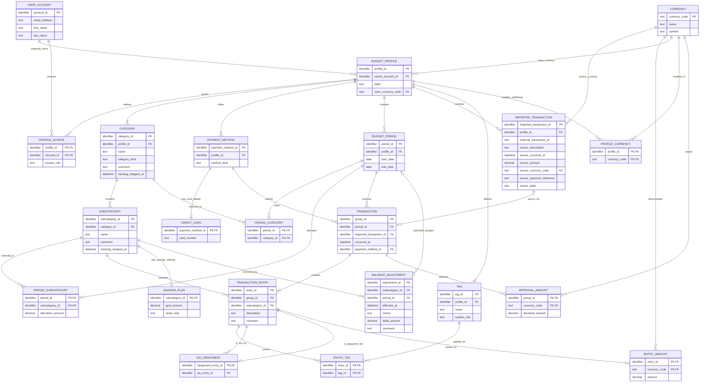

The general diagram allows zero/one SavingsPlan per Subcategory, but a Savings subcategory requires exactly one. PaymentMethod requires a CreditCard row exactly when its kind is `credit_card`. These conditional subtype constraints cannot be fully drawn with the same general cardinalities. A profile has at least its three automatic categories, its Cash payment method, and its two default tags.

## UML class diagram

This data-model view contains the same 22 entities and attributes as the ERD, with ordinary associations and multiplicities at both ends. It introduces no methods, services, inheritance, aggregation, or composition. Keys and conditional constraints are defined in the ERD and dictionary. Optional attribute values are not relationship multiplicities.


[Open UML SVG](uml.svg).

```mermaid
classDiagram
    direction TB
    class APPROVAL_AMOUNT {
        +identifier group_id
        +text currency_code
        +decimal declared_amount
    }
    class BALANCE_ADJUSTMENT {
        +identifier adjustment_id
        +identifier subcategory_id
        +identifier period_id
        +datetime effective_at
        +text metric
        +decimal delta_amount
        +text comment
    }
    class BUDGET_PERIOD {
        +identifier period_id
        +identifier profile_id
        +date start_date
        +date end_date
    }
    class BUDGET_PROFILE {
        +identifier profile_id
        +identifier owner_account_id
        +text label
        +text main_currency_code
    }
    class CATEGORY {
        +identifier category_id
        +identifier profile_id
        +text name
        +text category_kind
        +text comment
        +datetime tracking_stopped_at
    }
    class CREDIT_CARD {
        +identifier payment_method_id
        +text card_number
    }
    class CURRENCY {
        +text currency_code
        +text name
        +text symbol
    }
    class ENTRY_AMOUNT {
        +identifier entry_id
        +text currency_code
        +decimal amount
    }
    class ENTRY_TAG {
        +identifier entry_id
        +identifier tag_id
    }
    class IMPORTED_TRANSACTION {
        +identifier imported_transaction_id
        +identifier profile_id
        +text external_transaction_id
        +text source_description
        +datetime source_occurred_at
        +decimal source_amount
        +text source_currency_code
        +text source_payment_reference
        +text review_state
    }
    class IOU_REPAYMENT {
        +identifier repayment_entry_id
        +identifier iou_entry_id
    }
    class PAYMENT_METHOD {
        +identifier payment_method_id
        +identifier profile_id
        +text method_kind
    }
    class PERIOD_CATEGORY {
        +identifier period_id
        +identifier category_id
    }
    class PERIOD_SUBCATEGORY {
        +identifier period_id
        +identifier subcategory_id
        +decimal allocation_amount
    }
    class PROFILE_ACCESS {
        +identifier profile_id
        +identifier account_id
        +text access_role
    }
    class PROFILE_CURRENCY {
        +identifier profile_id
        +text currency_code
    }
    class SAVINGS_PLAN {
        +identifier subcategory_id
        +decimal goal_amount
        +text reset_note
    }
    class SUBCATEGORY {
        +identifier subcategory_id
        +identifier category_id
        +text name
        +text comment
        +datetime tracking_stopped_at
    }
    class TAG {
        +identifier tag_id
        +identifier profile_id
        +text name
        +text system_role
    }
    class TRANSACTION {
        +identifier group_id
        +identifier period_id
        +identifier imported_transaction_id
        +datetime occurred_at
        +identifier payment_method_id
    }
    class TRANSACTION_ENTRY {
        +identifier entry_id
        +identifier group_id
        +identifier subcategory_id
        +text description
        +text comment
    }
    class USER_ACCOUNT {
        +identifier account_id
        +text email_address
        +text first_name
        +text last_name
    }
    BUDGET_PERIOD "1" -- "0..*" PERIOD_CATEGORY : selects
    BUDGET_PERIOD "1" -- "0..*" PERIOD_SUBCATEGORY : allocates
    BUDGET_PERIOD "1" -- "0..*" TRANSACTION : receives
    BUDGET_PERIOD "0..1" -- "0..*" BALANCE_ADJUSTMENT : optionally_assigns
    BUDGET_PROFILE "1" -- "0..*" PROFILE_ACCESS : grants
    BUDGET_PROFILE "1" -- "1..*" CATEGORY : defines
    BUDGET_PROFILE "1" -- "1..*" PAYMENT_METHOD : offers
    BUDGET_PROFILE "1" -- "0..*" BUDGET_PERIOD : contains
    BUDGET_PROFILE "1" -- "0..*" IMPORTED_TRANSACTION : receives
    BUDGET_PROFILE "1" -- "1..*" TAG : defines
    BUDGET_PROFILE "1" -- "0..*" PROFILE_CURRENCY : enables_additional
    CATEGORY "1" -- "0..*" SUBCATEGORY : contains
    CATEGORY "1" -- "0..*" PERIOD_CATEGORY : selected_in
    CURRENCY "1" -- "0..*" IMPORTED_TRANSACTION : source_currency
    CURRENCY "1" -- "0..*" ENTRY_AMOUNT : denominates
    CURRENCY "1" -- "0..*" BUDGET_PROFILE : main_currency
    CURRENCY "1" -- "0..*" PROFILE_CURRENCY : enabled_in
    CURRENCY "1" -- "0..*" APPROVAL_AMOUNT : values
    IMPORTED_TRANSACTION "0..1" -- "0..1" TRANSACTION : source_for
    PAYMENT_METHOD "1" -- "0..1" CREDIT_CARD : has_card_details
    PAYMENT_METHOD "1" -- "0..*" TRANSACTION : pays
    SUBCATEGORY "1" -- "0..*" PERIOD_SUBCATEGORY : selected_in
    SUBCATEGORY "1" -- "0..*" TRANSACTION_ENTRY : classifies
    SUBCATEGORY "1" -- "0..1" SAVINGS_PLAN : has_savings_settings
    SUBCATEGORY "1" -- "0..*" BALANCE_ADJUSTMENT : corrected_by
    TAG "1" -- "0..*" ENTRY_TAG : applied_as
    TRANSACTION "1" -- "1..*" TRANSACTION_ENTRY : contains
    TRANSACTION "1" -- "0..*" APPROVAL_AMOUNT : declares
    TRANSACTION_ENTRY "1" -- "0..*" ENTRY_TAG : carries
    TRANSACTION_ENTRY "1" -- "0..*" IOU_REPAYMENT : is_iou_for
    TRANSACTION_ENTRY "1" -- "0..1" IOU_REPAYMENT : is_repayment_for
    TRANSACTION_ENTRY "1" -- "1..*" ENTRY_AMOUNT : valued_as
    USER_ACCOUNT "1" -- "0..*" BUDGET_PROFILE : originally_owns
    USER_ACCOUNT "1" -- "0..*" PROFILE_ACCESS : receives
```

## Entity dictionary

**Notation:** R = required, O = optional. Every chosen identifier PK is required and stable; generation and representation are undecided. Candidate keys are minimal unique identifying sets, not every possible unique superset. An identifier column alone is not evidence of normalization.

All monetary values use exact logical `decimal`. Allocations, goals, and correction deltas use their profile main currency (D11). Every approved entry has an amount in that unit, with optional entered representations in enabled additional currencies. Imported source amounts retain their own currency. Multiple representations describe one event. Values are independently entered, not generated from a stored or inferred exchange rate. Supported decimal scale and rounding remain unspecified. Splits and comparisons must use the same exact scale within each currency without floating-point rounding; do not assume two decimal places. Dates are calendar dates; datetimes require a consistently defined time basis before implementation. Text card numbers preserve leading zeros and are compared in a canonical form. No name is a key unless stated.

### UserAccount

**Grain:** one existing user account identity. **PK/only specified candidate key:** `account_id`.

| Attribute | Type | Required | Constraint |
| --- | --- | --- | --- |
| account_id | identifier | R | PK. |
| email_address | text | O | Separate from identity; requiredness and uniqueness remain undecided. |
| first_name | text | O | Requiredness remains undecided. |
| last_name | text | O | Requiredness remains undecided. |

D14 establishes these account fields. O is provisional optionality until requiredness is decided; it is not a confirmed requirement to allow missing values. Email verification, comparison/uniqueness, and use for sign-in remain unspecified, so email is not yet a candidate key. The stable identifier remains independent of email changes; GUID is suitable but its physical representation is outside this logical design.

### BudgetProfile

**Grain:** one independently owned budget profile. **PK/only candidate key:** `profile_id`.

| Attribute | Type | Required | Constraint |
| --- | --- | --- | --- |
| profile_id | identifier | R | PK. |
| owner_account_id | identifier | R | FK → UserAccount.account_id; original owner. |
| label | text | O | Proposed display label; not unique and not required by the proposal. |
| main_currency_code | text | R | FK → Currency.currency_code; one calculation unit for all allocations, balances and reports in this profile (D11). |

The main currency is always offered implicitly; no duplicate ProfileCurrency membership stores its role. Proposed A12 keeps it stable once the profile has financial facts, so historical allocations, goals, and adjustments cannot be silently reinterpreted in a different unit. Main-currency changes after that point need an explicitly defined revaluation/history workflow, which is not specified.

### ProfileCurrency

**Grain:** one enabled additional currency for one profile. **PK/only candidate key:** (profile_id, currency_code).

| Attribute | Type | Required | Constraint |
| --- | --- | --- | --- |
| profile_id | identifier | R | PK component; FK → BudgetProfile.profile_id. |
| currency_code | text | R | PK component; FK → Currency.currency_code; differs from that profile's main_currency_code. |

The effective enabled set is the profile main currency plus these additional memberships. A profile may have zero or many additional currencies; neither parent alone identifies a membership. There is no repeated currency list or duplicated is_main flag. Turning off an additional currency must not remove existing valuations or imported history: proposed A13 blocks disabling it while referenced by approved data unless a historical settings policy is defined. New entry/approval values must use the effective enabled set. An imported foreign source requiring source-currency portions must be enabled before approval; the raw import can remain pending meanwhile.

### ProfileAccess

**Grain:** one non-owner user's current grant on one profile. **PK/only candidate key:** `(profile_id, account_id)`.

| Attribute | Type | Required | Constraint |
| --- | --- | --- | --- |
| profile_id | identifier | R | PK component; FK → BudgetProfile.profile_id. |
| account_id | identifier | R | PK component; FK → UserAccount.account_id. |
| access_role | text | R | `editor` or `view_only`. |

The owner has access through BudgetProfile and has no ProfileAccess row. Removing a grant removes this association; no access-history requirement is inferred.

### Category

**Grain:** one category belonging to one profile across all its periods. **PK/only unconditional candidate key:** `category_id`.

| Attribute | Type | Required | Constraint |
| --- | --- | --- | --- |
| category_id | identifier | R | PK. |
| profile_id | identifier | R | FK → BudgetProfile.profile_id. |
| name | text | R | Mutable display name; not an identifier. |
| category_kind | text | R | `ordinary`, `income`, `savings`, or `debt`. |
| comment | text | O | User-editable category comment. |
| tracking_stopped_at | datetime | O | Set by explicit deletion of an ordinary category; must be absent for income, savings and debt. |

Each profile has exactly one category of each special kind, created as Income, Savings, and Debt. Ordinary categories may be numerous. `(profile_id, category_kind)` is unique **within the non-ordinary subset**, not a candidate key of the entire Category relation. Renaming never changes category kind. D13 prohibits deleting Income, Savings and Debt; no deletable flag is stored because the kind determines eligibility. Moving categories to another profile or changing their kind is not an established workflow.

### Subcategory

**Grain:** one enduring profile item under one category. **PK/only candidate key:** `subcategory_id`.

| Attribute | Type | Required | Constraint |
| --- | --- | --- | --- |
| subcategory_id | identifier | R | PK. |
| category_id | identifier | R | FK → Category.category_id. |
| name | text | R | Mutable; duplicate-name policy unspecified. |
| comment | text | O | User-editable subcategory comment. |
| tracking_stopped_at | datetime | O | Explicit individual deletion time; new tracking requires this and the parent category timestamp both to be absent. |

Profile and kind are reached through Category rather than copied here. The removal timestamp exists specifically to preserve historical items while stopping future tracking; it is not a general soft-deletion convention. Retiring the parent does not overwrite this timestamp. Period omission does not set it. Reparenting and restoration are unspecified.

### PaymentMethod and CreditCard

**PaymentMethod grain:** one selectable payment option in one profile. **PK/only unconditional candidate key:** `payment_method_id`.

| Attribute | Type | Required | Constraint |
| --- | --- | --- | --- |
| payment_method_id | identifier | R | PK. |
| profile_id | identifier | R | FK → BudgetProfile.profile_id. |
| method_kind | text | R | `cash` or `credit_card`. |

Each profile has exactly one Cash method, requiring `(profile_id, method_kind)` uniqueness only for `cash`. Cash's existence does not preselect it in an entry form.

**CreditCard grain:** card-number details for one saved card method. **PK/only candidate key within this relation:** `payment_method_id`.

| Attribute | Type | Required | Constraint |
| --- | --- | --- | --- |
| payment_method_id | identifier | R | PK; FK → PaymentMethod.payment_method_id, whose kind must be `credit_card`. |
| card_number | text | R | Canonical card-number identity; never a numeric quantity. |

Proposed A3: `(PaymentMethod.profile_id, CreditCard.card_number)` must be unique across the join. It is a candidate key of the logical saved-card view, not a local composite FK or key of CreditCard. A card number may occur in different profiles. Cash has no CreditCard row. Keeping profile ownership in PaymentMethod prevents duplicating it in card details.

### BudgetPeriod

**Grain:** one dated budget period in one profile. **PK/only candidate key:** `period_id`.

| Attribute | Type | Required | Constraint |
| --- | --- | --- | --- |
| period_id | identifier | R | PK. |
| profile_id | identifier | R | FK → BudgetProfile.profile_id. |
| start_date | date | R | Proposed validation: start_date ≤ end_date. |
| end_date | date | R | Proposed inclusive period boundary. |

No unique date range, period name, creation-order key, or prohibition on overlapping periods is inferred. “Previous” is selected by period dates (D6); ambiguous equal-date or overlapping predecessors require a clarified choice, not an arbitrary identifier tie-break.

### PeriodCategory

**Grain:** one selected category in one period, including a category with no selected subcategories. **PK/only candidate key:** `(period_id, category_id)`.

| Attribute | Type | Required | Constraint |
| --- | --- | --- | --- |
| period_id | identifier | R | PK component; FK → BudgetPeriod.period_id. |
| category_id | identifier | R | PK component; FK → Category.category_id. |

Both parents must belong to the same profile. No category allocation is stored; its amount is the sum of selected child allocations.

### PeriodSubcategory

**Grain:** one selected subcategory with its independent allocation in one period. **PK/only candidate key:** `(period_id, subcategory_id)`.

| Attribute | Type | Required | Constraint |
| --- | --- | --- | --- |
| period_id | identifier | R | PK component; FK → BudgetPeriod.period_id. |
| subcategory_id | identifier | R | PK component; FK → Subcategory.subcategory_id. |
| allocation_amount | decimal | R | Planned amount in the profile main currency (D11); proposed nonnegative domain. |

The parent category must have a PeriodCategory row for this period. This rule follows the category through Subcategory: `category_id` is not redundantly stored in this relation. For Income, this same amount is expected income (D5). Zero is a genuine allocation value, distinct from not selecting the item.

### Currency

**Grain:** one recognized currency definition. **PK/only established candidate key:** currency_code. The initial catalog supplies GBP and USD; relationships support additional recognized definitions without adding amount columns. Adding other definitions is a future support/policy decision, not automatic acceptance of arbitrary imported currency text.

| Attribute | Type | Required | Constraint |
| --- | --- | --- | --- |
| currency_code | text | R | PK; recognized currency identifier, initially GBP and USD. |
| name | text | R | Currency display name, initially Pound sterling or US dollar; not a business identifier. |
| symbol | text | R | Display symbol, initially £ or $; not a uniqueness rule. |

Currency metadata exists independently of transactions. Manual entry starts in the selected profile main currency, not a globally fixed GBP default. No exchange-rate table or automatic conversion is specified.

### ImportedTransaction

**Grain:** one retained bank-statement source record awaiting or having completed review. **PK/only established candidate key:** `imported_transaction_id`.

| Attribute | Type | Required | Constraint |
| --- | --- | --- | --- |
| imported_transaction_id | identifier | R | Internal PK; different from the bank's ID. |
| profile_id | identifier | R | FK → BudgetProfile.profile_id. |
| external_transaction_id | text | R | Source transaction ID; its uniqueness namespace is unspecified. |
| source_description | text | R | Original imported description. |
| source_occurred_at | datetime | R | Original imported transaction date/time. |
| source_amount | decimal | R | Original signed amount, in source_currency_code. |
| source_currency_code | text | R | FK → Currency.currency_code; retain imported GBP/USD currency. |
| source_payment_reference | text | R | Original payment-method reference, normally a canonical card number. |
| review_state | text | R | `pending` or `reviewed`; see lifecycle rules. |

The original facts are retained to explain split lineage and original totals. Matching to saved cards is computed from profile and source payment reference; a copied current card number or matching FK is not stored here. These references are historical source facts, so saving/renaming payment options does not rewrite the imported content.

Do not assume the external ID is globally unique, unique within a profile, or sufficient to identify duplicate uploads. A bank/account namespace may become necessary after statement formats are specified. Distinct imports may legitimately share external IDs; import deduplication remains open rather than inventing a candidate key.

### Transaction

**Grain:** one approved transaction operation assigned to one period, containing one or more approved entries. **PK/only unconditional candidate key:** group_id.

| Attribute | Type | Required | Constraint |
| --- | --- | --- | --- |
| group_id | identifier | R | PK. |
| period_id | identifier | R | FK → BudgetPeriod.period_id. |
| imported_transaction_id | identifier | O | FK → ImportedTransaction.imported_transaction_id; present only for statement approval. |
| occurred_at | datetime | R | Shared transaction date/time; independent of approval-period dates (D7). |
| payment_method_id | identifier | R | FK → PaymentMethod.payment_method_id; explicit Cash or saved card, shared by all entries (D7). |

An imported source appears in at most one group; its FK is an alternate key on the imported subset, not on manual groups. A manual creation has one entry. Import approval has one or multiple entries. Profile is reached through BudgetPeriod; source and payment method must belong to it. Main currency follows BudgetProfile.main_currency_code; original currency follows the source record. Neither is copied onto the group, avoiding a second mutable copy of a parent fact.

All entries require their profile main-currency EntryAmount. Imported entries also require source-currency portions, so splitting preserves original amounts. If source equals main, one row serves both purposes. Otherwise both currency rows are required before approval and an ApprovalAmount declares the whole main-currency valuation. Other enabled valuations are optional, manually entered, and reconciled by their declarations. No group-level computed totals or paired-currency scalar is stored.

### TransactionEntry

**Grain:** one approved financial entry assigned to one subcategory, including one portion of a split. **PK/only candidate key:** `entry_id`.

| Attribute | Type | Required | Constraint |
| --- | --- | --- | --- |
| entry_id | identifier | R | PK. |
| group_id | identifier | R | FK → Transaction.group_id. |
| subcategory_id | identifier | R | FK → Subcategory.subcategory_id. |
| description | text | R | Editable approved description, initially taken from the source for imports. |
| comment | text | O | Manual-entry/approval comment belonging to this entry. |

Its period, transaction date/time, and payment method belong to its group and are not copied onto each entry (D3, D7). Its subcategory must be selected in that period. This checks the implied `(group.period_id, entry.subcategory_id)` against the **complete** PeriodSubcategory key across relations; it is not a declared one-column FK to that composite key.

Repeated entries using the same group/subcategory are permitted; neither that pair nor date/amount/description is a candidate key. Imported source values and editable approved group/entry values are separate historical and current facts, not a required equality dependency. Approved descriptions and comments remain per entry; date/time and payment method are shared through the group (D7).

### EntryAmount

**Grain:** one entered monetary representation of one approved entry in one currency. **PK/only candidate key:** (entry_id, currency_code).

| Attribute | Type | Required | Constraint |
| --- | --- | --- | --- |
| entry_id | identifier | R | PK component; FK → TransactionEntry.entry_id. |
| currency_code | text | R | PK component; FK → Currency.currency_code. |
| amount | decimal | R | Signed amount in this currency; strictly positive for an Income entry. |

Every entry has exactly one row matching its profile main currency. Optional rows use enabled additional currencies and describe the same event; they are excluded from summary/report arithmetic. An imported entry additionally requires its source-currency portion; this may be the same row as main. Missing optional amounts have no row; zero is an explicit value. Neither entry nor currency alone determines amount. There is no hard-coded two-column or two-currency maximum; initially only GBP and USD are configured.

Source-currency rows for an imported group sum to ImportedTransaction.source_amount. For every other supplied currency, all its split entries have a row and their sum equals the associated ApprovalAmount.declared_amount (D10). If the import is foreign, its main-currency row/declaration is mandatory, so missing a main amount prevents approval rather than producing incomplete approved totals (D11). A complete distribution in every supplied currency is required; no automatic proportional conversion is inferred. Income positivity applies to all supplied valuations. Paired-sign/zero and precision policies remain recorded open questions.

### ApprovalAmount

**Grain:** one reviewer-declared whole-import valuation in one currency other than its original source currency. **PK/only candidate key:** (group_id, currency_code).

| Attribute | Type | Required | Constraint |
| --- | --- | --- | --- |
| group_id | identifier | R | PK component; FK → Transaction.group_id; group must have an imported source. |
| currency_code | text | R | PK component; FK → Currency.currency_code; differs from the source currency and is enabled for the profile. |
| declared_amount | decimal | R | Independently entered whole-transaction amount used to validate the split portions in this currency. |

Main-currency declaration is required for a foreign import; other non-source declarations are optional. There is no declaration for source currency because the retained source already owns that total. Manual one-entry groups need none. More than one additional recognized currency is representable, so group_id alone is not a candidate key and does not determine declared_amount or currency_code. A declaration requires a complete matching set of EntryAmount rows, and vice versa for imported non-source valuations. These are cross-relation constraints.

This is an independently supplied approval fact, not a cached aggregate. Editing it requires reconciling all affected portions. Source-currency conservation still uses the retained bank amount. No display name, profile, main-currency flag, source-currency copy, or derived exchange rate is stored here.

### Tag and EntryTag

**Tag grain:** one profile-scoped tag definition. **PK/only unconditional candidate key:** `tag_id`.

| Attribute | Type | Required | Constraint |
| --- | --- | --- | --- |
| tag_id | identifier | R | PK. |
| profile_id | identifier | R | FK → BudgetProfile.profile_id; scope proposed in A5. |
| name | text | R | Editable custom display name; no uniqueness rule supplied. |
| system_role | text | O | `iou`, `iou_repayment`, or absent for a custom tag. |

Each profile has one tag of each system role, initially named IOU and IOU REPAYMENT. Role identity is independent of display name. `(profile_id, system_role)` is unique for nonempty system roles only. Protecting default roles from deletion is proposed because IOU rules depend on them; custom-tag deletion does not delete transactions.

**EntryTag grain:** one application of one tag to one approved entry. **PK/only candidate key:** `(entry_id, tag_id)`.

| Attribute | Type | Required | Constraint |
| --- | --- | --- | --- |
| entry_id | identifier | R | PK component; FK → TransactionEntry.entry_id. |
| tag_id | identifier | R | PK component; FK → Tag.tag_id. |

Tag and entry must belong to the same profile. No comma-separated tag lists or repeated tag columns are stored.

### IOURepayment

**Grain:** one approved repayment entry's link to one approved IOU entry. **PK/only candidate key:** `repayment_entry_id`.

| Attribute | Type | Required | Constraint |
| --- | --- | --- | --- |
| repayment_entry_id | identifier | R | PK; FK → TransactionEntry.entry_id. |
| iou_entry_id | identifier | R | FK → TransactionEntry.entry_id. |

The IOU is tagged with the `iou` role; repayment is tagged with `iou_repayment`. They must differ and belong to the same profile; periods may differ. Multiple different repayments may target the same IOU. A pair-key would fail to enforce one IOU per repayment, so it is not selected as the PK.

Proposed A6: the full absolute main-currency valuation of a repayment is credited to its one IOU. Both belong to the same profile and therefore share one calculation unit (D11), regardless of import source currencies. All needed main amounts are required before approval; an invalid/missing main amount must not be treated as zero or a settled IOU. No duplicate repayment amount is stored on the link. A single payment covering several IOUs must first become separate transaction entries; this design does not include repayment-allocation rows. Tagging alone creates no link.

### SavingsPlan

**Grain:** current savings settings for one Savings subcategory. **PK/only candidate key:** `subcategory_id`.

| Attribute | Type | Required | Constraint |
| --- | --- | --- | --- |
| subcategory_id | identifier | R | PK; FK → Subcategory.subcategory_id, under a `savings` category. |
| goal_amount | decimal | O | Current goal in the profile main currency (D11); proposed nonnegative amount; optional until set. |
| reset_note | text | O | User note such as “every 12 months”; no scheduling or arithmetic semantics (D2). |

Every Savings subcategory has one settings row, even when neither optional value has been set. No per-period copy of settings, calculated current balance, reset date, or goal-history entity is required. Debt needs no parallel settings entity: it has no distinct non-derived configuration in the requirements.

### BalanceAdjustment

**Grain:** one dated correction to one savings/debt metric, including an opening amount or manual reset. **PK/only candidate key:** `adjustment_id`.

| Attribute | Type | Required | Constraint |
| --- | --- | --- | --- |
| adjustment_id | identifier | R | PK. |
| subcategory_id | identifier | R | FK → Subcategory.subcategory_id. |
| period_id | identifier | O | FK → BudgetPeriod.period_id; optional for an opening correction before any period exists. |
| effective_at | datetime | R | When the correction takes effect in the balance timeline. |
| metric | text | R | `savings_balance`, `debt_remaining`, or `debt_paid`. |
| delta_amount | decimal | R | Signed independent correction in the profile main currency (D11); not an overwritten aggregate. |
| comment | text | O | Optional explanation. |

Savings items permit only `savings_balance`; Debt items permit `debt_remaining` or `debt_paid`; other kinds permit none. If period_id is supplied, the complete pair `(period_id, subcategory_id)` is also an FK → PeriodSubcategory `(period_id, subcategory_id)`. An unassigned opening correction has no composite target until associated with a period. Repeated adjustments at the same timestamp or for the same item/metric are allowed; timestamp is not a candidate key.

Editing a displayed main-currency amount from calculated B to desired T creates delta `T − B`. Approved data must have its main-currency values; if malformed legacy/imported data violates that invariant, resolve it rather than computing a target adjustment from a misleading partial subtotal. Correcting debt remaining does not silently alter debt paid; altering both creates two explicit metric adjustments. A reset to zero creates delta `−B`. Earlier corrections subsequently change later derived balances; the reset records the amount corrected at that time, not a perpetual instruction to force zero after every future backdated edit. This is balance-event history, not a full audit trail of every edit.

## Relationships, lifecycle, and cross-entity rules

### Cardinality and optionality review

| Parent → related records | Parent-side range | Child-side requirement / mapping |
| --- | --- | --- |
| UserAccount → owned BudgetProfiles | 0..many | Exactly one owner via owner_account_id. |
| BudgetProfile and UserAccount → ProfileAccess | Each 0..many | Exactly one of each; complete pair unique. |
| BudgetProfile → Categories / PaymentMethods / Tags | Each 1..many | Exactly one profile; minimum includes automatic/default records. |
| Category → Subcategories | 0..many | Exactly one category. |
| PaymentMethod → CreditCard | 0..1 | Exactly one method; required for a card, forbidden for Cash. |
| BudgetProfile → BudgetPeriods / ImportedTransactions | Each 0..many | Exactly one profile. |
| BudgetPeriod and Category → PeriodCategory | Each 0..many | Exactly one of each. |
| BudgetPeriod and Subcategory → PeriodSubcategory | Each 0..many | Exactly one of each, plus selected parent category. |
| BudgetPeriod → Transaction | 0..many | Exactly one period. |
| ImportedTransaction ↔ Transaction | 0..1 in both directions | Optional source on a group; source linked at most once. |
| Transaction → TransactionEntry | 1..many | Exactly one group. |
| Subcategory → TransactionEntry | 0..many | Exactly one subcategory. |
| PaymentMethod → Transaction | 0..many | Exactly one method for each group (D7). |
| TransactionEntry / Tag → EntryTag | Each 0..many | Exactly one of each; complete pair unique. |
| IOU TransactionEntry → IOURepayment | 0..many | Exactly one IOU target. |
| Repayment TransactionEntry → IOURepayment | 0..1 | Exactly one repayment source; its ID is the link PK. |
| Subcategory → SavingsPlan | 0..1 generally | Exactly one parent; exactly one settings row for Savings only. |
| Currency → BudgetProfile / ImportedTransaction / EntryAmount | Each 0..many | Exactly one main, source, or valuation currency respectively. |
| BudgetProfile / Currency → ProfileCurrency | Each 0..many | Exactly one of each; complete pair unique; additional currency differs from main. |
| TransactionEntry → EntryAmount | 1..many | Exactly one entry; main required, source also required for imports, other enabled currencies optional. |
| Transaction / Currency → ApprovalAmount | Each 0..many | Exactly one of each; complete pair unique; imported non-source valuations only. |
| Subcategory / BudgetPeriod → BalanceAdjustment | Each 0..many | Exactly one item; 0..1 period, with complete composite selection reference when assigned. |

### Profile boundaries and access

- A profile chooses one recognized main currency and optionally enables additional currencies through ProfileCurrency. Manual entry and all allocations, goals, corrections, summaries and reports use main. A foreign import stays pending until its main amount and complete source/main distributions are supplied. Alternative-currency values never contribute a second time. Proposed A12 protects existing financial facts from an undefined main-currency change.
- Only the original owner may create, change, or remove ProfileAccess. Editors can change all profile content and periods; viewers cannot write. Owner identity is not reassigned by changing access.
- A selected item, entry, payment method, tag, import source, IOU counterpart, and optional adjustment period must agree on profile through their respective FK paths. Do not repeat `profile_id` in every relation just to make these checks local.
- Each special category, Cash method, and default tag must be created with the profile. Their initial display names do not serve as identity keys.

### Periods and item history

- Later periods copy selection rows and allocation values from the chosen date-ordered predecessor, then own the copied facts independently. No inheritance pointer or copied spending is needed. An empty new transaction set has zero spending.
- Renames modify the existing Category/Subcategory name. Reports group by IDs and can show the current name for all history. The requirement does not ask to reconstruct every former spelling.
- Explicitly deleting an ordinary category or any subcategory sets its tracking_stopped_at and retains references, allocations, approved entries and balance facts. New selections/copies require both parent and child timestamps to be absent. Parent deletion does not set child timestamps. Existing period selections remain available for corrections; omission from a period is not retirement and allows later reselection. Relevant reports retain balances and outstanding obligations even when retired. System categories cannot be deleted. Restoration is not yet a defined workflow.
- A selection with transactions or assigned adjustments cannot simply be removed while leaving orphan classification facts. Reclassify affected facts first, or retain the historical selection. Physical deletion of a referenced profile item is not a permitted substitute for stopping tracking.
- Backdating a new period does not automatically overwrite later allocations. The predecessor-selection rule must resolve overlapping/equal dates before copying.

### Review, splitting, and transaction deletion

- Pending imported records have no transaction group and contribute nothing to totals. Card matching selects the unique saved card in that profile; no match remains unresolved and never silently becomes Cash. Approval confirms a payment method.
- Manual creation produces a group and one approved entry directly. There is no pending-manual entity or redundant approved flag on every entry.
- Imported approval creates its group and all entries together, validates selected subcategories, positive Income amounts, methods and tags, and changes review_state to `reviewed`. A failed operation leaves the import pending without partial approved financial effects.
- Every imported group's source-currency EntryAmount rows sum exactly to source_amount. Every supplied non-source currency has a corresponding ApprovalAmount and complete per-entry distribution summing to its declared_amount. For a foreign import, the profile main-currency distribution is mandatory. Each currency equation is checked independently; values in different units are never added together. Period assignment belongs to the group. Edits that affect split amounts must preserve the sum by updating the group consistently; deleting one portion alone requires rebalancing the remaining portions or deleting the whole operation. Whole-group deletion remains possible without a sum check on an absent group.
- Proposed A8: after deleting an approved imported operation, retain its source with review_state `reviewed` and no group, so deletion does not accidentally requeue it. Thus review_state is not a duplicate of group existence. Explicit return-to-review/rejection workflows are not specified.
- Deleting an entry removes its EntryTag rows and any IOURepayment link for which it is the repayment, then recalculates unpaid amounts. An IOU target with surviving repayment links must be deliberately unlinked or its linked records resolved before deletion; it cannot leave dangling targets.
- Custom-tag deletion removes its EntryTag associations, not financial entries. System-tag membership required by an active IOU link cannot be removed without resolving that link. Default-role deletion is not an established workflow.

### Calculated values and time semantics

Let P(E) be the profile reached through an entry's Transaction and BudgetPeriod, and G(E) its group. Let **main(E)** select the EntryAmount row whose currency_code equals P(E).main_currency_code. That row is required for every approved entry, so absence is a validation failure, not zero and not an allowed incomplete-total state. Pending imports are excluded from all financial totals. Each profile report uses only that profile's main unit; combining different profiles/currencies is not requested.

| Value | Calculation / retained inputs |
| --- | --- |
| Category allocation | Sum selected child allocation_amount in the period; all in profile main currency. |
| Expected income | Income PeriodSubcategory.allocation_amount (D5). |
| Period income received | Sum main(E) for Income entries assigned through G(E).period_id. |
| Total allocated | Sum selected allocations; displayed inclusion of Income allocations remains A9. |
| Period net spending | A9: sum signed main(E) for non-Income entries assigned to the period, including Savings/Debt. |
| Allocated allowance remaining | Total allocated minus net spending, in the same main unit. |
| Income remaining after spending | Received income minus net spending. |
| Savings balance at t | Sum main(E) for Savings entries with G(E).occurred_at ≤ t, plus savings_balance deltas with effective_at ≤ t. |
| Debt paid at t | Sum main(E) for Debt entries through t plus debt_paid deltas through t. |
| Debt remaining at t | Sum debt_remaining deltas through t minus Debt main(E) through t. |
| Period savings additions/withdrawals | Positive/negative main(E) by approval period; corrections shown separately from movements. |
| IOU unpaid | Absolute main(IOU) minus sum absolute main(linked repayments), all within the one profile. |
| Profile totals | Sum corresponding subcategory/main-currency values; exclude all alternative amounts. |
| Date-range income/spending | Filter G(E).occurred_at across approval periods; use exactly one main amount per entry. |

For a GBP profile, GBP 80 / USD 100 is one event contributing GBP 80. For a USD profile, that same pair contributes USD 100. The alternative is descriptive, excluded from summaries/reports, and manually entered; no common exchange rate is inferred. A USD-only source on a GBP profile remains pending until the user supplies GBP. A GBP-only source on a USD profile likewise requires USD before approval. A same-main-currency import needs no alternative amount. Each source and declared valuation reconciles independently across split entries.

Proposed A10: carry-in at a period's start is the dated balance immediately before that start. Earlier corrections change later results. Budget activity uses approval period; dated balances/reports use shared transaction date/time. Out-of-period transaction dates can affect those views differently. Current balances include activity effective through the current time; date boundaries/time zones remain open.

No running balance, carried copy, tag list, category total or unpaid aggregate is stored. Original import amounts and ApprovalAmount declarations are retained input facts constraining distributions, not independently editable caches of reports. Manual corrections use the main unit without creating transactions, alternative valuations or FX events. A reset is a dated correction, never an automatic consequence of reset_note. A12 requires an explicit future policy before a financially populated profile's main currency can change.

## Normalization rationale

### Functional dependencies and candidate-key checks

The following are business dependencies for the stated grains, not observations from sample data. Group-level date/payment dependencies are confirmed by D7. The arrow targets all non-key attributes not written explicitly. Relations with only a key have no non-prime attributes to assess.

| Relation | Candidate keys / relevant dependencies |
| --- | --- |
| UserAccount | account_id → email_address, first_name, last_name. No email candidate key is assumed until uniqueness is agreed. |
| BudgetProfile | profile_id → owner_account_id, label, main_currency_code. Owner does not determine profile or main unit. |
| ProfileCurrency | Key (profile_id, currency_code); no non-prime attributes. Main currency is not copied into this relation. |
| ProfileAccess | (profile_id, account_id) → access_role. Neither profile nor account alone determines role. |
| Category | category_id → profile_id, name, category_kind, comment, tracking_stopped_at. Special-kind uniqueness is conditional; ordinary categories invalidate a global (profile_id, category_kind) key. |
| Subcategory | subcategory_id → category_id, name, comment, tracking_stopped_at. No profile, kind, or category name is copied. |
| PaymentMethod | payment_method_id → profile_id, method_kind. Conditional Cash uniqueness is not a key for all methods. |
| CreditCard | payment_method_id → card_number. Card number alone does not determine a method across profiles. The joined saved-card view also has candidate key (profile_id, card_number). |
| BudgetPeriod | period_id → profile_id, start_date, end_date. Date combinations are not asserted unique. |
| PeriodCategory | Key (period_id, category_id); no non-prime attributes. |
| PeriodSubcategory | (period_id, subcategory_id) → allocation_amount. Neither component alone determines the amount. |
| ImportedTransaction | imported_transaction_id → profile_id, external_transaction_id, source_description, source_occurred_at, source_amount, source_currency_code, source_payment_reference, review_state. No external-ID uniqueness is asserted. |
| Transaction | group_id → period_id, imported_transaction_id, occurred_at, payment_method_id. On imported groups, unique source use also determines the group. Main and source units are reached through their parent relations, not copied here. |
| TransactionEntry | entry_id → group_id, subcategory_id, description, comment. Group alone does not determine individual classification, description, or comment. |
| Currency | currency_code → name, symbol. Symbols/display names are not asserted keys. |
| EntryAmount | (entry_id, currency_code) → amount. Neither component alone determines amount across enabled recognized currencies. |
| ApprovalAmount | (group_id, currency_code) → declared_amount. Neither group nor currency alone determines the supplied valuation. |
| Tag | tag_id → profile_id, name, system_role. Display names are not keys; special-role uniqueness applies only to its subset. |
| EntryTag | Key (entry_id, tag_id); no non-prime attributes. |
| IOURepayment | repayment_entry_id → iou_entry_id. iou_entry_id does not determine repayment_entry_id. |
| SavingsPlan | subcategory_id → goal_amount, reset_note. Goal and note do not determine one another. |
| BalanceAdjustment | adjustment_id → subcategory_id, period_id, effective_at, metric, delta_amount, comment. Dates or item/metric pairs do not identify repeated corrections. |

EntryAmount does not store currency name/symbol, profile, group, or a main/source/alternative flag. Those roles follow through the profile and imported source. No exchange-rate determinant is asserted. If future requirements make a display name, bank namespace plus external ID, or other set an alternate key, reassess its dependencies explicitly. A surrogate ID does not erase alternate-key or partial dependencies. Conditional uniqueness constraints are analyzed on their applicable subsets and are not claimed as whole-relation candidate keys.

### 1NF

Each attribute is one scalar value from its declared domain. Selections, approved split entries, tag memberships, repayment links, and dated adjustments are separate rows, not repeated columns or collections. reset_note is atomic for its actual use as a human-readable note; splitting “every 12 months” into recurrence components would invent computational semantics. Card numbers and external IDs remain scalar text.

### 2NF

All relations satisfy 1NF. Whole-relation composite candidate keys are ProfileAccess, ProfileCurrency, PeriodCategory, PeriodSubcategory, EntryTag, EntryAmount, and ApprovalAmount. ProfileAccess.access_role, PeriodSubcategory.allocation_amount, EntryAmount.amount, and ApprovalAmount.declared_amount each depend on both key components; neither parent alone fixes the value. ProfileCurrency, PeriodCategory and EntryTag have no non-prime attributes. The joined saved-card alternate key `(profile_id, card_number)` determines its method identity as a whole; neither profile nor card alone identifies the saved option. No non-prime attributes depend on a proper subset of any specified composite candidate key.

### 3NF

For every stated nontrivial dependency `X → A`, X is a superkey or A is prime (belongs to a candidate key). This is the 3NF criterion, not a blanket claim that all determinants must be candidate keys as in BCNF. In these ordinary relations, the listed non-key facts depend on their complete entity/association keys. Profile, category kind/name, period dates, and tag names are not redundantly copied into subordinate financial rows. Cross-entity constraints below are integrity rules, not extra stored non-key attributes.

Source and approved values are intentionally different facts: corrections can change approved descriptions/dates/methods while original imported values remain. Confirmed D7 establishes `group_id → occurred_at, payment_method_id`, represented once in Transaction. Copying those values into TransactionEntry would create a non-key determinant of non-prime attributes and violate 3NF. Shared date/time and payment-method corrections update the group once and apply consistently to every linked portion.

### Meaningful decompositions and anomalies prevented

| Dependency / repeated fact to avoid | Decomposition or omission | Anomaly prevented |
| --- | --- | --- |
| subcategory_id → category_id; category_id → profile_id, category name/kind | Separate Category and Subcategory; derive profile/kind through the FK. | A rename or kind interpretation does not require updating every period or entry. |
| (period_id, subcategory_id) → allocation; subcategory_id → name/comment | Keep allocations in PeriodSubcategory and item facts in Subcategory. | Editing a period's allocation does not redefine the shared item or overwrite another period. |
| (profile_id, account_id) → access_role | ProfileAccess separate from profile details/owner. | Multiple grants do not duplicate profiles; last grant removal does not remove owner identity. |
| payment_method_id → profile_id, method_kind and card details only for card subtype | PaymentMethod plus CreditCard keyed by method ID. | Cash does not require fabricated card details; card changes do not repeat profile ownership. |
| group_id → approval period, date/time, payment method; entry_id → classified portion | Transaction plus TransactionEntry. | A split cannot acquire conflicting copies of shared group facts. |
| tag_id → tag name/role; many independent entry/tag memberships | Tag plus EntryTag. | Tag rename requires one change; deleting a membership does not delete the tag or entry. |
| repayment_entry_id → one IOU target; (entry_id, currency_code) → amount | IOURepayment stores only the target link, deriving main-currency credited amount. | A valuation correction cannot leave an outdated amount copied on the link. |
| (entry_id, currency_code) → amount; currency_code → currency name/symbol | EntryAmount plus Currency replace TransactionEntry.amount; no currency labels copied into every value. | A second representation requires no new transaction or repeating GBP/USD columns; currency metadata updates once. |
| Dated balance = movements + metric corrections | BalanceAdjustment; omit periodic copies of running totals. | Backdated edits update downstream results rather than leaving conflicting carry-forward snapshots. |
| Expected Income amount equals Income allocation (D5) | Use allocation_amount; omit duplicate expected-income field. | The two values cannot diverge after an update. |

The amount change is a requirements-driven change of grain, not a claim that the old single-currency amount violated 3NF. At the new grain, EntryAmount satisfies 1NF with separate related valuations, 2NF because amount depends on the whole pair, and 3NF because currency metadata stays in Currency. ApprovalAmount is an independently supplied review fact at group/currency grain, used for conservation rather than as an exchange-rate-derived value or cached report total. Separating main currency from additional memberships avoids copying profile_id → main_currency_code onto every enabled-currency row, which would introduce a partial dependency if it were stored there. It also avoids conflicting main flags.

These are explanations of the chosen decomposition, not a manufactured original spreadsheet schema.

Decompositions using a common referenced parent key are lossless: that shared key determines the parent facts, so joining a child back to its required parent cannot multiply it. PaymentMethod/CreditCard reconstruct the card subtype losslessly on method ID; Cash is intentionally outside that subtype. Optional source/settings links are reconstructed with an optional join rather than discarding manual transactions or non-Savings items. Composite associations preserve their full parent references. For the expanded monetary model, each EntryAmount joins to exactly one entry and currency. Reconstructing an old single-amount view requires selecting its profile main currency before joining; joining both currency rows and projecting away currency is not lossless. No old data denomination is guessed.

The ordinary dependencies listed in the table are preserved within their owning relations. Constraints needing checks across relations include same-profile consistency, profile-scoped card-number uniqueness, selected parent category, entry selection through group period, conditional subtype completeness, special category/tag uniqueness, tag-role eligibility for IOU links, and imported split conservation. These are explicitly retained as logical constraints; enforcement mechanisms are left to implementation. External-ID deduplication, automatic currency conversion, and credential uniqueness have no established dependency to preserve. Main/source valuation presence, enabled-currency membership, ApprovalAmount eligibility, complete imported distributions and all conservation equations require cross-relation checks.

## Representative use-case review

| Use cases / scenario | Representation and outcome |
| --- | --- |
| UC-001–003: account, profile, sharing | Account identity → owned profile; select GBP or USD as main, optionally enable the other; create categories/Cash/default tags and separate grants. Editor access does not grant sharing authority. |
| UC-004, UC-006–008: select, allocate, copy, rename, remove | January and February each have their own PeriodSubcategory rows referencing the same item. Rename changes one name. Editing January's allocation cannot change February's copy. Removing an item retains January history and excludes it from subsequent copying. |
| D12–D13: retirement and intermittent use | An ordinary item omitted from February can be selected in June. Explicitly deleting its category blocks new selections of all children while preserving their own timestamps and historical corrections. Savings, Debt and Income category deletion is rejected. Existing balances and unpaid IOUs remain in reports. |
| UC-005, UC-010: upload a card transaction | Source number matches through the profile's card-method join. The same number in another profile is irrelevant. An unmatched import remains pending and contributes zero; Cash is an explicit later choice. |
| UC-009, UC-011: dual-currency split | In a GBP profile with USD enabled, source USD 120 has a required GBP declaration of 96. Portions USD 80 / GBP 64 and USD 40 / GBP 32 preserve both totals. ApprovalAmount holds GBP 96; source holds USD 120. Entries share period/date/method and have separate tags/comments. |
| UC-009: profile-specific manual entry | A GBP profile records GBP 80 with optional enabled USD 100 and counts GBP 80 once. A USD profile defaults to USD 100, optionally showing GBP 80, and counts USD 100 once. No declaration is needed for a manual single-entry group. |
| UC-010–011: missing main valuation | Source USD 100 on a GBP profile stays pending if GBP is absent. Entering GBP 80 permits approval with both required source/main rows and a GBP declaration. Reverse the units for a USD profile importing GBP. A same-main import may omit alternatives. |
| UC-012–013: tags and later repayment | The 40 paid-for-others entry has IOU plus any custom tags. A later-period repayment of 15 links to it; unpaid is 25. Another repayment of 25 settles it. Trying to link the first repayment to a second IOU violates its link PK. |
| UC-014: savings carry and manual reset | Opening +100, Savings transaction +30, withdrawal −20 give 110. A reset creates savings_balance adjustment −110 and leaves zero. The reset note stays text. Correcting the earlier withdrawal to −25 changes subsequent balances by −5; no copied carry value conceals it. |
| UC-015: debt movement and override | Opening debt_remaining +1000; Debt payment +100 yields remaining 900 and paid 100. A debt_remaining correction +20 yields 920 without altering paid; an independent debt_paid correction is possible. A −10 reversed payment increases remaining by 10 and reduces paid by 10. |
| UC-013, UC-016: cross-currency repayment | In a GBP profile, IOU source USD 100 / GBP 80 followed by repayment GBP 30 yields GBP 50 unpaid. A further USD source cannot become an approved linked repayment without GBP. In a USD profile both IOU and repayment use their required USD values instead. |
| UC-016: recurring associations and repeated corrections | Many repayments per IOU and multiple same-day adjustments use their correct row identities. No uniqueness on item/date or IOU/period blocks legitimate repeats. |
| UC-017–018: historical and date-range reports | A transaction dated 31 January approved into February is in February's budget activity and January's transaction-date report. Renaming its subcategory later does not fragment aggregation. Pending source rows never join approved-entry totals. |
| Edge case: deleted approved import | Deleting the entire group removes financial effects; retained source remains reviewed under A8. No dangling tag or repayment link survives, and the import is not silently counted twice or requeued. |

## Assumptions and remaining decisions

The user confirmed D1–D15 (D8–D9 were superseded). The following interpretations are **proposed**, not additional established requirements. They do not imply a particular engine. Former A4 is resolved by D7. The newer proposal and D11 supersede D8–D9 and resolve the currency-model part of A1; D10 still governs split conservation. Existing identifiers are retained for continuity.

| ID | Proposed interpretation / open question | Affected model |
| --- | --- | --- |
| A1 | Per-profile main currency, enabled alternatives, and main-required approval are established by D11. Precision, rounding, paired-sign/zero validation, time zone and invalid/other imported currency handling remain unspecified. No conversion or rate storage. | Currency/EntryAmount and exact validation/report boundaries. |
| A2 | Exactly one special Income/Savings/Debt category per profile; kind stays stable when renamed. D13 resolves deletion: these categories cannot be deleted. Reparenting remains unspecified. | Category constraints and historical classification. |
| A3 | A canonical card number is unique within a profile. Card edit/removal must preserve referenced historical payment identity. | PaymentMethod/CreditCard; matching and joined uniqueness. |
| A5 | Tags are profile-scoped; default roles stay available. Used custom-tag deletion removes associations. Duplicate names are allowed until a rule says otherwise. | Tag/EntryTag; default uniqueness. |
| A6 | Full repayment magnitude in profile main currency applies to its single IOU. IOU direction, partial attribution, overpayment and both-role tagging remain unspecified. All approved entries require main amounts (D11). | IOURepayment and unpaid calculation. |
| A7 | D12 resolves removal and report behavior: explicit parent or child deletion blocks new tracking, preserves historical corrections and retains balances/obligations in reports. Restoration and other deletion workflows remain unspecified. | Subcategory lifecycle and selection validation. |
| A8 | Deleting approved imported activity retains a reviewed source and does not return it to pending. Explicit re-review and import deduplication require further rules. | ImportedTransaction review_state; approval/deletion lifecycle. |
| A9 | Net spending sums all non-Income signed entries; total allocation includes every selected allocation, including Income. Confirm whether summary/report definitions should exclude savings transfers, debt payments, or expected-income allocations. | Derived summaries only; no extra stored totals. |
| A10 | Dated balances use transaction/correction effective times; approval-period assignment separately determines budget activity. Boundaries are inclusive for displayed dates. Equal-date/overlapping predecessors, out-of-period corrections, and future-dated current balances need a final reporting policy. | Carry/report calculations and predecessor choice. |
| A11 | Payment selection is required for approved entries; allocations/goals are nonnegative; an unset goal is allowed. Zero non-Income transactions and negative savings/debt balances remain unspecified. | Attribute optionality and value validation. |
| A12 | Main currency is stable after the first financial facts are recorded. A later main-currency change needs an explicit revaluation/history policy; no relabeling or automatic conversion is invented. | BudgetProfile; unit semantics of allocations, goals, adjustments and historical reports. |
| A13 | Main currency is implicitly enabled; additional memberships exclude it. Disabling a referenced additional currency is blocked until a history policy is defined. Foreign source currencies used in approved portions must first be enabled. | ProfileCurrency and approval/disable lifecycle. |

No arbitrary uniqueness on labels, category/subcategory/tag names, period dates, bank IDs, or transaction appearance is assumed. Identifier-based selection continues to distinguish duplicate display names.

## Graphical exports and focused views

The complete [ERD](erd.svg) and [UML class diagram](uml.svg) are self-contained vector exports of their editable Mermaid blocks above. They contain the whole target schema. The following views help navigate the dense model; they are scoped projections, not separate schemas. A foreign key to an omitted entity still targets the complete dictionary, and the complete ERD retains every cross-area relationship.

### Whole-model overview

All 22 entities and all relationships, with attributes omitted for navigation.


[Open SVG](erd-overview.svg).

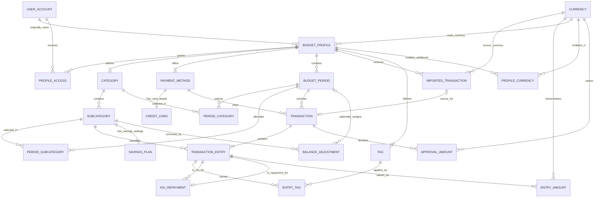

### Profiles, access, and budgets

Profile ownership/access, taxonomy, selected budget items, cards and tags. Transaction/balance references are detailed in the other focused views.


[Open SVG](erd-setup.svg).

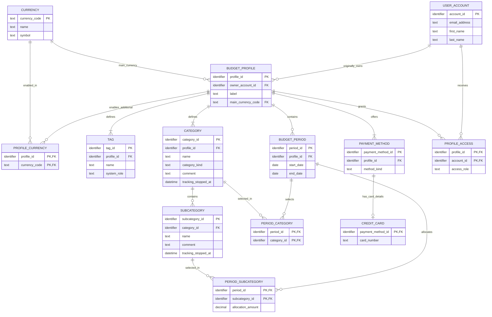

### Review, valuations, and tagging

Complete transaction/import/currency path, including IOU linking. Profile ownership and category ancestry are in the setup view.


[Open SVG](erd-transactions.svg).

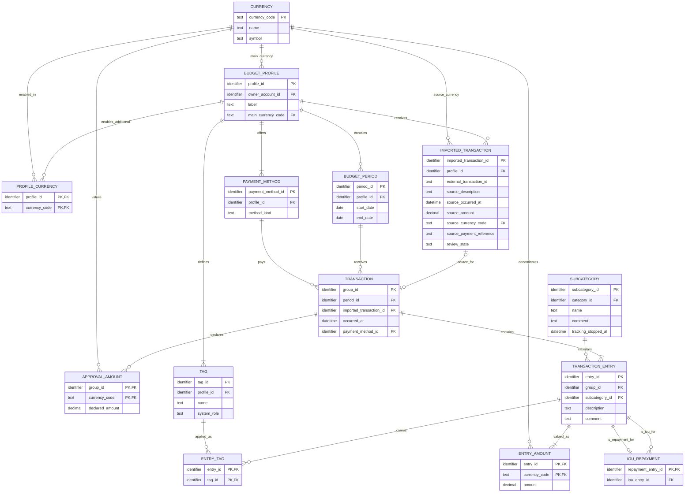

### Savings, corrections, and IOUs

Balance inputs and repayment links; currency valuation rows are shown so unpaid or carried amounts cannot silently mix units. Import provenance, tags, and payment methods are in the transaction view.


[Open SVG](erd-balances.svg).

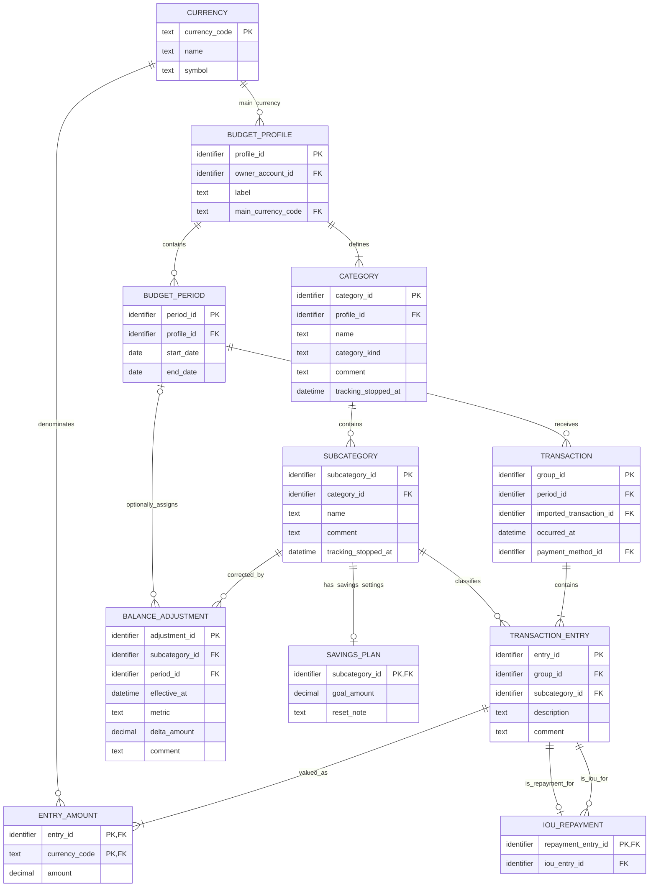

### Export verification

All six editable Mermaid blocks were parsed and rendered with Mermaid 11.12.0 on 20 October 2026. Visual inspection covered the complete ERD/UML, overview and three focused views. Automated geometry checks found no clipped text, relationship labels hidden behind entities, or overlapping relationship-label pairs. Exports contain vector text and shapes with no external assets or foreignObject elements. The full views require zooming; focused views provide more readable detail. Line crossings remain in the complete graph and do not denote extra relationships.

| Export | Width × height |
| --- | --- |
| erd.svg | 4146 × 2077 |
| uml.svg | 3480 × 1527 |
| erd-overview.svg | 3493 × 1349 |
| erd-setup.svg | 2512 × 1539 |
| erd-transactions.svg | 2865 × 1966 |
| erd-balances.svg | 1515 × 1929 |

Structural checks confirmed 22 entities, 84 attributes, 34 matching ER/UML relationships, dictionary agreement and valid foreign-key targets. These are logical-design and rendering checks, not tests against a database engine.

## Review decisions still open

Account field requiredness, email uniqueness/verification and sign-in remain undecided. Deleting BalanceAdjustment was discussed but not approved as a feature. Fixed balance checkpoints were discussed but not selected: adjustments continue to store signed deltas. Category restoration is a possible future workflow only.

## Design verification

- Reconciled the 18 baseline logical entities with the complete 22-entity target; none is omitted. Currency, EntryAmount, ProfileCurrency and ApprovalAmount are new. No implemented schema or live database was inspected or changed.
- Reviewed approved UC-001–UC-018 and their supporting diagrams, including profile-main defaults, required main valuations, dual-currency splits, cross-currency repayment, backdated correction, retirement, and approval-period/date-report differences.
- Both complete Mermaid diagrams use the same entity/attribute inventory and all 34 relationships. The dictionary covers every entity, FK target, key, optional attribute, and conditional constraint. Cross-table checks are identified explicitly.
- Normalization is assessed against the stated dependencies and all candidate keys, including EntryAmount's complete pair and scoped uniqueness rules. Remaining value-domain/lifecycle/reporting assumptions are recorded above rather than represented as confirmed requirements.
- All six diagram exports were parsed, rendered and visually inspected; results and limitations are recorded in Export verification. Rendering checks diagram syntax; it does not prove normalization or business semantics.
- The deliverable is a logical schema with editable diagrams and SVG exports. No executable DDL, application implementation, migration script, or running-engine validation is included.
