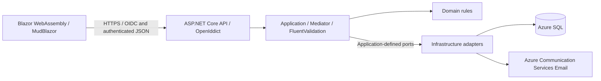

# Budget and Transaction Tracker — Technical Specification

Version: **v1.0**. Updated: **29 October 2026**.

Status: **Consolidated technical design draft — main stack, financial-summary decisions, and account email providers confirmed; proposed defaults and outstanding release gates require review.** This is not a complete implementation baseline. Confirmed decisions below come from the user; recommendations and open items do not constitute accepted requirements. UC-001 phase 3 has been implemented against localhost SQL Server LocalDB; no Azure resources have been provisioned.

Version resolution: branch `main` has no release version; `docs/v1.0/` is the only version folder. The version is retained without incrementing it.

## Sources and scope

- [Proposal](PROPOSAL.md): product scope and confirmed financial behavior.
- [Current use cases](use_cases/use-cases.md) and [CSV](use_cases/use-cases.csv): UC-001–UC-019 and their 57 diagrams. The history folder is a superseded snapshot.
- [Logical schema](migrations/schema-design.md): 22 domain entities, confirmed D-series decisions, and explicitly proposed A-series policies. Its statements that the use cases still need reconciliation predate the regenerated use cases.
- Technical interview in this chat: platform, architecture, hosting, persistence, API styles, and identity decisions.

The product supports personal budgeting, potentially shared with friends and family. Profile ownership and editor/viewer permissions govern financial data. Core workflows include profile setup, dated budgets, manual transactions, bank-statement review, reconciled splits, savings/debt corrections, IOUs, and reports. Live bank connections and native mobile applications are deferred. Account profile editing and permanent account deletion were explicitly added during this interview; the confirmed rules are recorded below. These interview decisions supplement the earlier proposal/use cases without modifying those source files.

## Requirements and constraints

- Online web application; internet access is required. No offline synchronization requirement.
- One developer maintaining the project with agents.
- User-selected Onion/Clean Architecture with domain-driven design.
- Minimize recurring cost, preferably to zero. Cold starts, quota-related interruptions, and other cost-saving limitations are accepted.
- Financial information must remain private to authorized users. No data-residency requirement was specified.
- The user does not own a domain and prefers not to buy one. Azure Communication Services Email is the selected production transactional email sender, with an Azure-managed sender domain. Development uses smtp4dev; ACS resource provisioning and managed-identity role assignment remain deployment gates.
- Future mobile clients may be considered; they are outside v1 scope.
- Delivery date and numerical usage/performance targets are unspecified.
- The existing artifacts are requirements and logical design, not an implemented application/database.

## Confirmed technology decisions

| Decision | Selection and status | Rationale | Alternatives considered / downstream effects |
| --- | --- | --- | --- |
| Platform | Online web app — user confirmed | Personal/family browser access | Native/mobile and offline usage deferred. |
| Backend | ASP.NET Core on .NET 10 LTS — user selected .NET LTS; current major verified | Existing preference for .NET APIs | Keep supported servicing patches current; support ends 14 November 2028. |
| Architecture | Onion/Clean Architecture and DDD — user confirmed | Learn and apply sound development practices | Infrastructure must depend inward; HTTP and persistence details stay outside domain rules. |
| Frontend | Blazor WebAssembly — user confirmed | C# browser frontend | Separately deployed static assets; privileged operations remain server-side. |
| UI components | MudBlazor — user confirmed | Shared forms, dialogs, data grids, and layouts for budgeting workflows | Radzen and Fluent UI Blazor considered. MIT licensed; choose a supported stable release compatible with .NET 10. |
| Hosting | Azure Static Web Apps Free + Azure App Service F1 API — user confirmed | Separate static delivery and API compute, low recurring cost | Combined frontend/API hosting and Container Apps were considered. Direct API calls require explicit CORS configuration. |
| Database | Azure SQL Database free offer — user confirmed | Relational model and recurring Azure free allowance | Neon PostgreSQL and Azure PostgreSQL considered. Pause at the free limit follows the user's explicit cost priority. |
| Data access | EF Core 10 throughout — user confirmed | Reduce handwritten persistence and migration work | EF+Dapper and Dapper-only considered; no Dapper dependency selected. |
| Application use cases | CQRS with Mediator by martinothamar — user confirmed | Separate command handlers/domain writes from report/query projections, with shared dispatch/pipeline conventions | Directly invoked C# handlers and feature application services considered; Foundatio.Mediator and Wolverine were compared for library selection. Use in-process request dispatch and one database; no distributed event bus or event-sourced storage is selected. |
| Input validation | FluentValidation — user confirmed | Separate, testable validators for conditional and collection inputs fit CQRS/Mediator | DataAnnotations and handwritten validators considered. Execute server-side validation through the Application pipeline; explicitly integrate browser feedback with MudBlazor forms. Domain invariants remain authoritative. |
| Automated testing | xUnit.net v3 + bUnit + Playwright for .NET — user confirmed | Domain/Application tests, Blazor component tests, and selected real-browser workflows | MSTest and NUnit stacks considered with the same component/browser tools. Add API integration tests and provider-specific SQL Server tests; keep runner and stable package versions compatible. |
| Build and release | GitHub Actions; automatic builds/tests and manually triggered production releases — user confirmed | Fits the existing GitHub repository and solo maintenance | Azure Pipelines and local/manual delivery considered. Remain within free allowances, disable paid overage, and retain production release control. |
| API style | REST/JSON with Minimal APIs for finance and controllers for accounts — user confirmed | Learn both ASP.NET Core styles within one application | One style per feature; shared application/domain rules and common authorization/error conventions. Upload media types remain to be specified. |
| Identity management | ASP.NET Core Identity — user confirmed | Application-owned accounts and learning account management | Managed Entra External ID and Auth0 considered. Account recovery/email operations require design. |
| Authentication protocol | Identity + OpenIddict; authorization code flow with PKCE and JWT access tokens — user confirmed | Standards-based authentication suited to separate frontend/API hosts | Built-in proprietary Identity bearer tokens considered. Browser API calls use access tokens; an identity-provider login cookie can still serve the authorization flow. |
| Account admission | Open registration — user confirmed | Anyone may create their own account without an invitation or administrator approval | Invitation-only and approval-based admission considered. Registration grants no access to other users' budget profiles. |
| Account email delivery | smtp4dev in Development; Azure Communication Services Email in Production — user confirmed on 29 October 2026 | Local messages stay in smtp4dev; Azure sends production verification email using the selected Azure-managed domain and managed identity | Provider adapters and environment selection are implemented. Provision the ACS resources and domain, configure the production sender/endpoint, grant managed-identity access, and review current costs, quotas, and delivery reporting before release. This does not change Identity/OpenIddict sign-in. |
| Account email/profile | Required unique email, verified before app use; names entered/edited on a separate account profile page — user confirmed | Verified email is the sign-in identifier; personal details remain separate from stable account identity | Email comparison/change defaults are proposed below. Names are managed separately from registration; requiredness on profile save was not explicitly decided. |
| Account deletion | Permanently erase the account and all account-owned live data; preserve profiles owned by others — user confirmed | User explicitly selected erasure over deactivation/history retention for owned data | Delete owned profiles and their full contents even if shared. Remove the account's grants to others' profiles while preserving those profiles and their financial records. User accepts existing backup copies expiring under Azure retention rather than immediate backup erasure. |
| Period summaries | Signed non-Income movements include Savings and Debt; total allocated excludes Income allocations — user confirmed | Measures money committed across expenses, savings, and debt while keeping expected income separate | Expense-only spending and dual totals considered. This resolves A9 for period summaries; date-report category defaults remain an open presentation policy. |
| Statement input | PDF bank statements with OCR support — user confirmed | Supports scanned/image-based PDFs as well as digital statements | Upload requirements and initial bank layouts are still being defined. Tesseract is provisional; wrapper/renderer, execution location, extraction/mapping rules, and retention remain open. |
| OCR baseline | Tesseract — user accepted as a provisional engine | Free, open-source OCR; no per-page library fee | .NET wrapper, browser-based Tesseract.js, and PaddleOCR approaches compared. Execution location, wrapper, PDF rendering, and F1 feasibility remain open. |

## Architecture and boundaries

Proposed organization within the confirmed Clean Architecture: Domain, Application, Infrastructure, API, and Blazor Client projects. The API and authorization-server functionality share one backend deployment; this is a proposed simple deployment organization, not a selected microservices design.

The diagram shows runtime calls. Source-code dependencies point inward: Domain references no other application project; Application references Domain; Infrastructure implements Application ports and references inward; API composes the implementations. Client uses explicit request/response contracts rather than infrastructure or EF entities. A small shared Contracts project is a proposed implementation convenience, not permission to share server-only dependencies with the browser.

- Domain: financial identities, aggregates, value objects, and invariant enforcement independent of EF Core and HTTP.
- Application: authorized use cases and transaction coordination, using interfaces for persistence and infrastructure operations.
- Infrastructure: EF Core mappings, database access, Identity/OpenIddict integration, and statement-format adapters.
- API: account controllers and finance Minimal APIs; authentication, authorization, HTTP contracts, and error translation.
- Blazor Client: forms and reports, authentication redirects/callbacks, and authenticated API requests. Browser validation aids usability; the API enforces authoritative rules.

The user selected CQRS with [Mediator by martinothamar](https://github.com/martinothamar/Mediator), an MIT-licensed library distinct from MediatR. Organize commands/queries and handlers by feature. Both account controllers and finance Minimal APIs dispatch through the Application layer. Domain invariants stay in domain objects/services rather than being duplicated in handlers. EF-backed query projections and domain writes share the same database; separate stores, distributed messaging, and event sourcing have not been selected.

Use `Mediator.Abstractions` in Application and the generator package in the executable API composition root. Configure the mediator and EF-dependent handlers with a scoped lifetime; the library's singleton default must not capture a scoped DbContext. Select matching supported stable package versions before implementation. Proposed request order: authenticate and enforce coarse endpoint policy; validate request shape; load the authorized profile/resource; enforce domain rules; execute the command's explicit transaction; map the result. Wrap this in correlation/timing diagnostics without payloads. Resource authorization must precede exposing resource-specific validation details. Queries do not acquire a generic write transaction; command handlers specify the records and invariant protected by their transaction.

MudBlazor is the selected UI component library. Keep domain rules, authorization, and database access outside UI components; request authorized DTOs through the API. Use a consistent responsive layout for forms, transaction review, budgets, and reports. Precise visual design and report chart requirements have not been selected.

The aggregate and HTTP designs below are proposed implementation details within the confirmed stack. FluentValidation is the selected input-validation library.

Use FluentValidation for Application commands, invoked with `ValidateAsync` through a Mediator pipeline shared by account controllers and finance Minimal APIs. Invalid input returns consistent field/model errors before handler side effects. Keep request-shape/conditional validation separate from domain invariants, authorization, and database uniqueness/concurrency constraints. Database-dependent checks cannot alone prevent races; enforce final invariants when committing. Integrate browser-safe validation explicitly with MudBlazor forms, and display server errors against the relevant fields or form. Do not send server-only validators/dependencies to the WebAssembly client. Do not use the unsupported `FluentValidation.AspNetCore` automatic MVC validation package or assume it covers Minimal APIs. Browser feedback remains advisory and server validation authoritative. DataAnnotations and handwritten request validators were considered but not selected as the primary validation approach.

## Data and financial integrity

Use the logical schema as the domain-data baseline; do not equate its 22 domain entities with the eventual physical table count. Identity/OpenIddict require supporting persistence that must be mapped separately.

The following source requirements must be preserved:

- Stable category/subcategory identities across renames; deletion stops future tracking and retains history. Period omission is independent of deletion.
- Profile main-currency values alone feed calculations. Foreign approval requires manually supplied main-currency values; no exchange-rate conversion.
- Income entries require positive supplied valuations; other transaction types support positive and negative amounts under the source rules. Do not apply a blanket positive-only amount validator to all financial commands.
- Imported split entries share a period/date/payment method, have independent classifications and tags, reconcile each supplied currency, and approve atomically.
- Approved signed movements and dated correction deltas determine savings/debt balances. Corrections propagate forward, including after manual savings resets. Debt metrics can be corrected independently.
- One IOU can have many repayments; one repayment entry targets one IOU in the same profile.
- Budget activity follows assigned periods; date-range reports follow transaction dates.
- Original owners alone manage sharing; owner/editor/viewer checks apply server-side to every relevant operation.

Proposed implementation treatment: exact decimal arithmetic, database constraints plus domain validation, explicit transaction boundaries, and optimistic concurrency with additional serialization where a cross-record invariant needs it. Precision, temporal boundaries, and concurrency behavior require concrete treatment before implementation. EF Core alone does not establish these business rules.

Proposed aggregate treatment: a transaction group owns its entries, currency valuations, and split declarations for atomic editing/approval. Profile setup, budget periods, savings/debt corrections, and IOU links are coordinated through explicit use cases rather than loading all profile history into one aggregate. Queries project approved records into reports without persisting mutable derived totals. Recheck profile access and affected record versions inside write operations. Profile ownership scopes all joins and foreign-key checks; a valid ID alone is insufficient authorization.

### Confirmed period-summary policy

The user selected option 1: period spending includes every approved signed non-Income movement, including Savings contributions/withdrawals and Debt payments/reversals. Total allocated is the sum of selected non-Income subcategory allocations, including Savings and Debt. Income allocations represent expected income and are shown separately. Pending imports, alternative-currency amounts and balance-adjustment deltas do not contribute to transaction spending. Negative movements reverse the corresponding signed total.

| Metric | Definition, in the profile main currency |
| --- | --- |
| Expected income | Sum of Income allocations in the selected period. |
| Received income | Sum of approved Income entry amounts assigned to the selected period. |
| Total allocated | Sum of selected non-Income allocations in the period. |
| Spending | Sum of approved signed non-Income entry amounts assigned to the period, including Savings and Debt. |
| Allocated allowance remaining | Total allocated minus spending. |
| Income remaining after spending | Received income minus spending. |

Example: expected income 1,000, non-Income allocations 800, received income 900, ordinary expenses 200, Savings contributions 100 and Debt payments 50 give spending 350, allowance remaining 450 and income remaining 550. An alternative-currency valuation does not change these figures. The allocation calculation is 800, not 1,800.

This interview decision resolves A9 for period summaries and supersedes the schema's proposed inclusion of Income allocations. The source proposal/use cases/schema remain unedited by this specification. Date-range reports still filter transaction dates across approval periods; their default category inclusion must be stated explicitly in report contracts rather than inferred from the label "spending".

### Proposed persistence and time conventions — review before implementation

- Use C# `decimal` and explicit SQL decimal precision for monetary values, never binary floating point. Proposed baseline for initial GBP/USD values: `decimal(19,2)` with validation rejecting excess fractional digits rather than silently rounding. All split sums compare exact accepted values per currency. Revisit scale before adding currencies with different minor units.
- Use stable identifiers and SQL `rowversion` concurrency tokens for mutable records/aggregate roots. Client updates carry the expected version. Return a conflict when stale; never silently overwrite another user's allocation, split, sharing or correction.
- Store transaction/correction instants with an offset-aware UTC representation and period boundaries as dates. A profile reporting time zone is proposed so all collaborators see the same date boundaries. Reject ambiguous imported local times until resolved. Convert inclusive displayed end dates to an exclusive next-day boundary in that zone; do not add an assumed 24 hours across daylight-saving changes. Zone choice and equal-time ordering remain open.
- A correction stores delta = requested target minus calculated balance at its effective point. A manual reset stores the corresponding negative balance. A backdated edit changes later balances, including those after a reset, as required; do not replace it with a fixed checkpoint.
- Approval writes the source review transition, group, entries, declarations, valuations and links in one database transaction. Concurrent attempts cannot approve one source twice. Retry with the same operation identifier returns the same completed result or a conflict, never another financial operation. Idempotency records, if used, inherit profile ownership and erasure rules.
- Persist profile ownership once; prevent cross-profile period/category/payment/tag/IOU references with mappings, constraints and authorized command checks. Prefer explicit deletion order where SQL Server cascade paths are ambiguous. Never cascade deletion of a user into a surviving profile owned by someone else.
- Start with provider-specific indexes for profile/date queries, pending review, stable category joins and ownership/access lookup; verify query plans before adding caches. Bound report queries and paginate transaction lists. No additional search engine, distributed cache or background broker is justified by current scope.

## HTTP and integration contracts — proposed design

Use explicit request/response DTOs with stable IDs, main-currency amounts and concurrency versions. Keep domain entities and EF navigation graphs out of JSON responses. Date, amount and currency formats must be documented and round-trip without culture-dependent parsing. Generate an OpenAPI document from the actual endpoints during implementation; documentation must not expose private data or credentials.

| Surface | Responsibility and authorization |
| --- | --- |
| Account controllers | Registration, email confirmation/change, account profile edits, recovery and permanent deletion. Anonymous entry points are narrowly scoped; authenticated changes act on the current user rather than an arbitrary submitted account ID. |
| OpenIddict protocol endpoints | Authorization, token exchange and logout/discovery using the selected OAuth/OIDC flow. These protocol responses follow the protocol rather than the financial API's custom DTO conventions. |
| Profile/setup Minimal APIs | Profiles, sharing, categories/subcategories, payment methods and currencies. Only the original owner manages grants; owner/editor/viewer policies apply to other operations. |
| Budget/transaction Minimal APIs | Period creation/editing, manual approved activity, review/approval/splits, tags and IOU links; editors can write, viewers can read. |
| Corrections/report Minimal APIs | Savings/debt correction commands and authorized date/period-based query projections. Reads must not reveal another profile through aggregates or lookup lists. |
| Statement import boundary | PDF extraction/OCR and bank-format adapters produce pending candidate records with source provenance. Untrusted extraction never bypasses normal approval and currency validation. Exact upload routes, limits, persistence and processing mode remain deferred with the upload requirements. |

Use consistent Problem Details responses for application APIs, with a safe code, correlation identifier and field errors where applicable. Proposed mappings: malformed/invalid input 400, unauthenticated 401, insufficient permission 403 (or a consistent non-disclosing 404 for inaccessible IDs), missing resource 404, concurrency/duplicate-state conflict 409, rate limit 429, and temporary dependency/quota failure 503. Never turn financial write failures into a success response or expose stack traces/SQL/token material. Clients preserve unsaved edits on recoverable errors and do not blindly retry non-idempotent commands.

## Authentication and account lifecycle

The Blazor application is a public OAuth client with no client secret embedded in downloaded assets. The selected flow requires PKCE. Use exact environment-specific redirect/logout URIs and a dedicated API audience/scope. Only API access tokens authorize financial API calls; ID tokens do not. Validate issuer, audience, signature, expiry, client/scope and active subject state. A token may carry user identity, but profile roles must be resolved against current grants rather than treated as permanent token claims.

Proposed session baseline, not user-confirmed policy: 15-minute access tokens held in memory, with top-level authorization redirects when a new token is needed; no long-lived refresh token persisted in local storage. The authorization server may maintain an HttpOnly, Secure login cookie on its own origin to make reauthorization convenient; this cookie does not authenticate direct financial API calls. A reload may require redirecting through the authorization endpoint. Persistent browser sessions/refresh-token policy and final lifetimes remain review items; do not silently add persistent login to reduce redirects.

Keep OpenIddict token/authorization storage enabled. For the co-hosted API, enable token-entry and authorization-entry validation and check that the account still exists and is permitted to use the app on authenticated requests. OpenIddict's default cryptographic validation alone does not immediately enforce stored revocation. Do not register a competing bearer scheme that bypasses these checks. Logout revokes the applicable grant/token chain and clears client state and the login cookie. Account deletion invalidates all the user's chains and server-side sessions. These proposed checks add database work to implement the confirmed immediate-access-removal requirement; the design does not promise stateless JWT authorization.

Account controllers will delegate through Application identity ports implemented with ASP.NET Core Identity in Infrastructure; Domain/Application must not reference ASP.NET Identity managers or HTTP types. Do not add duplicate registration endpoints through an unqualified `MapIdentityApi` mapping. Registration is open without invitations or administrator approval; a new account has no access to anyone else's profiles. A unique email address is required and must be verified before financial/profile use. Verification, sign-in/logout, recovery, and deletion operations must remain reachable as appropriate before verification.

UC-001 implementation approval, 23 October 2026: registration requires email, password and matching password confirmation; names belong to a later account profile page. Passwords require at least 12 characters without character-class requirements; email confirmation expires after 24 hours. Use Identity normalized-email comparison with a unique database index, Identity password hashing and token providers, smtp4dev over local SMTP for Development, and fake transports in automated tests. Registration and email confirmation are approved for this slice; OpenIddict sign-in is separate. On 26 October 2026, the user authorized and completed the local SQL Server LocalDB integration described in the [approved implementation plan](use_cases/UC-001_create-a-user-account/implementation-plan.md). On 27 October 2026, the user selected Azure Communication Services Email, replacing the earlier Gmail choice. On 29 October 2026, the user approved the production ACS adapter, Azure-managed sender domain, and managed identity. Follow-up decisions confirm generic duplicate-registration responses, retention of unverified accounts after delivery failure, a resend operation, and harmless replay of a still-valid confirmation link. Acknowledgements do not promise account creation or delivery. The provider adapters and environment selection are implemented; cloud resource provisioning and deployment configuration remain future work.

Other account details remain proposed: require email syntactic validity and use Identity's normalized-email comparison backed by a unique database index so concurrent registrations cannot duplicate an email. Do not invent provider-specific dot/plus-address equivalence. Keep the current verified email active during an email-change request and commit the replacement only after a time-limited confirmation sent to the new address; recheck uniqueness at commit and invalidate relevant sessions. Require recent authentication for password/email changes and deletion. Recovery/verification responses must avoid account enumeration. Use Identity's password hashing and token providers, bounded failed-login lockout and independent rate limits on registration, recovery and resends; no custom password cryptography. The UC-001 password minimum and email-confirmation expiry are confirmed above; lockout and other token-expiry settings require review before their features launch. MFA has not been requested or selected and is not silently included as a v1 feature.

First and last names can be entered and edited on a separate account profile page. Preserve the stable account ID when those details or the email address change. Whether names must be nonempty when saving that page was not explicitly decided; do not make registration depend on completing that page by implication.

### Permanent account deletion — confirmed ownership rules

- Permanently delete the account's identity/personal record and account-owned data; deactivation or a retained soft-deleted account is not the selected result.
- Delete every profile originally owned by the account, its access grants, and all profile-owned financial/setup/import data. This includes shared owned profiles and data entered into those profiles by other participants.
- For profiles originally owned by another account, remove the deleted account's access grants and retain the profile and its financial records, including entries the departing user created/edited. Profile ownership, rather than the last writer, controls financial-data retention.
- Revoke/delete the account's authentication grants, sessions, and tokens and block subsequent access/refresh. Ensure previously issued JWTs cannot continue authorizing deleted-account requests merely because their cryptographic expiration has not passed.
- Remove account-owned documents, extracted artifacts, queued operations, and other auxiliary copies when those features exist. Bound logging so it does not become a second store of financial/personal payloads.
- Define transactional coordination, retry/recovery, and the point at which deletion is confirmed. No successful deletion response may imply completion while owned application data remains accessible.
- Category/subcategory history-retention rules still govern ordinary item deletion within a surviving profile. Account deletion is a separate, explicitly confirmed erasure operation and removes owned profiles entirely.

The user confirmed that deletion removes owned data from the live application immediately, while existing backup copies expire under Azure's retention policy. Immediate selective erasure from managed backups is not required. A restore must not make previously deleted accounts or their owned data accessible again; the restore procedure and minimal operational tracking needed to reapply deletions remain a release gate. Do not use this accepted backup exception to retain soft-deleted live accounts or owned financial data.

Proposed live deletion coordination: authenticate recently, identify original ownership, serialize against concurrent owned-profile writes, and remove account/owned-profile database rows, access grants and authentication records in one explicit SQL transaction where supported by the final mappings. Surviving profiles must not retain deleted-user names/email or mandatory identity FKs merely for audit; clear optional actor attribution while preserving their financial facts. Tests must verify no orphaned or cross-profile cascaded records. External uploads/queues, if introduced later, need an idempotent deletion coordinator with restricted access while cleanup is incomplete. Do not return completed deletion until auxiliary erasure has succeeded. This coordinator and its transient records cannot become indefinite account retention.

## Security, privacy, and usability requirements

The privacy and authorization requirements below implement confirmed scope. Numerical limits and user-experience targets are proposed defaults until reviewed.

- Serve frontend, API and authorization endpoints over HTTPS. CORS allows only the configured frontend origins; distinguish development origins from production. Do not enable wildcard origins or blanket credentialed CORS. For cookie-authenticated authorization/login actions, use appropriate antiforgery/state/nonce protection; bearer API calls do not make cookie-backed account flows immune to CSRF.
- Treat PDFs, extracted descriptions, comments and tags as untrusted. Encode displayed content, do not render imported HTML, and use a content security policy compatible with the chosen Blazor/MudBlazor runtime. The upload design must constrain size/page count, parser resource usage and temporary-file lifetime before enabling it. Bank statements must not be publicly readable or retained inside web-served static directories.
- Store secrets, signing/encryption keys, Azure Communication Services Email credentials and connection strings only in protected server/deployment configuration. Separate local development secrets from production credentials; never place real financial data in fixtures, build artifacts, diagnostics or client assets.
- Logs contain safe event codes, timings and correlation IDs rather than request bodies, account names/email, card numbers, statement content, amounts, passwords or tokens. Redact URL query values that might contain confirmation/reset codes. Operational logs and any eventual telemetry service need explicit retention and cost limits.
- A saved card number is sensitive private data. Store no card security code or online-banking credentials. Display a masked identifier by default, restrict full-number access, and keep statement matching behind server-side authorization. Exact full-number storage/encryption versus matching representation is a design review item; do not silently replace the proposal's matching requirement with last-four matching, which can collide.
- Proposed usability target: keyboard-operable core workflows, labeled controls, visible focus, readable contrast, accessible validation, and no meaning conveyed only by color. Review against WCAG 2.2 AA criteria without claiming certification. MudBlazor selection alone is not accessibility verification. Core screens should work on narrow and desktop browser widths; native mobile apps remain outside scope.
- Free-tier interruptions are accepted, but data corruption and authorization bypasses are not. Show actionable errors for database pause/quota and delivery failure, preserve input where possible, and never show partial approval as complete. No availability SLA, recovery-time guarantee or numerical load target has been agreed.
- Proposed list baseline: 50 rows/page, capped at 200; report projections use bounded date/profile filters and cancellation. Measure representative family-scale data before adopting latency targets or upgrading compute. OCR feasibility must be measured separately from ordinary API requests.

## Deployment, cost, and operations

Confirmed target services are listed above; no provisioning is authorized by this specification workflow. Static Web Apps' integrated App Service API proxy requires Standard; the chosen Free plan instead uses direct browser-to-API calls.

As researched on 20 October 2026:

- App Service F1 has a 60 CPU-minute daily quota; this is CPU time, not a promise of one wall-clock hour of availability.
- Azure SQL's free offer includes 100,000 vCore-seconds of compute, 32 GB of data, and 32 GB of backup storage per database monthly. Specify pause-at-limit behavior rather than paid overage.
- Free allowances and eligibility must be checked before deployment. No whole-system zero-cost guarantee is implied; auxiliary services need their own cost review.

OpenIddict signing/encryption credentials and ASP.NET Core Data Protection keys must survive restarts. Production keys must not be generated afresh at startup or placed in source/browser assets. Key loading and persistence must be validated specifically on F1; development certificate defaults are not a production deployment plan.

GitHub Actions is confirmed for automatic builds/tests and manually triggered production releases. The existing Git remote is GitHub (`juliantiu/personal-finance`); repository visibility has not been assumed. Azure Pipelines and local/manual releases were considered but not selected. Check free-runner, storage and account allowances before enabling workflows and keep paid usage disabled. Selecting this delivery design does not authorize deployment or resource creation in this specification task.

Proposed workflow detail: pull requests and main-branch changes restore locked dependencies, build Release artifacts and run applicable unit, API/database, component and browser checks. Browser tests use a locally started test stack and synthetic data. Retain small, short-lived test artifacts with sensitive-content capture disabled. Manual production runs select a reviewed commit that passed checks, publish matching frontend/backend artifacts, apply reviewed EF migrations as an explicit release step, then check sign-in and a private read/write smoke workflow. Do not run database migrations concurrently in every app startup or seed development users/data into production. Use least-privilege deployment credentials configured for the selected Azure tier; validate F1 authentication/deployment capabilities before choosing a credential mechanism. A failed migration blocks application rollout. Keep prior build artifacts for application rollback; a database rollback requires an explicit compatible migration/restore plan.

Environment/monitoring/maintenance defaults are proposed below. Azure Communication Services Email resource/domain provisioning, managed-identity authorization setup, delivery-status handling, statement retention/storage and the recovery gates remain deployment/operations gates as listed under outstanding decisions.

Proposed environment baseline: local development/test with synthetic data and a fake email sender, plus production on the selected free Azure services. A permanently hosted staging environment is not assumed. Keep issuer URLs, CORS origins, database names and credentials distinct by environment. Match SQL Server behavior in integration tests; choose a supported local/CI SQL Server setup during implementation rather than buying a second cloud database for tests.

Proposed low-cost observability: framework structured logging, safe health endpoints and release smoke checks before adding paid monitoring. Liveness exposes no dependencies/secrets; an authorized or otherwise narrowly protected readiness check verifies required services without returning private data. Monitor Azure quota/storage and Communication Services Email send/delivery failures within available portal diagnostics. Do not run frequent synthetic polling that consumes the accepted free compute budget. Application Insights or another telemetry provider is not selected.

### Backup and recovery constraints

Use the Azure SQL free offer's managed short-term backups under the selected pause-at-limit configuration; verify the actual available restore points and retention before deployment. The researched pause option permits at most seven days of point-in-time retention and no long-term-retention backup. A retention window is not a guarantee that every backup copy is physically erased at an exact seven-day deadline.

Azure documents that a database cannot be restored into a free-offer database. Recovery may therefore require a temporary paid target. This is a known unresolved exception to the cost preference, not authorization to incur charges. Before launch, document which recovery path is affordable, who performs it, and the accepted loss/downtime expectations. Restore into isolation, deny public app access, reapply all erasures after the chosen restore point, verify ownership/access and totals, then cut over only after checks. Do not restore deleted accounts merely because they exist in the backup. A durable minimal erasure-reapplication mechanism and its compatibility with the user's no-retention rule require explicit resolution; this draft does not choose a permanent deletion ledger by implication.

Proposed maintenance practice: pin the SDK and direct package versions, retain dependency lock information, update supported servicing/security releases, review dependency advisories and license changes, and test migrations against an empty database and representative prior schema. Track .NET support expiry and free-service eligibility. The solo maintainer owns quota, sender credentials, key rotation, recovery and release documentation; no round-the-clock operations team is assumed.

Azure Communication Services Email is the user-selected production sender for verification and password-reset emails, replacing Gmail on 27 October 2026. Development uses smtp4dev over local SMTP; automated tests use fake transports. The Infrastructure adapters share the application email-sender port, and API composition selects smtp4dev only for Development and ACS for other environments. The Production adapter uses `DefaultAzureCredential`; use the selected Azure-managed sender domain and the API host's managed identity. Configure the endpoint, verified sender address, and public client URL in backend host settings only. A completed ACS send operation means accepted for outbound delivery, not confirmed in the recipient's inbox; delivery-event handling remains future operations work. Review current pay-as-you-go pricing and quotas and perform a controlled send before release. App sign-in remains the selected Identity/OpenIddict flow. ACS resource/domain provisioning and managed-identity authorization have not been performed.

## Testing and acceptance

Verify UC-001–UC-019 plus the new account edit/delete requirements. Priorities include permissions, atomic approval and duplicate submissions, currency conservation, backdated correction propagation, linked-record lifecycle, concurrent edits, and transaction-date reporting. Identity flows and deployment feasibility need dedicated coverage. The following scenarios translate agreed behavior into acceptance checks; proposed targets elsewhere remain subject to review.

The user selected xUnit.net v3 + bUnit + Playwright for .NET, with API/database integration tests. Use data-driven domain/Application tests for financial invariants, bUnit for component interactions/error display, and a small set of Playwright real-browser workflows for authentication, sharing, transaction approval and account deletion. Use `WebApplicationFactory` for API integration and isolated SQL Server test data for provider-specific constraints, migrations, transactions, and concurrency. EF InMemory is not evidence that SQL Server financial-data guarantees hold. Select supported stable test packages/runners together during implementation; prerelease examples in documentation are not a requirement. Automated tests must use synthetic accounts/data and a fake email sender, with no messages to real users. MSTest and NUnit were considered but not selected.

| Acceptance check | Required evidence |
| --- | --- |
| Account admission | Duplicate normalized email cannot register, including concurrent requests; unverified accounts cannot use financial/profile features; names on the separate page preserve stable identity. |
| Profile isolation | A second account cannot access another private profile through direct IDs, lists, reports, import operations or aggregate counts. Viewers cannot write; editors cannot grant access; owner grant removal takes effect on subsequent requests. |
| Period copying/history | A later period copies predecessor selections/allocations without copying actual spending or mutating older periods; retired items are excluded from new tracking but retain historical balances and reports. |
| Summary example | The documented 1,000 expected / 800 allocated / 900 received / 350 spending example yields 450 allowance remaining and 550 income remaining. Negative movements reverse spending; Income allocation is excluded from total allocated. |
| Currency/splits | Each supplied currency reconciles independently; a foreign import missing main-currency values cannot approve; pending/alternative valuations are excluded from totals; a failed split writes no partial approved group. |
| Duplicate/concurrent writes | Two simultaneous approvals of one source create exactly one operation; stale edits cannot overwrite an accepted version; repeated release/API retries do not duplicate movements. |
| Savings/debt correction | Delta corrections and resets follow source formulas; backdated changes propagate after a reset; independent debt-paid and debt-remaining corrections do not silently rewrite one another. |
| IOU relationships | Multiple repayments link to one target across periods; a repayment cannot target a different profile or multiple IOUs. Amount/direction/overpayment checks follow the eventual explicit A6 policy. |
| Reports | Renamed/retired identities aggregate correctly; transaction-date reports and approval-period summaries deliberately differ for out-of-period dates; alternatives never double-count. |
| Account deletion | Owned private/shared profiles and auxiliary owned data are erased; others' profiles and their financial records survive; old access tokens, refresh attempts and login cookies cannot restore access. |
| Client/error usability | bUnit verifies validation display and recoverable errors; Playwright verifies real browser redirect/CORS behavior, core edits and permission failures. Keyboard/narrow-screen checks cover the selected core workflows. |
| Release/recovery | Migration failure blocks rollout; persistent production keys survive restart; quota/dependency failures do not report financial success; isolated recovery reapplies erasures before access. |

Test infeasible-hosting assumptions before completing the main build: deploy a minimal .NET 10/OpenIddict configuration on the actual F1 target when separately authorized; confirm supported runtime, persistent credentials, database connectivity, CORS and login callbacks. Validate Azure Communication Services Email sending and delivery-status behavior with controlled test recipients only after the resources and integration are separately authorized. Treat OCR renderer/native-runtime and quota testing as a separate upload feasibility step when its design is ready. These are implementation/release checks, not work performed by this specification task.

## Outstanding decisions and release gates

The major technology interview is complete. The following unresolved product policies and operational feasibility checks are explicitly preserved rather than treated as approved defaults. They can be resolved during detailed design; affected features must not be released with ambiguous financial or security behavior.

| Item / status | What remains and its effect |
| --- | --- |
| PDF/OCR — deliberately deferred by user | Initial bank layouts, digital-text versus OCR routing, execution location, PDF renderer/wrapper, limits, duplicate/source identity, original-upload retention and private storage. Tesseract is provisional, not evidence of a working universal PDF importer. Import remains v1 scope until the user changes scope. |
| Account/session defaults — proposed | UC-001 confirms normalized-email uniqueness, a minimum 12-character password without composition requirements, and 24-hour email confirmation. Review in-memory session/token policy, email-change workflow, recovery/rate-limit settings and first/last-name requiredness for their affected features. Unique verified email, separate profile page, open registration, Identity/OpenIddict and Azure Communication Services Email remain confirmed. |
| Azure Communication Services Email — production release gate | The Infrastructure adapter uses the Azure Email SDK with `DefaultAzureCredential`; Production selects this adapter and requires `Email:Azure:Endpoint`, a verified `Email:SenderAddress`, and `Email:ClientBaseUrl`. Use the selected Azure-managed sender domain and the App Service managed identity. Provision/link the ACS and Email resources, assign the required send permission, configure those values in backend App Service settings, verify current cost/quotas, and perform a controlled live-send check before release. No Azure resources were provisioned or real messages sent by the code change. ACS send-operation completion means accepted for delivery, not confirmed inbox delivery; bounce/event handling remains a separate operations decision. |
| Free hosting and keys — release gate | Verify .NET 10 availability, signing/encryption and Data Protection persistence, deployment authentication, SQL connectivity and resource quotas on the actual F1/subscription combination. Revisit only affected hosting choices if a required capability is unavailable. |
| Recovery and erasure — release gate | Resolve a durable erasure-reapplication mechanism without indefinite account retention, available backup window, restored-target cost and recovery procedure. No restoration into public service before deletion/access checks. |
| A1/A10 — product-policy review | Monetary precision/sign/zero rules, profile time zone, effective-time ties, date boundaries, ambiguous local imports, equal/overlapping predecessors and treatment of future-dated balances. Decimal/time conventions above are proposed. |
| A6 — product-policy review | IOU direction, repayment credit magnitude/sign, overpayments and both-role tagging. One target per repayment and same-profile ownership are already confirmed; do not infer partial allocation or currency conversion. |
| A2/A3/A5/A7/A8/A11/A12/A13 — explicit detailed-design review | Special-category kind/reparenting, canonical saved-card identity/storage, tag deletion/default roles, restoration, deletion/re-review of approved imports, nonnegative allocations/goals/payment requiredness, main-currency stability after financial facts, and disabling used alternatives. Existing confirmed D-series rules stand; proposed A-series rules are not automatically accepted. |
| A9 — resolved for periods | Signed non-Income spending includes Savings/Debt and total allocated excludes Income. Date-report category defaults still need an explicit contract; do not preserve the superseded proposed Income-allocation inclusion. |
| Quality/operations defaults — proposed | Review accessibility target, bounded queries, local/production environment split, log retention, key rotation, operational alerting and recovery expectations. No paid monitoring/staging service, SLA or numerical performance promise is selected. |

No implementation is blocked merely because every UI layout or endpoint path is not yet written. Resolve the applicable financial policies before corresponding domain/migration work and the deployment/recovery gates before handling real financial data. Changes to confirmed scope or technology choices require an explicit decision; routine package versions, DTO names and supported deployment wiring do not require another technology-selection interview.

## Requirement traceability

| Source | Technical treatment |
| --- | --- |
| UC-001 / account interview | Identity/OpenIddict, unique verified email, Azure Communication Services Email for verification/recovery, separate names page; account controllers and admission tests. Account deletion is an interview-added requirement with separate ownership/erasure rules. |
| UC-002–UC-003 | Profile ownership and grants; server-side owner/editor/viewer policies, authorized query scoping and sharing/concurrency tests. |
| UC-004–UC-005 | Stable category/subcategory/payment identity; explicit retirement versus account erasure, saved-card matching/privacy and historical queries. |
| UC-006–UC-008 | BudgetPeriod selection/allocation use cases, independent predecessor copying, explicit optimistic concurrency and confirmed period formulas. |
| UC-009 | Transaction-group aggregates, exact main-currency values, approved manual writes and atomic edit/delete transactions. |
| UC-010–UC-011 | Deferred PDF extraction/OCR adapter into pending review; authorized matching, main-required approval, per-currency reconciliation, atomic split and duplicate-approval prevention. |
| UC-012–UC-013 | Profile-scoped tag/IOU link validation, one-target repayment rule and A6 policy gate. |
| UC-014–UC-016 | Dated correction deltas, independent debt metrics, signed movement projections and historical/retired-item inclusion. |
| UC-017–UC-018 | Transaction-date queries, stable category aggregation and one main valuation per entry; report inclusion/boundary policies explicitly reviewed. |
| UC-019 | Profile main/enabled currency configuration; no FX conversion, foreign approval validation and A12/A13 history-policy gates. |
| Cost/privacy/solo-maintenance interview | Free Azure hosting, SQL pause-at-limit, local test environment, no private payload logging, GitHub Actions checks/manual releases and documented recovery limitations. |

## Verified technical references

Accessed 27 October 2026. These support technical facts and options; they do not establish user acceptance of recommendations.

- [.NET support policy](https://dotnet.microsoft.com/en-us/platform/support/policy/dotnet-core)
- [Clean Architecture guidance](https://learn.microsoft.com/en-us/dotnet/standard/modern-web-apps-azure-architecture/common-web-application-architectures)
- [Static Web Apps plans](https://learn.microsoft.com/en-us/azure/static-web-apps/plans)
- [App Service integration requires Standard](https://learn.microsoft.com/en-us/azure/static-web-apps/apis-app-service)
- [Azure service limits](https://learn.microsoft.com/en-us/azure/azure-resource-manager/management/azure-subscription-service-limits)
- [Azure SQL free offer](https://learn.microsoft.com/en-us/azure/azure-sql/database/free-offer?view=azuresql)
- [Azure SQL automated backup retention](https://learn.microsoft.com/en-us/azure/azure-sql/database/automated-backups-overview?view=azuresql) and [free-offer restore limitations](https://learn.microsoft.com/en-us/azure/azure-sql/database/free-offer-faq): account erasure applies immediately to live application data; existing managed backup copies expire separately. Recovery must also account for the free offer's restriction on restoring into a free-offer database.
- [EF Core 10](https://learn.microsoft.com/en-us/ef/core/what-is-new/ef-core-10.0/whatsnew)
- [EF transactions](https://learn.microsoft.com/en-us/ef/core/saving/transactions) and [concurrency](https://learn.microsoft.com/en-us/ef/core/saving/concurrency)
- [ASP.NET Core API styles](https://learn.microsoft.com/en-us/aspnet/core/fundamentals/minimal-apis/overview?view=aspnetcore-10.0)
- [CQRS with a single data store](https://learn.microsoft.com/en-us/azure/architecture/patterns/cqrs) and [DDD application command handlers](https://learn.microsoft.com/en-us/dotnet/architecture/microservices/microservice-ddd-cqrs-patterns/microservice-application-layer-implementation-web-api): domain rules remain in the domain model; handlers coordinate use cases.
- [Mediator by martinothamar](https://github.com/martinothamar/Mediator): selected MIT-licensed, source-generated mediator; generator placement, matching abstraction package, configurable pipelines, and scoped service lifetime require explicit configuration.
- [MudBlazor](https://github.com/MudBlazor/MudBlazor) and [installation guide](https://mudblazor.com/getting-started/installation): selected MIT-licensed UI library; its support matrix lists .NET 10 support. Select a supported stable version and verify standalone WebAssembly asset configuration during implementation.
- [FluentValidation compatibility](https://docs.fluentvalidation.net/en/latest/) and [ASP.NET integration](https://docs.fluentvalidation.net/en/latest/aspnet.html): user-selected validation library; .NET 10 supported and explicit asynchronous invocation preferred over unsupported MVC auto-validation integration. [Blazor validation](https://learn.microsoft.com/en-us/aspnet/core/blazor/forms/validation?view=aspnetcore-10.0) documents DataAnnotations and custom validation alternatives.
- Selected testing stack: [xUnit.net v3](https://xunit.net/docs/getting-started/v3/getting-started), [bUnit](https://bunit.dev/), [Playwright for .NET](https://playwright.dev/dotnet/docs/intro), and [ASP.NET Core integration tests](https://learn.microsoft.com/en-us/aspnet/core/test/integration-tests?view=aspnetcore-10.0). Alternatives considered: [MSTest](https://learn.microsoft.com/en-us/dotnet/core/testing/unit-testing-mstest-intro) and [NUnit](https://docs.nunit.org/articles/nunit/intro.html).
- Selected delivery platform: [GitHub Actions billing/allowances](https://docs.github.com/en/billing/concepts/product-billing/github-actions), [Static Web Apps build configuration](https://learn.microsoft.com/en-us/azure/static-web-apps/build-configuration), and [App Service GitHub Actions delivery](https://learn.microsoft.com/en-us/azure/app-service/deploy-github-actions). Alternative considered: [Azure Pipelines free parallel-job eligibility](https://learn.microsoft.com/en-us/azure/devops/pipelines/licensing/concurrent-jobs?view=azure-devops).
- [Blazor WebAssembly and Identity](https://learn.microsoft.com/en-us/aspnet/core/blazor/security/webassembly/standalone-with-identity/?view=aspnetcore-10.0)
- [OpenIddict integration and .NET 10 support](https://documentation.openiddict.com/integrations/aspnet-core)
- [OpenIddict PKCE enforcement](https://documentation.openiddict.com/configuration/proof-key-for-code-exchange)
- [OpenIddict signing/encryption credentials](https://documentation.openiddict.com/configuration/encryption-and-signing-credentials)
- [OpenIddict token storage/revocation validation](https://documentation.openiddict.com/configuration/token-storage.html) and [authorization-entry validation](https://documentation.openiddict.com/configuration/authorization-storage.html): stored revocation is not automatically checked on every API request; enable checks for the confirmed immediate-access-removal behavior.
- [ASP.NET Core antiforgery](https://learn.microsoft.com/en-us/aspnet/core/security/anti-request-forgery?view=aspnetcore-10.0) and [API error handling](https://learn.microsoft.com/en-us/aspnet/core/fundamentals/error-handling-api?view=aspnetcore-10.0): cookie-backed flows need protection alongside the selected bearer API; consistent safe Problem Details is proposed for application endpoints.
- [WCAG 2.2](https://www.w3.org/TR/WCAG22/): reference for the proposed accessibility review target, not an asserted compliance requirement or certification.
- [OpenIddict Apache 2.0 licensing](https://openiddict.com/)
- [Azure Communication Services Email overview](https://learn.microsoft.com/en-us/azure/communication-services/concepts/email/email-overview) and [.NET send-email quickstart](https://learn.microsoft.com/en-us/azure/communication-services/quickstarts/email/send-email): selected production email provider; resource provisioning and managed-identity access assignment remain deployment gates.
- [Azure-managed email domains](https://learn.microsoft.com/en-us/azure/communication-services/quickstarts/email/add-azure-managed-domains) and [email pricing](https://learn.microsoft.com/en-us/azure/communication-services/concepts/email-pricing): managed sender domains avoid requiring a custom domain but have limitations; email sending is pay-as-you-go, so check current pricing before deployment.
- [Brevo Free plan](https://help.brevo.com/hc/en-us/articles/208589409-About-Brevo-s-pricing-plans) and [temporary sender-domain replacement](https://help.brevo.com/hc/en-us/articles/16045394674066-Troubleshooting-Domain-authentication): shared sending domain is documented as a temporary workaround, not a permanent domain entitlement.
- [2026 Stack Overflow database survey](https://survey.stackoverflow.co/2026/technology/data/databases): usage evidence supported ecosystem comparison; project fit and cost determined the database recommendation.
- [Tesseract OCR](https://github.com/tesseract-ocr/tesseract), [.NET wrapper](https://github.com/charlesw/tesseract), and [supported input formats](https://tesseract-ocr.github.io/tessdoc/InputFormats.html): Apache-2.0 engine/wrapper; PDF pages need image rendering for OCR. Exact .NET 10/native runtime and F1 compatibility remain feasibility checks.
- [Tesseract.js](https://github.com/naptha/tesseract.js) and [PaddleOCR](https://github.com/PaddlePaddle/PaddleOCR): researched alternatives, not selected dependencies.
