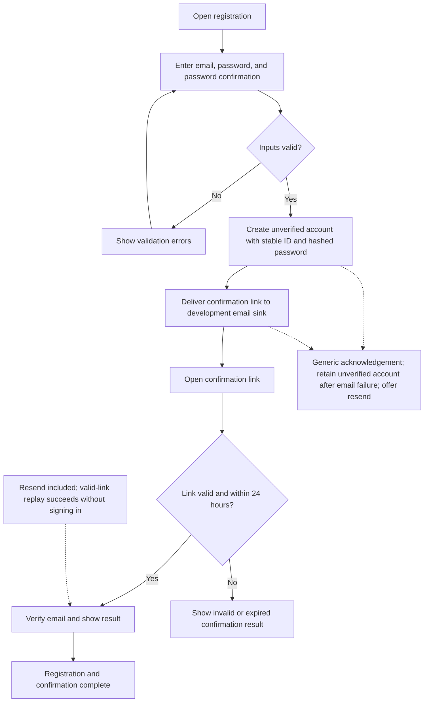

# UC-001 — Create a user account — Flow

[Written specification](../use-cases.md#uc-001) · [Approved implementation plan](implementation-plan.md)

Updated 23 October 2026 following approval of registration and email confirmation. Names belong to a later account profile page. OpenIddict sign-in and Gmail integration are separate slices.

