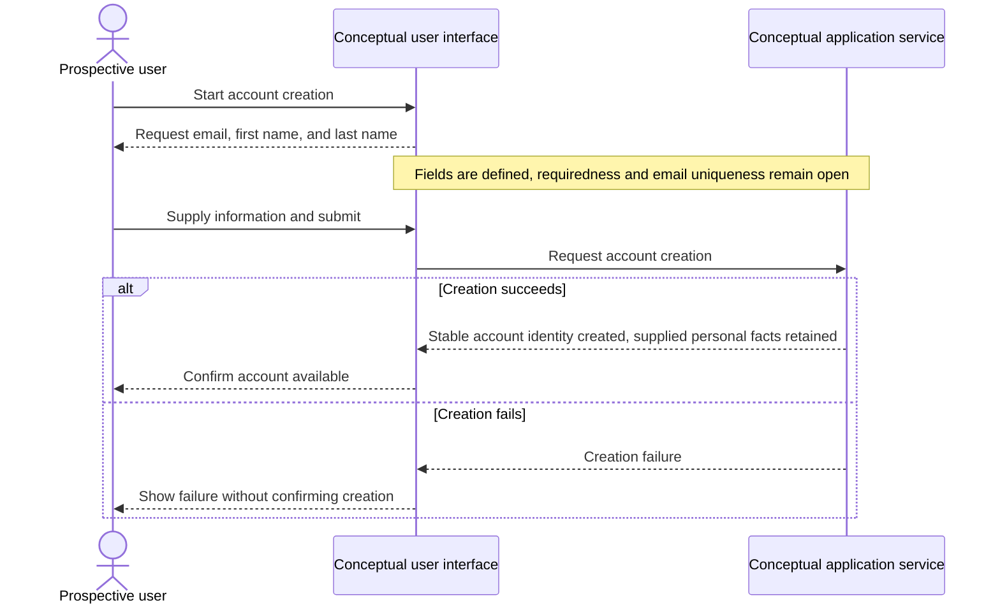

# UC-001 — Create a user account — Sequence

[Written specification (UC-001)](../use-cases.md#uc-001) · [Source proposal](../../PROPOSAL.md) · [Supporting schema](../../migrations/schema-design.md)

Approved generation for **v1.0**, 20 October 2026. UI/service boundaries are conceptual; no HTTP or implementation contract is implied.

**Scope and open policies:** Account identity is independent of email, first name and last name (D14). Requiredness, uniqueness, verification and authentication remain undecided; no credential workflow is invented.

