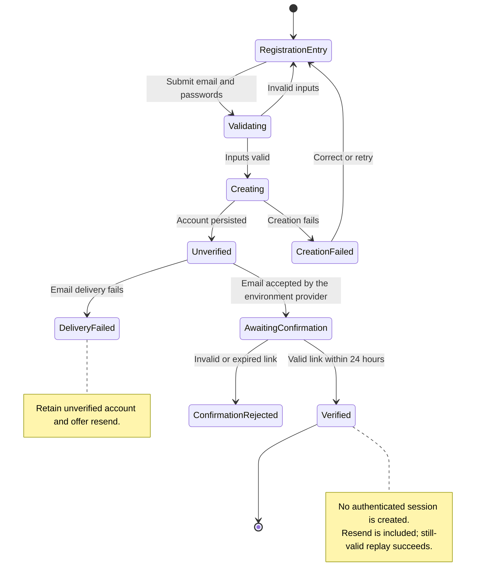

# UC-001 — Create a user account — States

[Written specification](../use-cases.md#uc-001) · [Approved implementation plan](implementation-plan.md)

Updated 23 October 2026. These are conceptual workflow states; they do not prescribe database columns.

