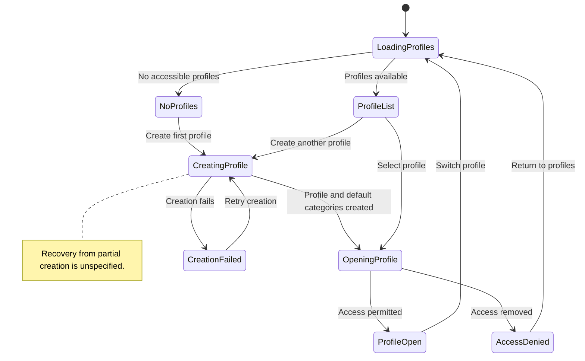

# UC-002 — Create and access budget profiles — States

[Written specification (UC-002)](../use-cases.md#uc-002) · [Source proposal](../../PROPOSAL.md) · [Supporting schema](../../migrations/schema-design.md)

Approved generation for **v1.0**, 20 October 2026. UI/service boundaries are conceptual; no HTTP or implementation contract is implied.

**Scope and open policies:** Profile setup includes its main currency, optional additional currencies, automatic protected categories, Cash and default tags. Partial-creation recovery and profile lifecycle beyond creation/access are unspecified.

