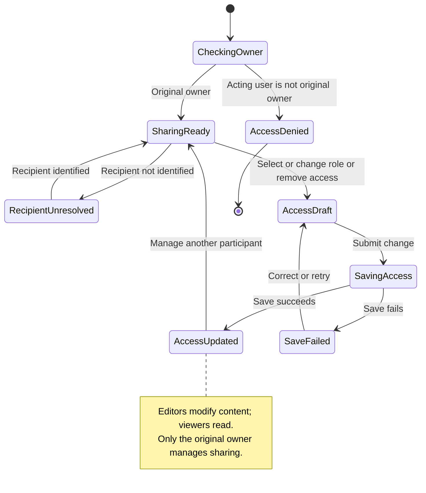

# UC-003 — Share a profile and change access — States

[Written specification (UC-003)](../use-cases.md#uc-003) · [Source proposal](../../PROPOSAL.md) · [Supporting schema](../../migrations/schema-design.md)

Approved generation for **v1.0**, 20 October 2026. UI/service boundaries are conceptual; no HTTP or implementation contract is implied.

**Scope and open policies:** Only the original owner manages sharing. Editors may change all profile content but cannot share; viewers read. Recipient identification/invitations and ownership transfer remain outside defined workflows.

