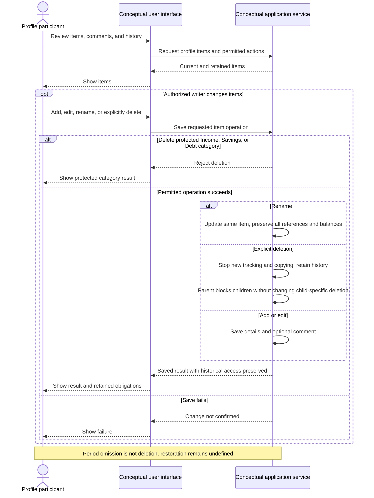

# UC-004 — Maintain categories and subcategories — Sequence

[Written specification (UC-004)](../use-cases.md#uc-004) · [Source proposal](../../PROPOSAL.md) · [Supporting schema](../../migrations/schema-design.md)

Approved generation for **v1.0**, 20 October 2026. UI/service boundaries are conceptual; no HTTP or implementation contract is implied.

**Scope and open policies:** Ordinary-category and any-subcategory deletion stop new tracking without erasing history (D12). Parent deletion does not overwrite independent child deletion; protected Income/Savings/Debt categories cannot be deleted (D13). Omission is temporary selection absence. Restoration is undefined.

