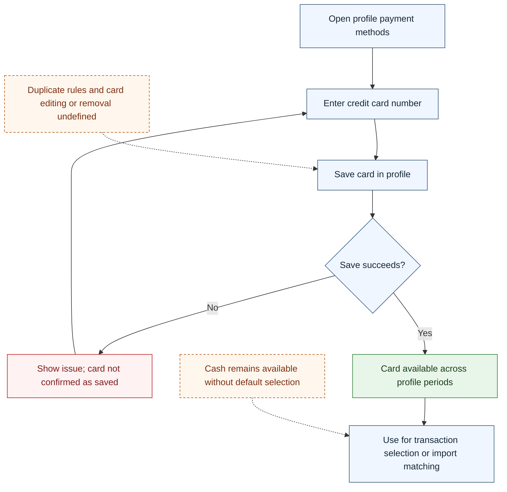

# UC-005 — Save credit card payment methods — Flow

[Written specification (UC-005)](../use-cases.md#uc-005) · [Source proposal](../../PROPOSAL.md) · [Supporting schema](../../migrations/schema-design.md)

Approved generation for **v1.0**, 20 October 2026. UI/service boundaries are conceptual; no HTTP or implementation contract is implied.

**Scope and open policies:** Cards are profile payment methods and Cash has no default selection. Canonical card-number uniqueness is proposed A3; edit/removal, formatting, and duplicate handling are not confirmed user workflows.

