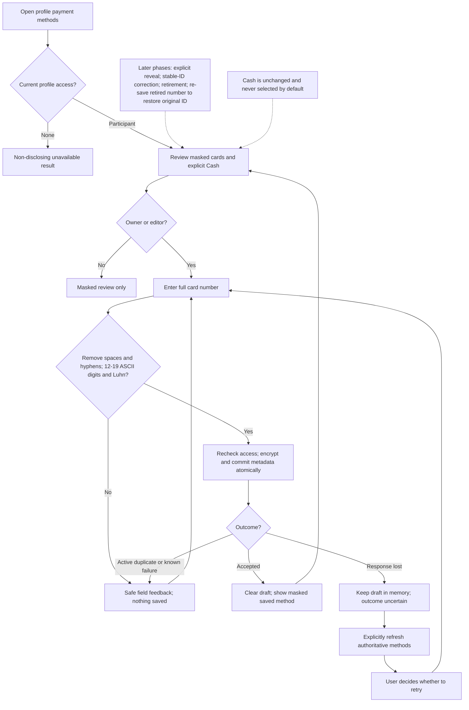

# UC-005 — Save credit card payment methods — Flow

[Written specification](../use-cases.md#uc-005) · [Proposal](../../PROPOSAL.md) · [Implementation phases](implementation-plan.md)

Reconciled on 12 November 2026 with the confirmed UC-005 decisions. Phase 2 delivers encrypted saving and masked review. Reveal, editing and retirement/restoration remain later phases; actual transaction/import integration requires the dependent use cases.

Canonical identity is unique per profile, including retained cards. Leading zeros remain text. Different full numbers sharing the last four digits are distinct; another profile may save the same number. No card-brand whitelist or live verification is implied. Future stale edits/removals require explicit refresh without automatic resubmission.

**Nickname amendment (12 November 2026):** Payment methods have an optional nickname, trimmed before the 100-character limit; blank values become null and duplicates are allowed. Add-card entry accepts a nickname, and masked lists/profile details show it beside the masked number, falling back to the method label when absent. Existing and newly created Cash methods default to "Cash"; existing cards retain a null nickname. Nicknames do not affect card identity, duplicate detection, protection or matching. Renaming existing methods, including Cash, waits for the planned editing phase.
