# UC-005 — Save credit card payment methods — States

[Written specification](../use-cases.md#uc-005) · [Proposal](../../PROPOSAL.md) · [Implementation phases](implementation-plan.md)

Reconciled on 12 November 2026. Phase 2 implements masked review and encrypted saving; the note records agreed later lifecycle behavior without claiming it is implemented.

```mermaid
stateDiagram-v2
    [*] --> LoadingMethods
    LoadingMethods --> MethodsReady: Authorized masked list loaded
    LoadingMethods --> Unavailable: Missing access or profile
    LoadingMethods --> LoadFailed: Request failed
    LoadFailed --> LoadingMethods: Explicit retry
    MethodsReady --> CardDraft: Owner/editor enters full number
    CardDraft --> SavingCard: Submit once with antiforgery proof
    SavingCard --> CardDraft: Invalid or active duplicate; safe feedback
    SavingCard --> CardSaved: Accepted encrypted save
    CardSaved --> LoadingMethods: Clear draft and reload masked methods
    SavingCard --> Uncertain: Response lost or outcome unconfirmed
    Uncertain --> Refreshing: Explicit refresh
    Refreshing --> Uncertain: Refresh failed; retry blocked
    Refreshing --> Refreshed: Authoritative methods loaded
    Refreshed --> SavingCard: Separate explicit retry
    CardDraft --> Unavailable: Observed access loss; clear draft
    SavingCard --> Unavailable: Observed access/session loss; clear draft
    note right of MethodsReady
        Viewers have masked review only.
        Cash is explicit and never the default.
        Later phases add explicit reveal, correction,
        retirement and restoration by re-saving.
        Correction retains ID, references and retirement state.
        Retirement retains current details and history.
        Restoration retains the original method ID.
    end note
```

**Nickname amendment (12 November 2026):** Payment methods have an optional nickname, trimmed before the 100-character limit; blank values become null and duplicates are allowed. Add-card entry accepts a nickname, and masked lists/profile details show it beside the masked number, falling back to the method label when absent. Existing and newly created Cash methods default to "Cash"; existing cards retain a null nickname. Nicknames do not affect card identity, duplicate detection, protection or matching. Renaming existing methods, including Cash, waits for the planned editing phase.
