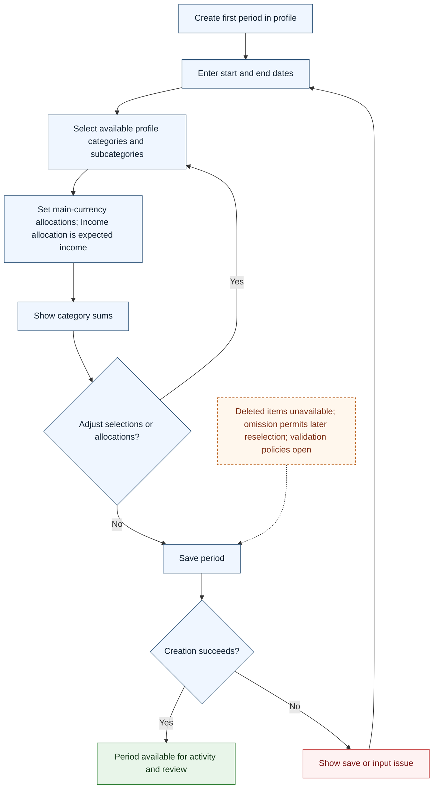

# UC-006 — Create the first budget period — Flow

[Written specification (UC-006)](../use-cases.md#uc-006) · [Source proposal](../../PROPOSAL.md) · [Supporting schema](../../migrations/schema-design.md)

Approved generation for **v1.0**, 20 October 2026. UI/service boundaries are conceptual; no HTTP or implementation contract is implied.

**Scope and open policies:** Allocations use the profile main currency; Income allocation is expected Income (D5). Deleted items and children of deleted categories cannot be newly selected. Omission is not deletion. Date validation, nonnegative allocation policy A11, and empty-selection rules remain qualified.

