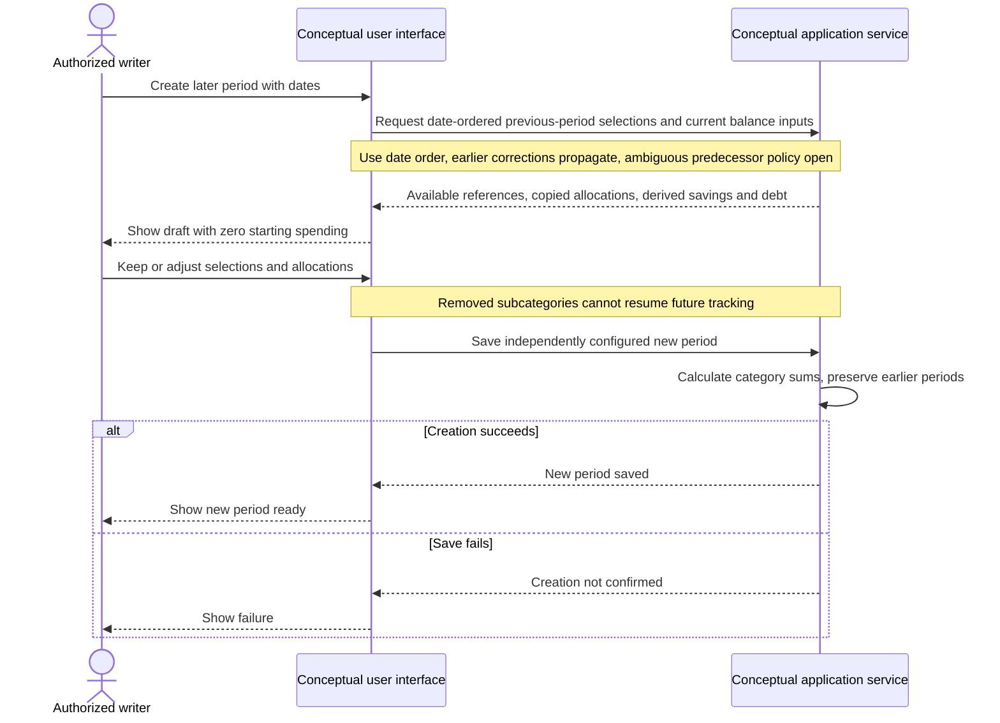

# UC-007 — Create a later budget period — Sequence

[Written specification (UC-007)](../use-cases.md#uc-007) · [Source proposal](../../PROPOSAL.md) · [Supporting schema](../../migrations/schema-design.md)

Approved generation for **v1.0**, 20 October 2026. UI/service boundaries are conceptual; no HTTP or implementation contract is implied.

**Scope and open policies:** Previous periods follow date order (D6). Exclude explicitly deleted parent/child items; active omitted items can be selected again. Savings/debt carry is derived from movements and dated deltas; prior corrections affect later balances. Equal/overlapping-date predecessor and boundary policies remain open.

