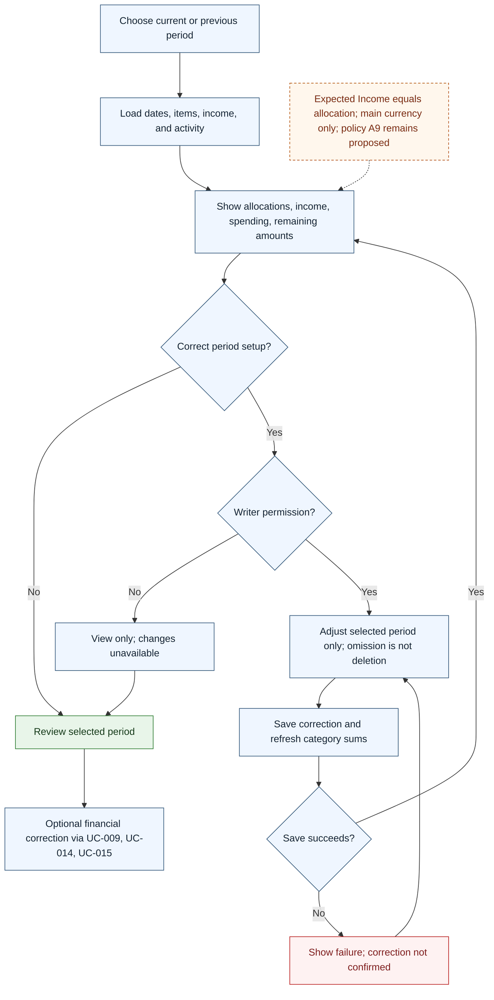

# UC-008 — Review and correct a budget period — Flow

[Written specification (UC-008)](../use-cases.md#uc-008) · [Source proposal](../../PROPOSAL.md) · [Supporting schema](../../migrations/schema-design.md)

Approved generation for **v1.0**, 20 October 2026. UI/service boundaries are conceptual; no HTTP or implementation contract is implied.

**Scope and open policies:** Expected Income equals allocation, and main-currency amounts alone feed totals. Period omission is not deletion; saved period configuration is independent. Referenced selections must not be orphaned. Spending/allocation inclusion A9 and date policy A10 remain proposed; financial corrections propagate to later balances.

