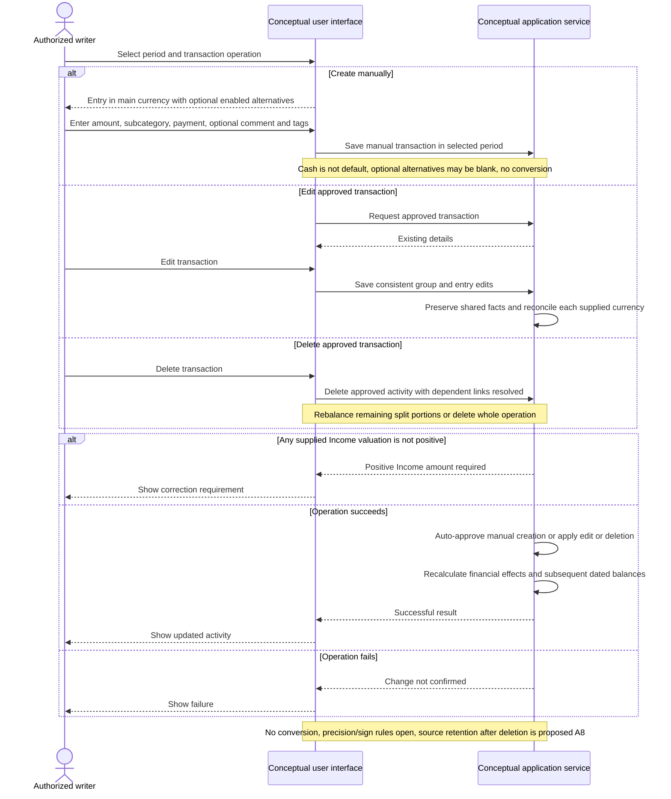

# UC-009 — Create, edit, or delete an approved transaction — Sequence

[Written specification (UC-009)](../use-cases.md#uc-009) · [Source proposal](../../PROPOSAL.md) · [Supporting schema](../../migrations/schema-design.md)

Approved generation for **v1.0**, 20 October 2026. UI/service boundaries are conceptual; no HTTP or implementation contract is implied.

**Scope and open policies:** Main-currency manual creation is approved immediately; alternatives are manually entered and excluded from totals. Income supplied values must be positive. Shared split facts and each retained currency total must stay consistent through edits/deletions; dependent links must be resolved. Schema A8 import-source retention is proposed, not an established requeue workflow.

