# UC-010 — Upload a bank statement for review — States

[Written specification (UC-010)](../use-cases.md#uc-010) · [Source proposal](../../PROPOSAL.md) · [Supporting schema](../../migrations/schema-design.md)

Approved generation for **v1.0**, 20 October 2026. UI/service boundaries are conceptual; no HTTP or implementation contract is implied.

**Scope and open policies:** Source facts are retained separately from approved entries; pending records contribute nothing. Card matching stays within the profile and never defaults unmatched records to Cash. Formats, external-ID deduplication, unsupported currencies, and partial-import recovery remain open.

```mermaid
stateDiagram-v2
    [*] --> StatementReady
    StatementReady --> ReadingStatement: Upload
    ReadingStatement --> ImportFailed: Upload or reading fails
    ImportFailed --> StatementReady: Review and retry
    ReadingStatement --> MatchingCards: Transactions parsed
    MatchingCards --> PendingMatched: Unique card match
    MatchingCards --> PendingUnresolvedPayment: No unique match
    PendingMatched --> ReviewingPending: Open review list
    PendingUnresolvedPayment --> ReviewingPending: Open review list
    note right of PendingUnresolvedPayment
        Resolution interaction is unspecified.
        Do not default to Cash.
    end note
    note right of MatchingCards
        Duplicate and currency exception rules unspecified.
    end note
    note right of ReviewingPending
        Period assignment and approval occur in UC-011.
    end note
```

