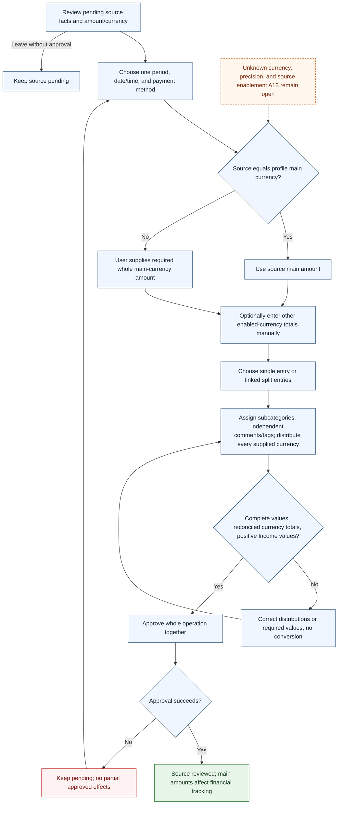

# UC-011 — Approve or split a pending transaction — Flow

[Written specification (UC-011)](../use-cases.md#uc-011) · [Source proposal](../../PROPOSAL.md) · [Supporting schema](../../migrations/schema-design.md)

Approved generation for **v1.0**, 20 October 2026. UI/service boundaries are conceptual; no HTTP or implementation contract is implied.

**Scope and open policies:** D3/D7 require all split entries to share one period/date/payment and approve together. D10 requires independent complete reconciliation in every supplied currency; D11 requires main currency before foreign approval. All supplied Income amounts are positive. Precision and proposed source-currency enablement A13 remain open; failed approval has no partial financial effects.

