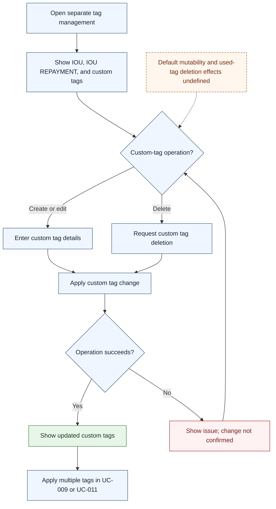

# UC-012 — Manage transaction tags — Flow

[Written specification (UC-012)](../use-cases.md#uc-012) · [Source proposal](../../PROPOSAL.md) · [Supporting schema](../../migrations/schema-design.md)

Approved generation for **v1.0**, 20 October 2026. UI/service boundaries are conceptual; no HTTP or implementation contract is implied.

**Scope and open policies:** Multiple tags belong to individual entries. Custom tag management is separate from entry/review. Profile scope, used-tag cleanup and default-role protection are proposed A5; active IOU link consistency must be resolved, and no new default-tag deletion workflow is inferred.

