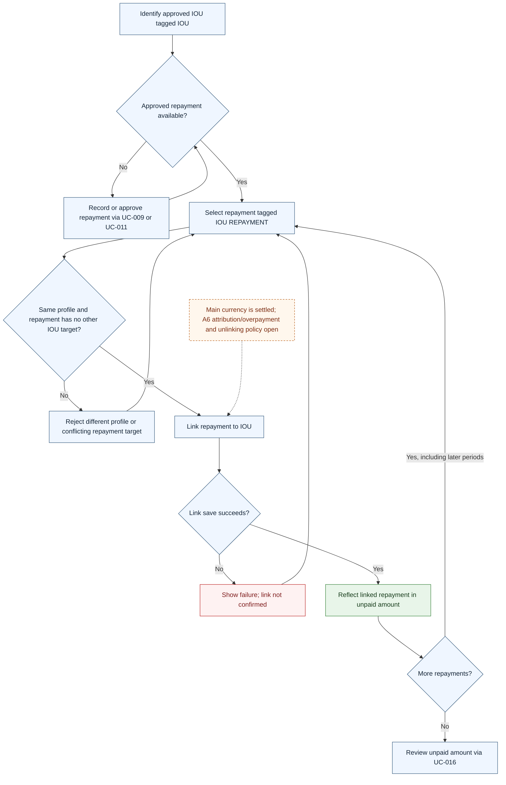

# UC-013 — Link repayments to an IOU — Flow

[Written specification (UC-013)](../use-cases.md#uc-013) · [Source proposal](../../PROPOSAL.md) · [Supporting schema](../../migrations/schema-design.md)

Approved generation for **v1.0**, 20 October 2026. UI/service boundaries are conceptual; no HTTP or implementation contract is implied.

**Scope and open policies:** One repayment entry has one IOU target (D4), while an IOU may have many repayments from later periods. Both use their required main amounts; source currencies do not affect the unit. A6 full absolute credit, direction, partial attribution and overpayment remain proposed/open; tagging alone does not link.

