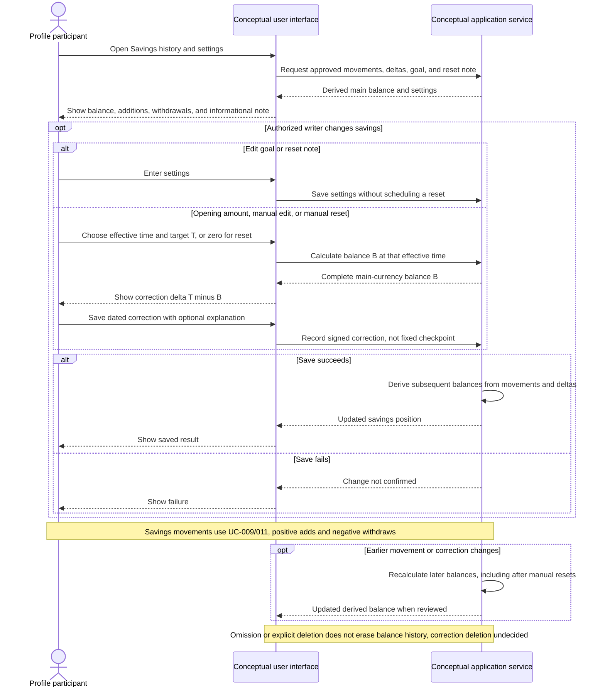

# UC-014 — Track and adjust savings — Sequence

[Written specification (UC-014)](../use-cases.md#uc-014) · [Source proposal](../../PROPOSAL.md) · [Supporting schema](../../migrations/schema-design.md)

Approved generation for **v1.0**, 20 October 2026. UI/service boundaries are conceptual; no HTTP or implementation contract is implied.

**Scope and open policies:** Reset periods are informational notes, with no due calculation or automatic reset (D2). Positive/negative Savings entries add/withdraw funds. Opening amounts and manual targets create dated deltas T minus B; resetting creates minus B. Earlier corrections change later values even after reset (D1). Correction deletion, negative-balance policy, and date boundaries remain open.

