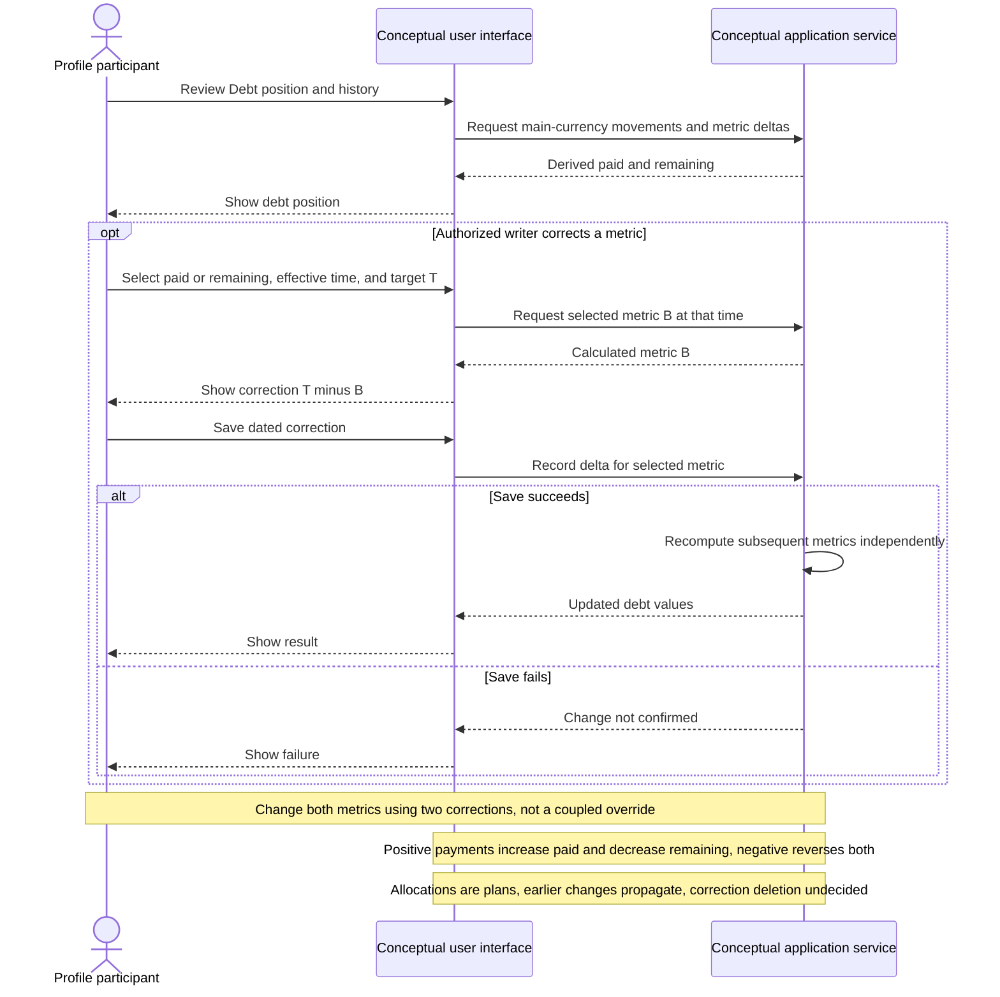

# UC-015 — Track and adjust debt — Sequence

[Written specification (UC-015)](../use-cases.md#uc-015) · [Source proposal](../../PROPOSAL.md) · [Supporting schema](../../migrations/schema-design.md)

Approved generation for **v1.0**, 20 October 2026. UI/service boundaries are conceptual; no HTTP or implementation contract is implied.

**Scope and open policies:** Positive Debt payments increase paid/decrease remaining; negative payments reverse both (D6). Plans do not move debt. Opening/manual edits create dated metric deltas T minus B, with paid/remaining corrected independently (D1). Prior changes propagate. Correction deletion, negative balances, precision and boundaries remain open.

