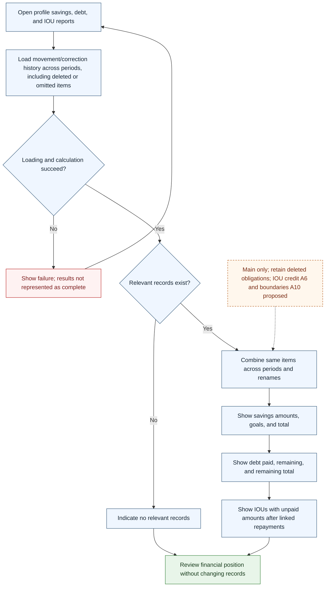

# UC-016 — Review savings, debt, and unpaid IOUs — Flow

[Written specification (UC-016)](../use-cases.md#uc-016) · [Source proposal](../../PROPOSAL.md) · [Supporting schema](../../migrations/schema-design.md)

Approved generation for **v1.0**, 20 October 2026. UI/service boundaries are conceptual; no HTTP or implementation contract is implied.

**Scope and open policies:** Main-currency reports combine stable item identity, approved signed movements, dated metric deltas, and valid repayment links. Explicit deletion or selection gaps do not hide balances/outstanding obligations. IOU credit A6 and time boundaries A10 remain qualified; report failure never implies complete results.

