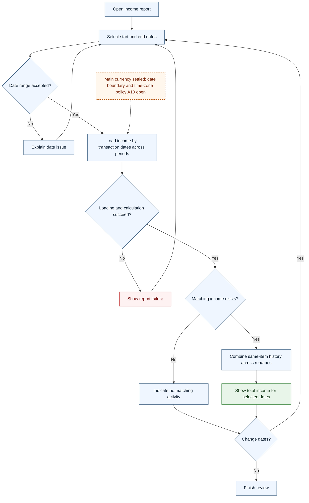

# UC-017 — Report income for a date range — Flow

[Written specification (UC-017)](../use-cases.md#uc-017) · [Source proposal](../../PROPOSAL.md) · [Supporting schema](../../migrations/schema-design.md)

Approved generation for **v1.0**, 20 October 2026. UI/service boundaries are conceptual; no HTTP or implementation contract is implied.

**Scope and open policies:** Reports use main amounts and transaction dates across approval periods. Stable item identity combines rename/deletion history; pending imports and alternatives contribute nothing. Boundary inclusivity and time zone remain proposed/open A10.

