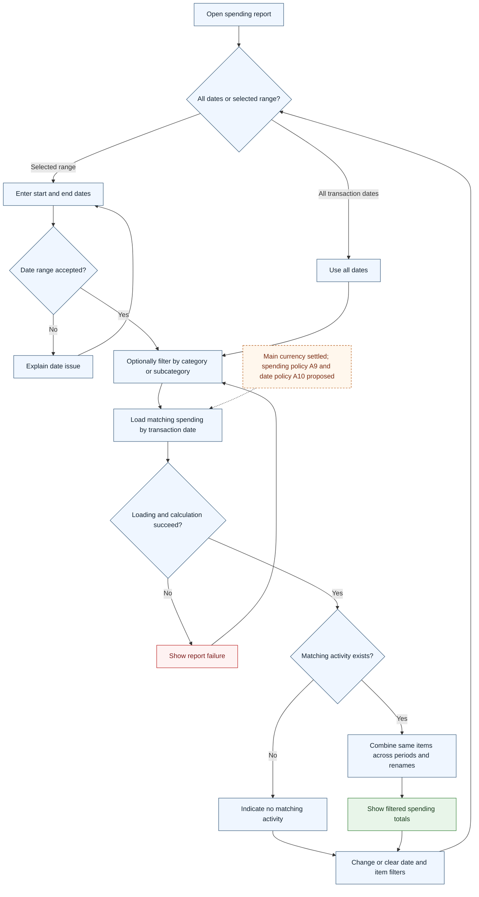

# UC-018 — Report spending by date and category — Flow

[Written specification (UC-018)](../use-cases.md#uc-018) · [Source proposal](../../PROPOSAL.md) · [Supporting schema](../../migrations/schema-design.md)

Approved generation for **v1.0**, 20 October 2026. UI/service boundaries are conceptual; no HTTP or implementation contract is implied.

**Scope and open policies:** Main-currency reports use transaction dates and stable item identity across periods, renames and deletion. Alternative valuations/pending sources contribute nothing. Spending classification/netting A9, boundary policy A10, and historical filter presentation remain proposed/open.

