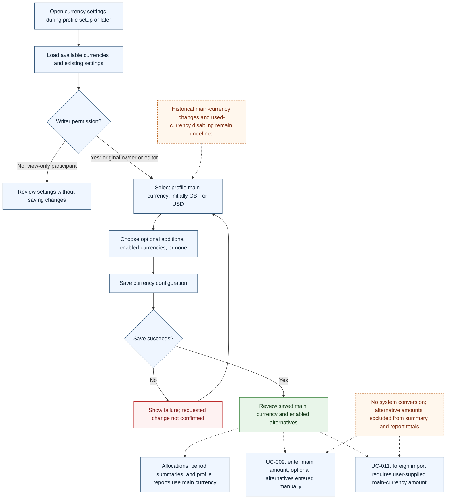

# UC-019 — Configure profile currencies — Flow

[Written specification (UC-019)](../use-cases.md#uc-019) · [Source proposal](../../PROPOSAL.md) · [Supporting schema](../../migrations/schema-design.md)

Approved generation for **v1.0**, 20 October 2026. UI/service boundaries are conceptual; no HTTP or implementation contract is implied.

**Scope and open policies:** The main unit governs allocations, goals, corrections, summaries and reports; alternatives are manually entered without FX and excluded from totals (D11). Foreign approval requires main values and complete per-currency splits. Historical main changes, used-currency disabling, and source enablement are proposed A12/A13 policies, not newly confirmed workflows. No initial main default is defined.

