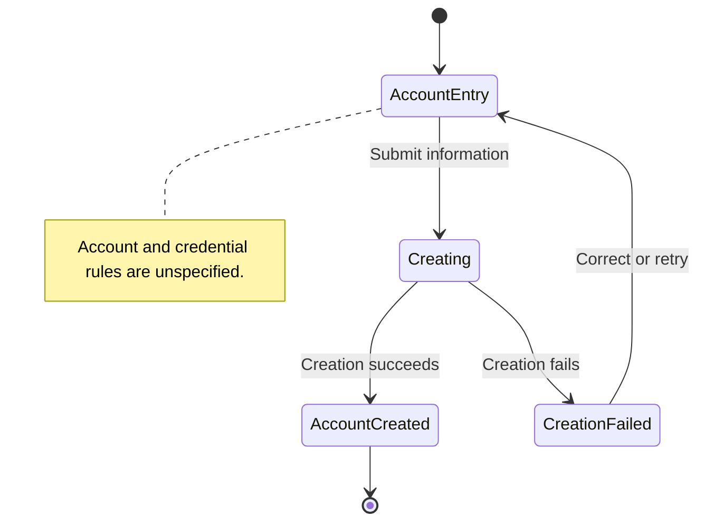

# UC-001 — Create a user account — States

[Written specification (UC-001)](../use-cases.md#uc-001)

Conceptual diagram for approved proposal version **v1.0**. Screen labels and UI/service boundaries are illustrative; no endpoint or implementation contract is implied.

**Scope and open rules:** Account fields, credential validation, verification, sign-in, and recovery are not defined. The form and creation request below are conceptual. Failure feedback follows the approved shared failure-handling assumption.

