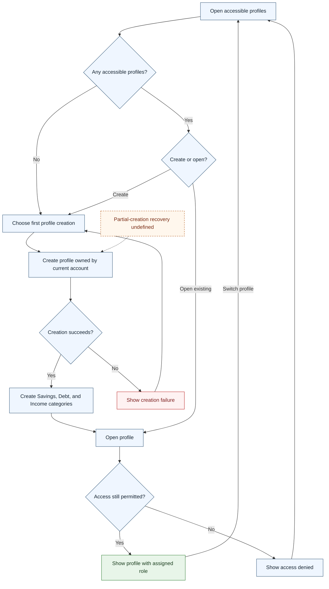

# UC-002 — Create and access budget profiles — Flow

[Written specification (UC-002)](../use-cases.md#uc-002)

Conceptual diagram for approved proposal version **v1.0**. Screen labels and UI/service boundaries are illustrative; no endpoint or implementation contract is implied.

**Scope and open rules:** Profile setup, profile selection, and creation boundaries are conceptual. Creation must include the automatic categories, but recovery from partial creation is unspecified. No deletion or ownership-transfer interaction is added.

