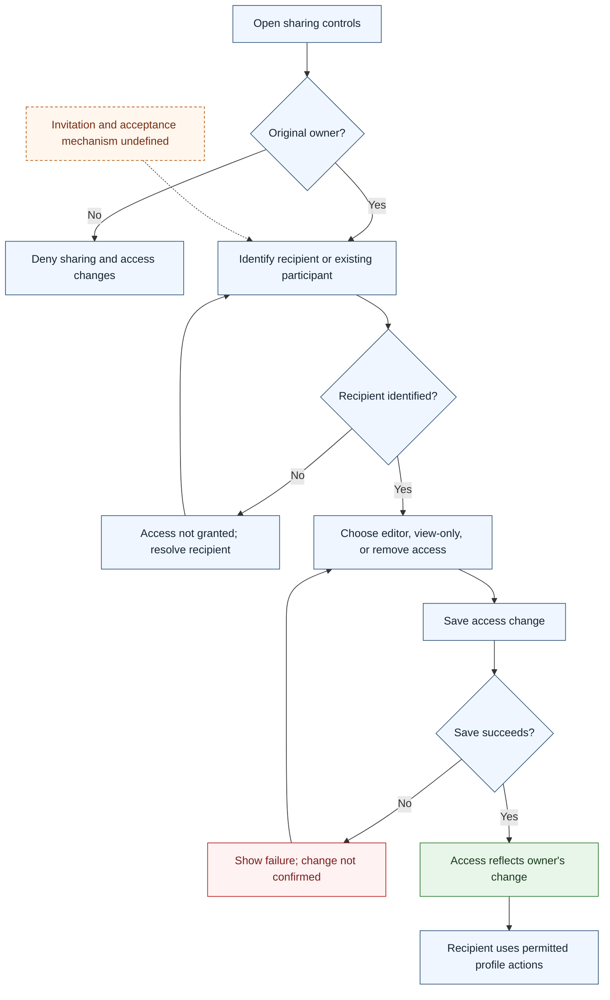

# UC-003 — Share a profile and change access — Flow

[Written specification (UC-003)](../use-cases.md#uc-003)

Conceptual diagram for approved proposal version **v1.0**. Screen labels and UI/service boundaries are illustrative; no endpoint or implementation contract is implied.

**Scope and open rules:** Only the original owner can manage sharing. Recipient identification and invitation/acceptance mechanisms are unspecified. Saving role changes and removing access are shown without an assumed delivery channel.

