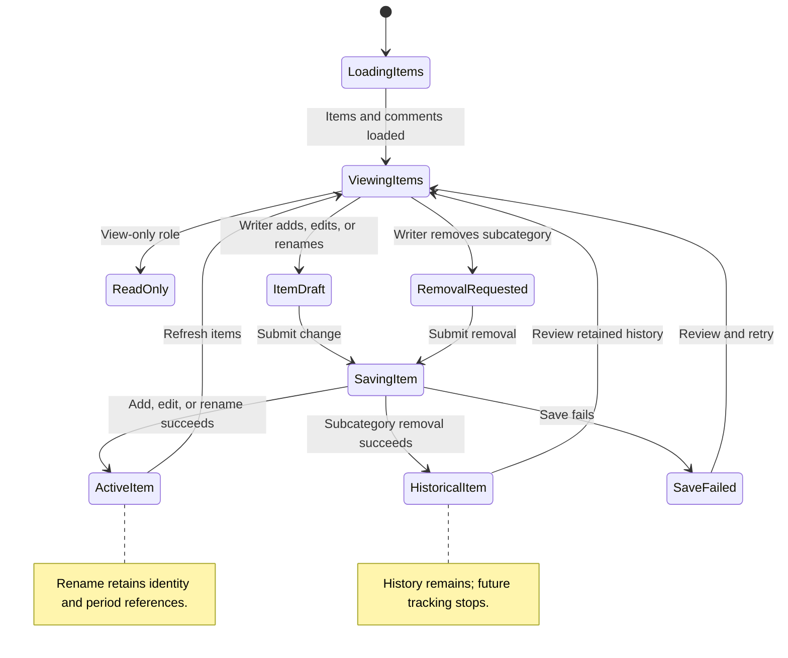

# UC-004 — Maintain categories and subcategories — States

[Written specification (UC-004)](../use-cases.md#uc-004)

Conceptual diagram for approved proposal version **v1.0**. Screen labels and UI/service boundaries are illustrative; no endpoint or implementation contract is implied.

**Scope and open rules:** Renaming preserves item identity and all financial references. Removal here applies to subcategories only. Category deletion, automatic-category restrictions, restoration, and removed-item use in existing periods remain unspecified.

