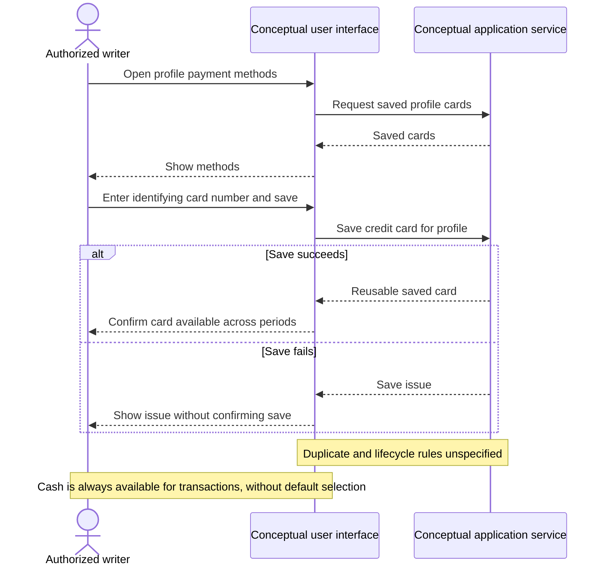

# UC-005 — Save credit card payment methods — Sequence

[Written specification (UC-005)](../use-cases.md#uc-005)

Conceptual diagram for approved proposal version **v1.0**. Screen labels and UI/service boundaries are illustrative; no endpoint or implementation contract is implied.

**Scope and open rules:** Saved cards are identified by their numbers and belong to the profile. Card-number validation, duplicate handling, and card editing/removal are unspecified. Cash is always a transaction choice and is not selected by default; saving a card does not choose a default.

