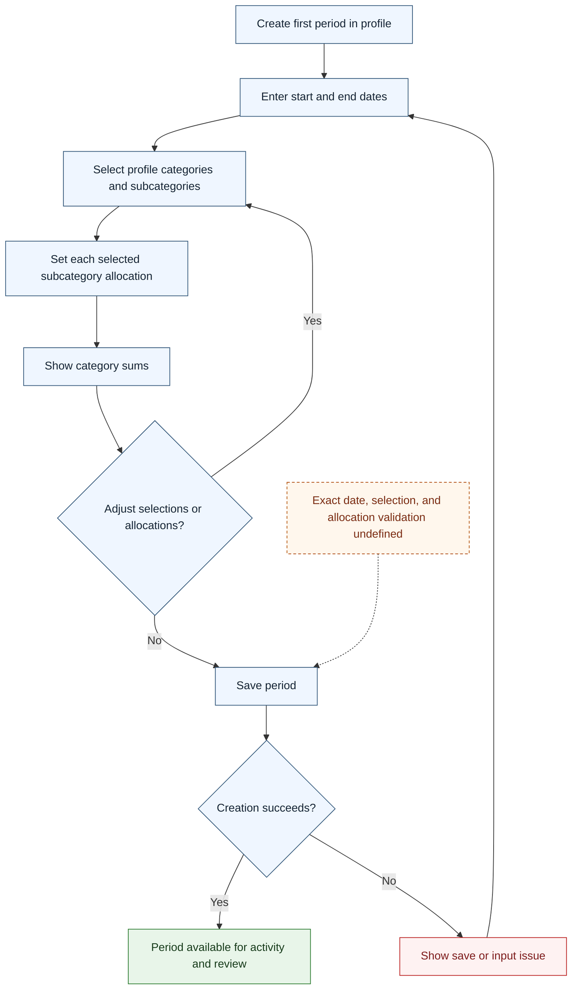

# UC-006 — Create the first budget period — Flow

[Written specification (UC-006)](../use-cases.md#uc-006)

Conceptual diagram for approved proposal version **v1.0**. Screen labels and UI/service boundaries are illustrative; no endpoint or implementation contract is implied.

**Scope and open rules:** Dates, item selections, and allocation entry are conceptual controls. Date validation, empty selections, overlapping periods, and allocation limits are not defined. Category allocations must sum the selected subcategory allocations.

