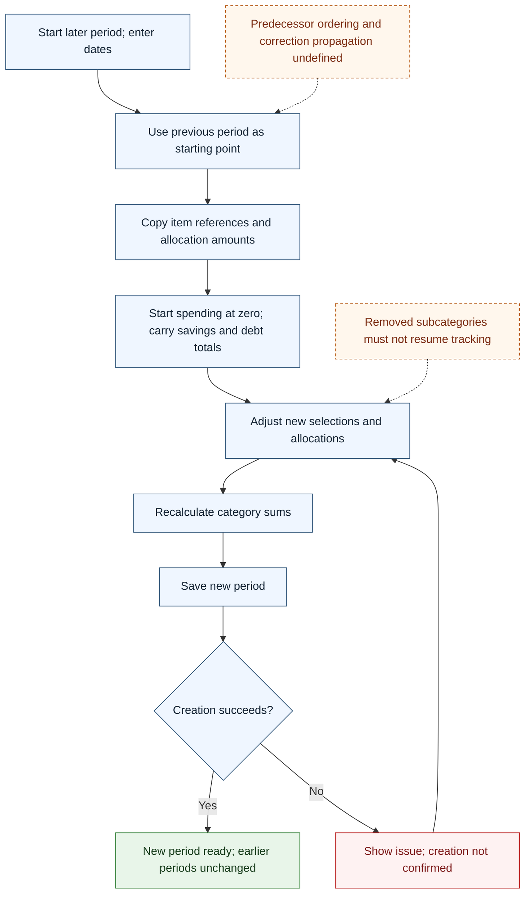

# UC-007 — Create a later budget period — Flow

[Written specification (UC-007)](../use-cases.md#uc-007)

Conceptual diagram for approved proposal version **v1.0**. Screen labels and UI/service boundaries are illustrative; no endpoint or implementation contract is implied.

**Scope and open rules:** “Previous period” ordering and propagation of earlier balance corrections are unresolved. Removed subcategories cannot resume future tracking; how they appear in a copied draft is unspecified. Creation copies references/allocations, carries savings/debt, and starts spending at zero without copying transactions.

