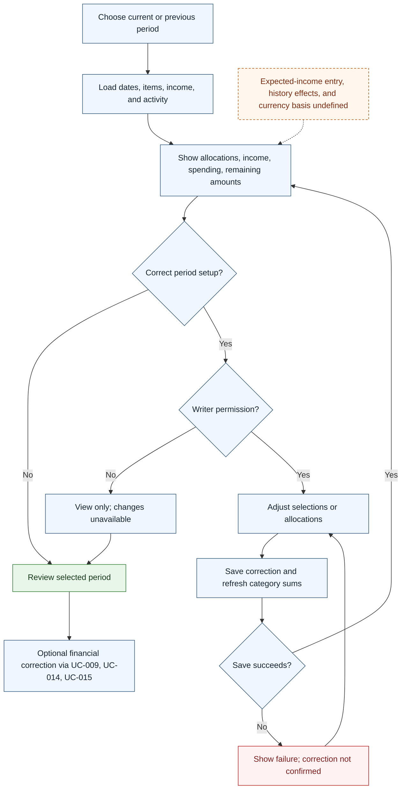

# UC-008 — Review and correct a budget period — Flow

[Written specification (UC-008)](../use-cases.md#uc-008)

Conceptual diagram for approved proposal version **v1.0**. Screen labels and UI/service boundaries are illustrative; no endpoint or implementation contract is implied.

**Scope and open rules:** Expected-income entry, deselection of items with history, propagation of prior-period savings/debt corrections, and currency basis for totals remain unspecified. Other financial corrections are separate use cases, not new actions added here.

