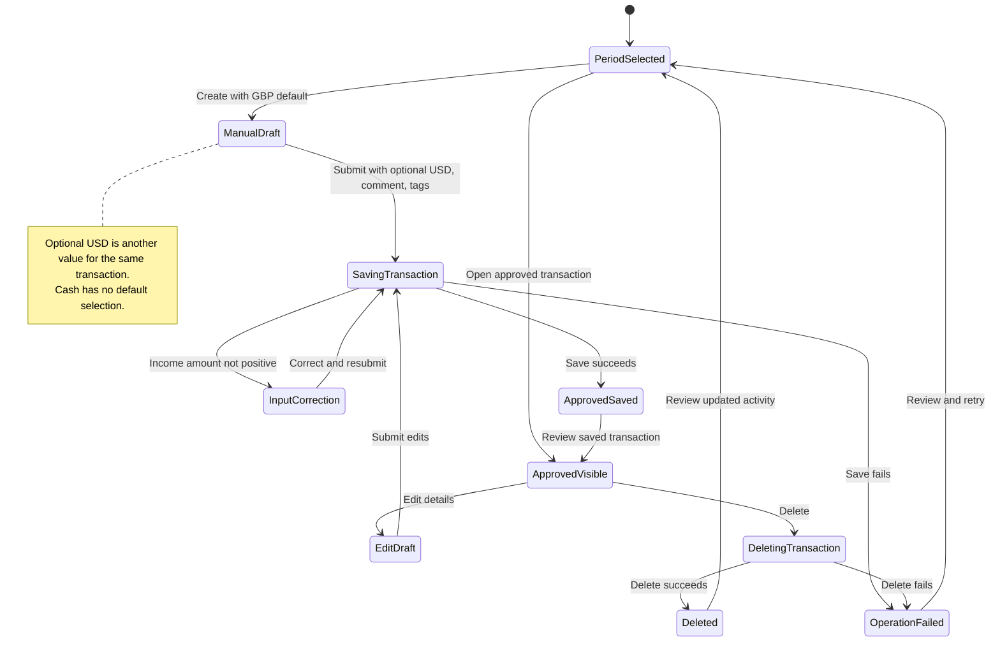

# UC-009 — Create, edit, or delete an approved transaction — States

[Written specification (UC-009)](../use-cases.md#uc-009)

Conceptual diagram for approved proposal version **v1.0**. Screen labels and UI/service boundaries are illustrative; no endpoint or implementation contract is implied.

**Scope and open rules:** Manual entry defaults to GBP with an optional USD amount for the same transaction; no conversion is implied. Cash is available without a default selection. Paired-amount validation and linked split/IOU effects on edit or deletion remain unspecified. Existing transaction correction is included; splitting is modeled in UC-011.

