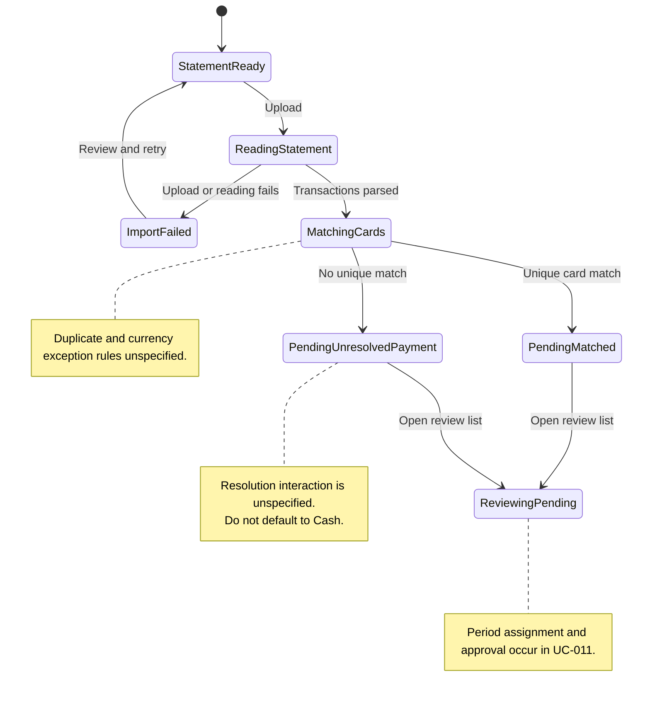

# UC-010 — Upload a bank statement for review — States

[Written specification (UC-010)](../use-cases.md#uc-010)

Conceptual diagram for approved proposal version **v1.0**. Screen labels and UI/service boundaries are illustrative; no endpoint or implementation contract is implied.

**Scope and open rules:** Statement formats, duplicate resolution, partial-import recovery, and missing/other currencies are unspecified. The unmatched-card branch describes an unresolved payment field, not a Cash fallback. Pending records are assumed not to affect totals until approval, as stated in the written specification.

