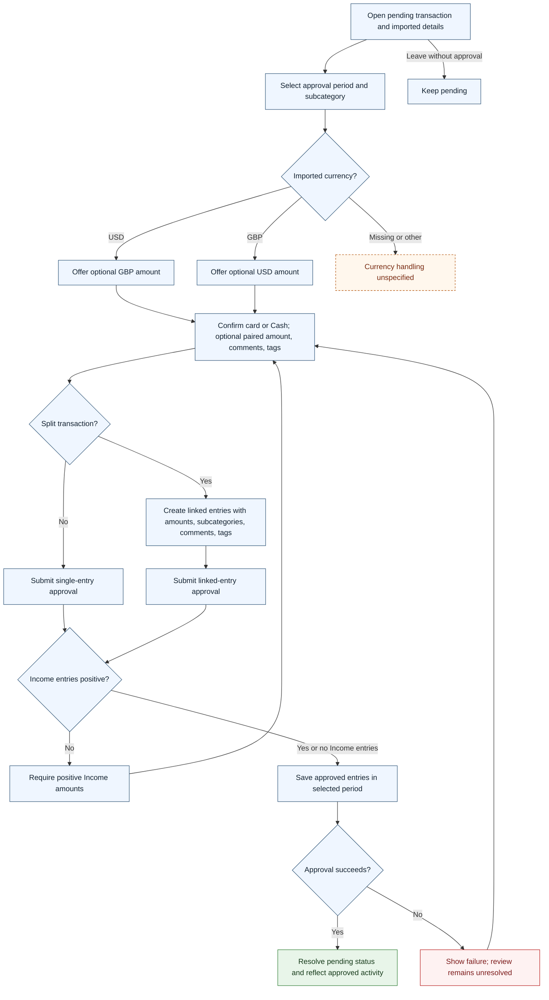

# UC-011 — Approve or split a pending transaction — Flow

[Written specification (UC-011)](../use-cases.md#uc-011)

Conceptual diagram for approved proposal version **v1.0**. Screen labels and UI/service boundaries are illustrative; no endpoint or implementation contract is implied.

**Scope and open rules:** A GBP transaction offers optional USD; a USD transaction offers optional GBP. The paired field may be blank. Split total preservation is an approved specification assumption, not a confirmed business rule; dual-currency distribution, split atomicity, and other currencies remain unspecified. Approval period differs from transaction date.

