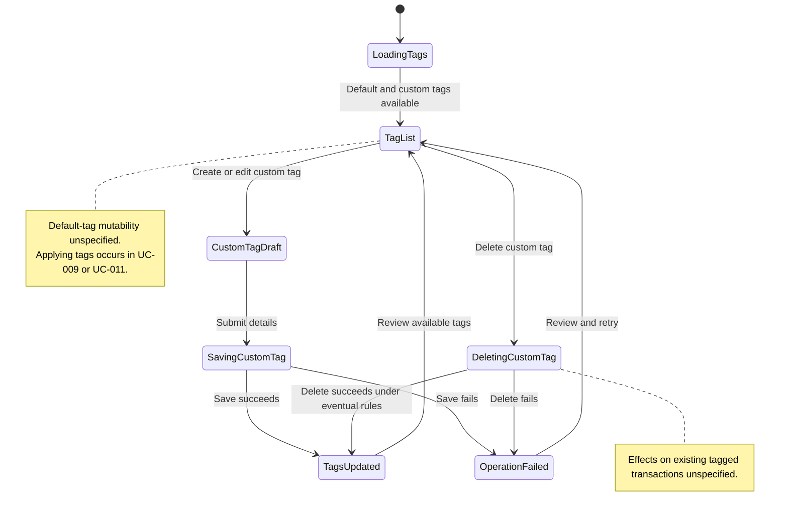

# UC-012 — Manage transaction tags — States

[Written specification (UC-012)](../use-cases.md#uc-012)

Conceptual diagram for approved proposal version **v1.0**. Screen labels and UI/service boundaries are illustrative; no endpoint or implementation contract is implied.

**Scope and open rules:** Tag management is separate from transaction entry/review. Only custom-tag creation, editing, and deletion are defined. Default-tag mutability, duplicate names, cross-profile scope, and deletion effects on used tags remain unspecified. Tags alone do not create repayment links.

