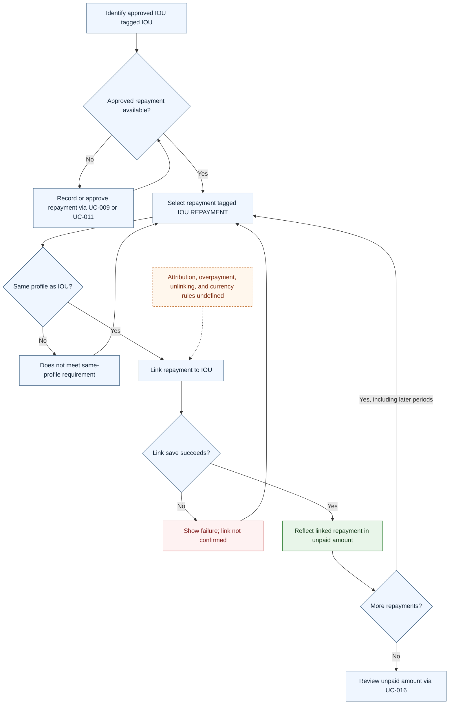

# UC-013 — Link repayments to an IOU — Flow

[Written specification (UC-013)](../use-cases.md#uc-013)

Conceptual diagram for approved proposal version **v1.0**. Screen labels and UI/service boundaries are illustrative; no endpoint or implementation contract is implied.

**Scope and open rules:** Repayments must belong to the same profile as the IOU and may come from later periods. Attribution, partial allocation, overpayment, unlinking, record-deletion effects, and cross-currency calculation are unspecified. Linking is explicit and is not inferred from tags.

