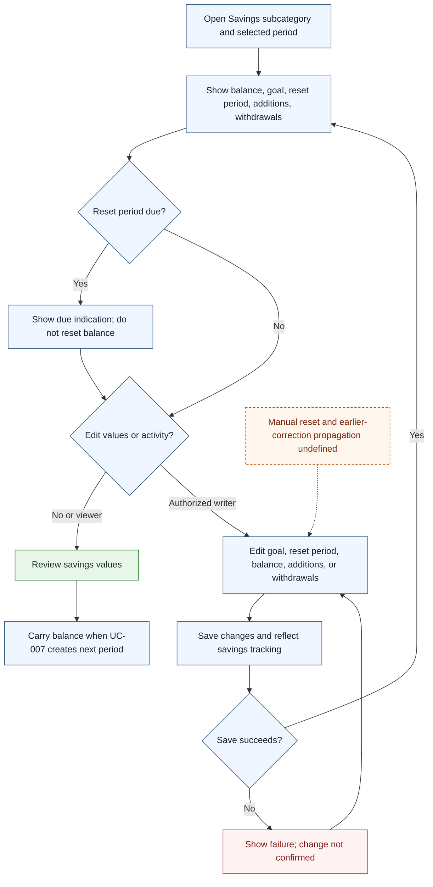

# UC-014 — Track and adjust savings — Flow

[Written specification (UC-014)](../use-cases.md#uc-014)

Conceptual diagram for approved proposal version **v1.0**. Screen labels and UI/service boundaries are illustrative; no endpoint or implementation contract is implied.

**Scope and open rules:** Savings additions/withdrawals are conceptual recorded activity; whether they are transactions or separate adjustments is unspecified. Reset format, manual reset behavior, negative balances, currency denomination, and propagation of historical corrections are unresolved. A due reset never automatically resets the balance.

