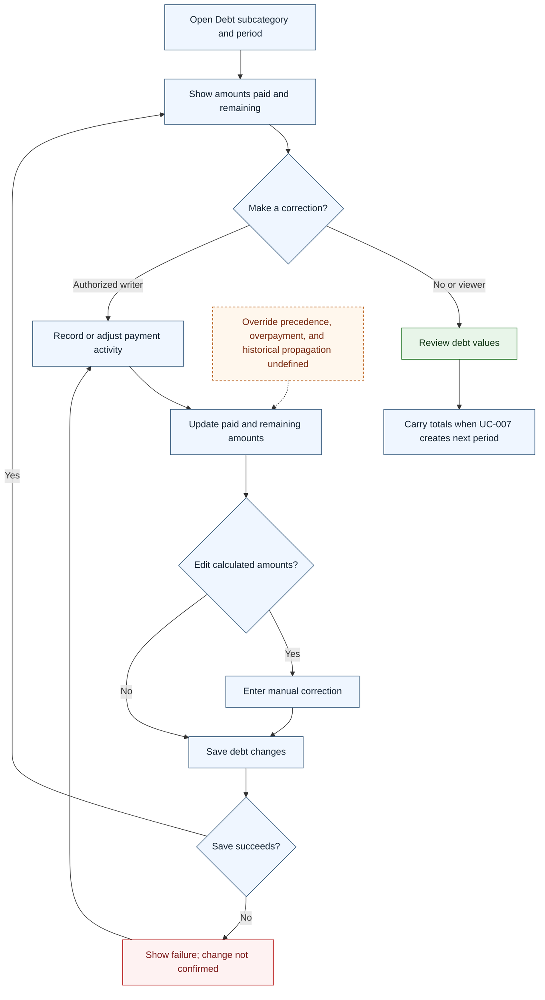

# UC-015 — Track and adjust debt — Flow

[Written specification (UC-015)](../use-cases.md#uc-015)

Conceptual diagram for approved proposal version **v1.0**. Screen labels and UI/service boundaries are illustrative; no endpoint or implementation contract is implied.

**Scope and open rules:** Debt activity, paid/remaining calculations, and manual overrides are conceptual operations. Starting debt entry, overpayment, currency denomination, override precedence, and propagation of earlier corrections are unspecified. Calculated amounts remain editable.

