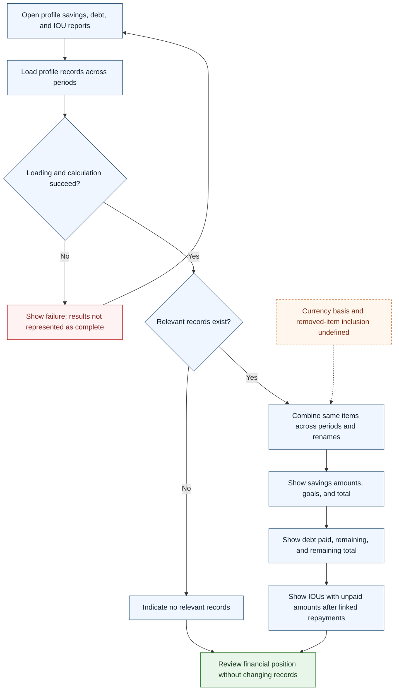

# UC-016 — Review savings, debt, and unpaid IOUs — Flow

[Written specification (UC-016)](../use-cases.md#uc-016)

Conceptual diagram for approved proposal version **v1.0**. Screen labels and UI/service boundaries are illustrative; no endpoint or implementation contract is implied.

**Scope and open rules:** This report is read-only and combines profile history by item identity, including renames. Inclusion of removed items in current balance lists, empty-total presentation, and currency basis are unresolved. IOU unpaid amounts depend on saved repayment links and eventual attribution rules.

