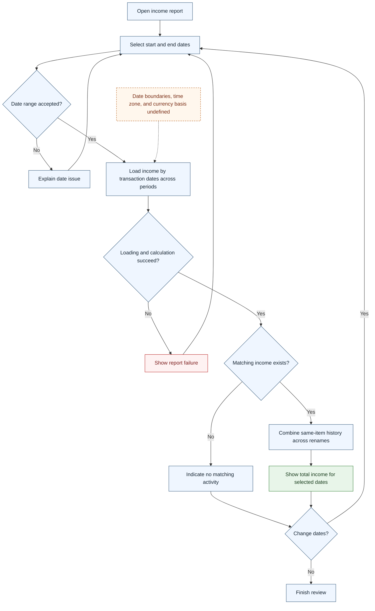

# UC-017 — Report income for a date range — Flow

[Written specification (UC-017)](../use-cases.md#uc-017)

Conceptual diagram for approved proposal version **v1.0**. Screen labels and UI/service boundaries are illustrative; no endpoint or implementation contract is implied.

**Scope and open rules:** Date validation, boundary inclusivity, time zone, report currency, and missing paired amounts are unresolved. The report uses transaction dates across periods, not the dates of approval periods. Two currency values for one transaction do not represent two income events.

