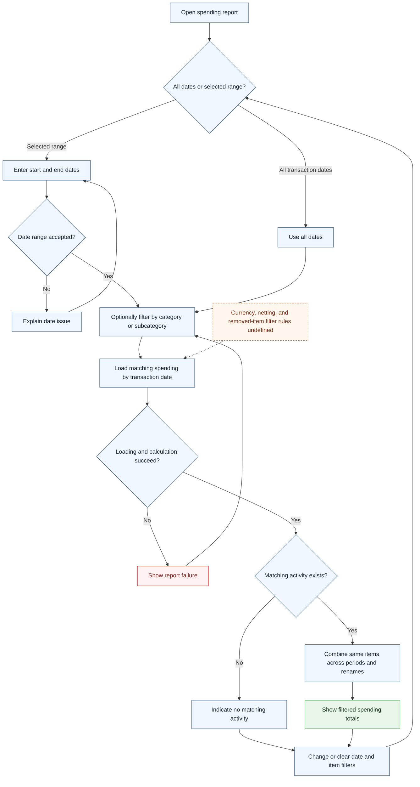

# UC-018 — Report spending by date and category — Flow

[Written specification (UC-018)](../use-cases.md#uc-018)

Conceptual diagram for approved proposal version **v1.0**. Screen labels and UI/service boundaries are illustrative; no endpoint or implementation contract is implied.

**Scope and open rules:** Spending classification/netting, currency basis, historical filter presentation, date boundaries, and time zone are unresolved. All-date reporting and selected-date reporting use transaction dates across periods and preserve item identity across renames. The report does not change source records.

