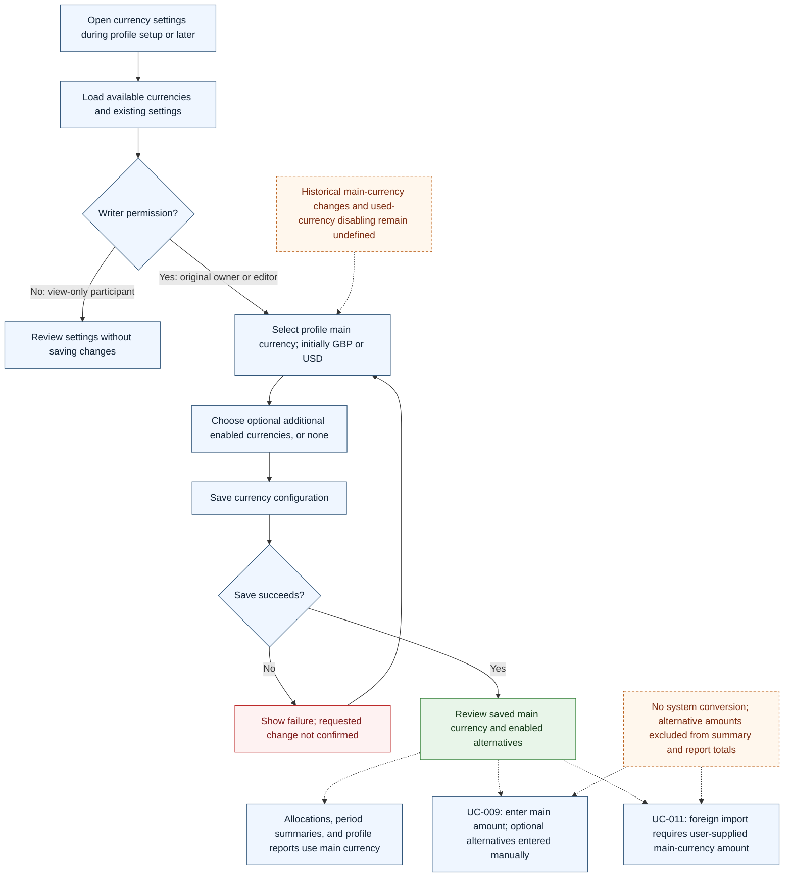

# UC-019 — Configure profile currencies — Flow

[Written specification (UC-019)](../use-cases.md#uc-019) · [Currency clarifications](../use-cases.md#current-currency-rules-and-precedence)

Conceptual diagram for approved proposal version **v1.0**. Settings and screen labels are illustrative; no implementation or HTTP contract is implied.

**Scope and open rules:** the owner and editors may save profile currency settings; viewers may read them. GBP and USD suffice initially, with no specified initial main-currency default. Changing the main currency after financial activity exists, disabling an already-used currency, and managing further supported currencies require rules that the proposal does not define. The diagram does not invent an allow/deny decision for those unresolved operations. Dashed arrows show how other use cases consume saved settings, rather than additional steps needed to complete configuration.

