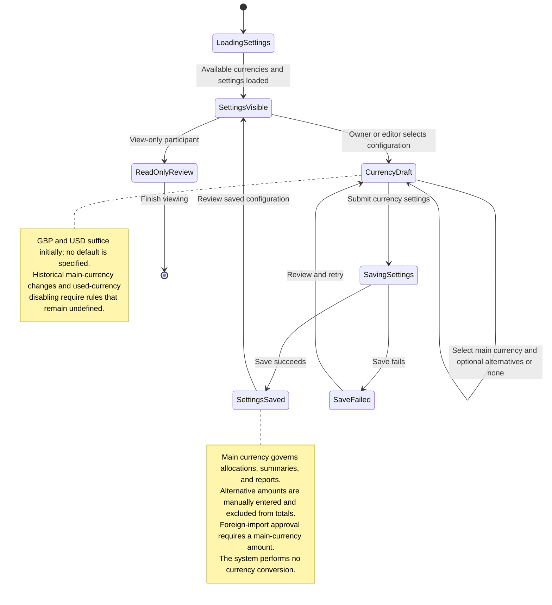

# UC-019 — Configure profile currencies — States

[Written specification (UC-019)](../use-cases.md#uc-019) · [Currency clarifications](../use-cases.md#current-currency-rules-and-precedence)

Conceptual application interaction states for approved proposal version **v1.0**, rather than implemented persistence states or screen contracts.

**Scope and open rules:** a main-only configuration is valid because additional currencies are optional. Saving requires writer permission. The initial main-currency default, changes to the main currency after recorded activity, disabling used currencies, and further currency-catalog management are unspecified. Their handling is not modeled as an implemented state or validation rule. Failed-save feedback follows the approved shared failure-handling assumption.

